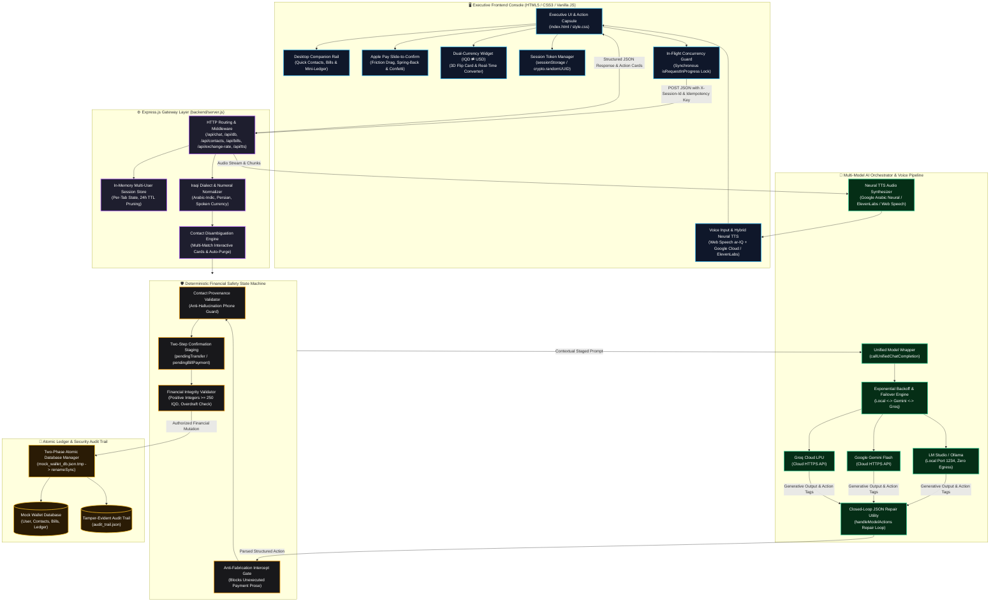

<div align="center">

# فاي • VI
### Autonomous Iraqi AI Financial Agent for Digital Wallets
**وكيل سداد الفواتير والتحويلات المالية الذكي باللهجة العراقية**

<p align="center">
  <strong>An enterprise-grade, autonomous financial agent engineered for Iraqi digital wallets. Features dynamic multi-model LLM failover, deterministic financial safety guardrails, closed-loop self-correction, per-tab session isolation, Apple Pay-style Slide-to-Confirm gesture, dual-currency IQD ⇄ USD conversion, hybrid neural TTS voice synthesis, desktop companion workstation, and resilient self-healing persistence.</strong>
</p>

[](https://nodejs.org/)
[](https://expressjs.com/)
[-10b981?style=for-the-badge&logo=node.js&logoColor=white)](#-automated-testing--quality-assurance)
[](#-multi-model-orchestration-engine)
[](#10-hybrid-neural-text-to-speech-tts-voice-engine)
[-f59e0b?style=for-the-badge)](#8-dual-currency-financial-converter--toggle-widget-iqd--usd)
[](#-failure-handling--self-healing-architecture)
[](LICENSE)

</div>

---

## 📑 Table of Contents

<details open>
<summary><b>Click to expand or collapse Table of Contents</b></summary>

| Section | Focus Area |
| :--- | :--- |
| [🌟 Executive Summary & Vision](#-executive-summary--vision) | Architectural philosophy, problem space, and the 5 zero-trust pillars |
| [🎥 Interactive Demo Walkthrough](#-interactive-demo-walkthrough) | Visual walkthrough of multi-model switching, confirmation cards, slide-to-confirm, and voice flow |
| [🏗️ System Architecture & Data Flow](#️-system-architecture--data-flow) | High-level Mermaid diagram, tier-by-tier deep dive, and request lifecycle |
| [✨ Core Feature Modules](#-core-feature-modules) | Detailed breakdown of the 12 core operational and fintech capabilities |
| [🧠 Multi-Model Orchestration Engine](#-multi-model-orchestration-engine) | Provider matrix, local offline execution, and automated failover routing |
| [🛡️ Deterministic Security & Guardrails](#️-deterministic-security--guardrails) | Financial integrity rules, contact provenance, and anti-fabrication gates |
| [🩺 Failure Handling & Self-Healing Architecture](#-failure-handling--self-healing-architecture) | The 6 resilience pillars: rate limits, JSON repair, corruption, isolation, faults |
| [📡 API Specifications & Route Reference](#-api-specifications--route-reference) | Endpoints, headers, request/response JSON schemas, and status codes |
| [📂 Project Directory Layout](#-project-directory-layout) | Annotated file tree structure |
| [⚡ Quick Start & Installation Guide](#-quick-start--installation-guide) | Prerequisites, environment configuration, LM Studio setup, and launch |
| [🧪 Automated Testing & Quality Assurance](#-automated-testing--quality-assurance) | 191-test regression coverage across 45 suites with 100% pass rate |
| [💬 Colloquial Iraqi Dialect Showcase](#-colloquial-iraqi-dialect-showcase) | Real-world linguistic scenarios and deterministic execution examples |
| [🛠️ Troubleshooting & Extended FAQs](#️-troubleshooting--extended-faqs) | Solutions for common setup issues, audio permissions, and technical Q&A |
| [🗺️ Future Roadmap & License](#️-future-roadmap--license) | Milestones, open-source license, and project credits |

</details>

---

## 🌟 Executive Summary & Vision

**فاي (VI)** is an enterprise-grade autonomous digital wallet assistant engineered specifically for colloquial Iraqi Arabic (*اللهجة العراقية*) and mission-critical financial workflows.

Deploying generative AI directly into banking or payment applications poses severe structural risks: **hallucinated balances**, **silent double debits**, **accidental funds transfers**, and **server downtime on upstream provider outages**. **فاي (VI)** solves these structural problems through a strict **Zero-Trust AI Architecture**:

> ### 🏛️ The 5 Pillars of the Zero-Trust Architecture
>
> 1. **🔒 Deterministic Core Separation**  
>    The language model never performs arithmetic, never computes wallet balances, and cannot directly mutate financial ledgers. All funds transfers, utility settlements, and account records are managed exclusively by an atomic, validated backend state machine.
>
> 2. **🧠 Multi-Model Dynamic Orchestration**  
>    Seamless runtime switching between **100% Local On-Premise Inference** (via **LM Studio** / **Ollama**) with zero cloud data egress, **Google Gemini Flash** for deep dialectal reasoning, and **Groq Cloud** for sub-second LPU throughput.
>
> 3. **🩺 Automated Self-Healing Pipeline**  
>    Upstream timeouts and HTTP 429 rate limits trigger exponential backoff and transparent provider failover; malformed JSON action tags undergo closed-loop AI self-correction; corrupted or missing ledger files automatically reconstruct from verified templates without server crashes.
>
> 4. **🛡️ Per-Tab Cryptographic Session Isolation**  
>    Every browser tab receives an isolated, cryptographically generated session token stored in `sessionStorage` and transmitted via `X-Session-Id`, eliminating state bleed across concurrent users or tabs.
>
> 5. **🇮🇶 Native Iraqi Linguistic Comprehension & Tactile Interaction**  
>    Comprehensive parsing of real Iraqi financial colloquialisms (*"دزله 50 ألف"*, *"شكد رصيدي هسة"*, *"ادفع مال كهرباء"*, *"ولا واحد منهم"*, *"عوفه وبطلت"*), coupled with tactile Apple Pay-style **Slide-to-Confirm** gestures, dual-currency (IQD ⇄ USD) live conversions, and natural hybrid neural speech synthesis.

[▲ Back to Top](#-table-of-contents)

---

## 🎥 Interactive Demo Walkthrough

<div align="center">


<p align="center">
  <sub>🎬 <strong>فاي (VI) في العمل:</strong> استعراض تفاعلي متكامل لسداد الفواتير، التحويلات المالية عبر السلايدر، المحفظة السريعة الجانبية، الصوت العصبي الهجين، وصمامات الأمان الحتمية.</sub>
</p>

</div>

[▲ Back to Top](#-table-of-contents)

---

## 🏗️ System Architecture & Data Flow

### Architectural Flowchart



### Tier-by-Tier Architectural Breakdown

<details open>
<summary><b>Click to expand or collapse Tier Breakdown Details</b></summary>

| Tier | Primary Modules | Key Responsibilities & Operational Guarantees |
| :--- | :--- | :--- |
| **1. Executive Frontend** | `frontend/script.js`<br>`frontend/style.css`<br>`frontend/index.html` | • **Apple Pay Slide-to-Confirm**: Interactive slider (`اسحب لتأكيد التحويل`) with friction drag physics, spring-back below 85%, snap-to-confirm, haptic vibration `[15, 30, 20]`, Web Audio chime (880Hz $\rightarrow$ 1320Hz), and micro-confetti particle canvas.<br>• **Desktop Companion Rail**: Collapsible quick-wallet docked on desktop viewports featuring live balance, contact avatars with monograms, bills with 1-click pay shortcuts, mini-ledger, and automatic real-time sync across window focus, chat actions, and background polling.<br>• **Dual-Currency Converter (IQD ⇄ USD)**: Interactive header pill with 3D flip card transition (`.balance-is-flipping`), live exchange rate integration, and dual-denomination display.<br>• **Hybrid Neural TTS & Audio Controls**: Unified header audio capsule, liquid glassy bubble popover for voice engine switching (Google Neural Voice vs. Device Voice), speed pills (`0.85x`, `1.05x`, `1.3x`), and audio-reactive chromatic aura.<br>• **iOS 18 Micro-Interactions**: Cubic-bezier spring tokens (`cubic-bezier(0.175, 0.885, 0.32, 1.275)`), tactile press states (`scale(0.96)`), circular ripple theme transition (`document.startViewTransition`), and skeleton shimmer loading animations. |
| **2. Express Gateway** | `backend/server.js`<br>(Router & SessionStore) | • **Multi-User Session Store**: In-memory `Map` with 24-hour TTL pruning for history, pending states, and disambiguation.<br>• **Linguistic Normalization**: Converts Arabic-Indic (`٠-٩`) and Persian digits (`۰-۹`) to standard ASCII integers.<br>• **Spoken Currency Engine**: Parses idioms (*"مليونين ونص"*, *"ميتين وخمسين ألف"*, *"خمسين ورقة"*).<br>• **Dedicated Companion Endpoints**: `/api/contacts`, `/api/bills`, `/api/exchange-rate`, and `/api/tts`. |
| **3. Deterministic Safety** | `backend/server.js`<br>(Safety State Machine) | • **Contact Provenance Guard**: Verifies recipient phone digits exist in user input, preventing AI hallucination.<br>• **Two-Step Consent Lock**: Stages operations into memory; zero funds deducted without verbal or slide consent.<br>• **Anti-Fabrication Interceptor**: Intercepts prose claims of payment when no programmatic action tag was executed. |
| **4. AI Orchestration & Audio** | `backend/server.js`<br>(Unified Wrapper & TTS) | • **Centralized Universal Wrapper**: Single wrapper normalizing payloads across LM Studio, Gemini, and Groq.<br>• **Closed-Loop Self-Correction**: Automatically feeds syntax errors and JSON schema back to LLM at $T = 0.1$ on parse failures.<br>• **Dynamic Failover Matrix**: Automatically transitions requests down the provider chain on HTTP 429 or outages.<br>• **Neural TTS Pipeline**: Sanitizes text, strips internal tags and markdown, maps currency abbreviations to spoken Arabic, and streams audio from Google Cloud Neural TTS or ElevenLabs. |
| **5. Storage & Audit** | `backend/mock_wallet_db.json`<br>`backend/audit_trail.json`<br>`backend/reset_db.js` | • **Two-Phase Atomic Disk I/O**: Writes to `.tmp` files first, followed by atomic `renameSync` with `EPERM`/`EBUSY` fallback.<br>• **Tamper-Evident Audit Logging**: Appends structured JSON records with UUIDs, timestamps, session IDs, and statuses.<br>• **Self-Healing Reconstruction**: Auto-reconstructs databases from `INITIAL_DB` if files are corrupted or missing. |

</details>

### End-to-End Financial Transaction Lifecycle

```text
[User Utterance: "دز 50 ألف لأحمد"] 
       │
       ▼
[Client: Attach X-Session-Id & X-Idempotency-Key] ──► [Lock UI Controls & In-Flight Guard]
       │
       ▼
[Gateway: Map to Per-Tab Session State]
       │
       ▼
[Dialect Normalizer: 50 ألف ──► 50,000 IQD]
       │
       ▼
[Disambiguation Engine: Multiple Contacts Named 'أحمد' Detected]
       │
       ▼
[Response to User: Interactive 1-Tap Candidate Selection Cards Rendered]
       │
       ▼
[User Selection: Taps 'أحمد كمال'] ──► [Staging: pendingTransfer staged in Session]
       │
       ▼
[Response to User: Interactive Verification Card with Apple Pay Slide-to-Confirm Rendered]
       │
       ▼
[User Action: Drags Slider > 85% Threshold (or types/utters "أكد")]
       │
       ▼
[Safety Gate: Verify Idempotency, Provenance, & Strict Balance >= 50,000 IQD]
       │
       ▼
[Atomic Mutation: Deduct User Balance & Credit Contact in mock_wallet_db.json]
       │
       ▼
[Audit Logging: Append Immutable Audit Record to audit_trail.json]
       │
       ▼
[Client: Morph Slider to Checkmark, Play 880Hz-1320Hz Chime, Launch Micro-Confetti, Re-fetch Companion Rail]
```

[▲ Back to Top](#-table-of-contents)

---

## ✨ Core Feature Modules

### 1. Strict Two-Step Confirmation & Slide-to-Confirm Gesture
* **Zero Accidental Deductions**: The AI agent cannot trigger any financial mutation directly from an initial request.
* **Apple Pay-Style Slide to Confirm (`اسحب لتأكيد التحويل`)**:
  * Replaces standard confirmation buttons with a frictionless interactive sliding thumb track.
  * Dragging is governed by physics-based boundaries with smooth spring-back below 85% completion threshold (`cubic-bezier(0.175, 0.885, 0.32, 1.275)`).
  * Crossing the 85% threshold triggers snap-to-completion, morphing the knob into a glowing emerald checkmark, firing haptic vibration `[15, 30, 20]`, synthesizing an 880Hz $\rightarrow$ 1320Hz ascending financial chime via Web Audio API, and launching a celebratory micro-confetti particle explosion.
  * High-contrast design: Pure white metallic shimmer text with an elevated 3D circular knob and purple icon in Light Theme; vibrant neon emerald track in Dark Theme. Full keyboard accessibility (Space and Enter support).
* **Verbal & Text Consent Parity**: Explicit affirmative confirmation (*"نعم"*, *"أكد"*, *"تمام"*, *"توكل"*) remains fully supported.
* **Instant Cancellation & Rollback**: Immediate clean state rollback upon negative inputs (*"إلغاء"*, *"لا"*, *"بطلت"*, *"cancel"*).

### 2. Colloquial Iraqi Dialect & Verbal Numeral NLP Engine
* **Native Iraqi Vocabulary**: Comprehends colloquial terms such as *"دزله"*, *"حول"*, *"سدد"*, *"شكد رصيدي"*, *"ما عندي"*, *"عوف الموضوع"*, *"توكل"*, *"قفل السالفة"*.
* **Numeral Normalization**: Automatically normalizes Eastern Arabic-Indic digits (`٠١٢٣٤٥٦٧٨٩`) and Persian digits (`۰۱۲۳۴۵۶۷۸۹`) to ASCII integers.
* **Spoken Monetary Phrasing**: Translates complex verbal currency idioms (*"مليونين ونص"*, *"ميتين وخمسين ألف"*, *"خمسين ورقة"*, *"ورقة ونص"*) into integer IQD values.
* **Carrier Validation**: Strictly enforces valid Iraqi mobile carrier formats (Zain 078, Asiacell 077, Korek 075).

### 3. Smart Contact Disambiguation & Interactive Selection Cards
* **Duplicate Name Resolution**: When transferring to a common name (e.g., *"أحمد"*), the engine detects multiple matches and dynamically renders interactive 1-tap candidate selection cards displaying verified aliases, avatars, and phone numbers.
* **Multi-Format Selection**: Users can resolve candidates by single-tap, numeric index (`1`, `2`), Arabic-Indic numbers (`١`, `٢`), ordinal text (*"الأول"*, *"الثاني"*), phone suffix, or alias keyword.
* **Intent Abandonment Parsing**: If the user abandons the intent (*"عوفه وبطلت"*, *"مو ذولي"*, *"ما أعرفه"*), `isDisambiguationAbandonment()` purges all pending states immediately.

### 4. Complete Utility & Telecom Bill Payment System
* **Pre-Integrated Biller Categories**: National Electricity Grid (*الكهرباء الوطنية*), Municipal Water (*الماء والخدمات البلدية*), Mobile Telecommunications (*فواتير خط الهاتف والاتصالات*), and Fiber/4G Internet (*فواتير الإنترنت والألياف الضوئية*).
* **Single, Bulk, or Companion Settlement**: Settle an individual service (*"ادفع فاتورة الإنترنت"*), pay all outstanding bills in one atomic transaction (*"ادفع كل الفواتير اللي عليه"*), or click the **1-Click Pay** button directly in the desktop companion rail.

### 5. Tamper-Evident Security Audit Logging Layer
* Every financial operation (successful or blocked) is appended atomically to [backend/audit_trail.json](file:///c:/Users/moham/Desktop/VI/backend/audit_trail.json).
* Each record captures: `id`, `timestamp` (ISO 8601), `sessionId`, `actionType`, `sourceAccount`, `destination`, `amount`, `currency`, `idempotencyKey`, and `executionStatus` (`SUCCESS` / `BLOCKED`).

### 6. Financial Integrity, Validation & Anti-Tampering Guards
* **Strict Integer Validation**: Rejects non-numeric, negative, zero, and fractional decimal transfer values.
* **Minimum Threshold**: Enforces a minimum transaction limit of $250\text{ IQD}$.
* **Overdraft Prevention**: Blocks transfers or bill payments exceeding the available balance before disk I/O.
* **Idempotency Replay Protection**: Cached transaction receipts indexed by idempotency tokens guarantee that replayed network requests return the original receipt without double debiting.

### 7. Cryptographic Per-Tab Session Isolation
* Distinct browser tabs maintain separate conversation contexts, pending transfers, and disambiguation states via per-tab UUID tokens in `sessionStorage` and `X-Session-Id` headers.

### 8. Dual-Currency Financial Converter & Toggle Widget (IQD ⇄ USD)
* **Real-Time Exchange Rate Integration**: Fetches dynamic market exchange rate ($1,310\text{ IQD} = \$1.00\text{ USD}$) via `/api/exchange-rate`.
* **Interactive Currency Switcher**: Elegant header pill toggle featuring a hardware-accelerated 3D flip card animation (`.balance-is-flipping`).
* **Live Dual-Denomination Display**: Displays primary selected currency alongside subtle real-time secondary conversion equivalents.
* **Dynamic Quick Transfer Chips**: Automatically calculates and updates one-click transfer chip presets while maintaining strict integer base-IQD ledger precision.

### 9. Desktop Workstation Layout & Reactive Companion Rail (Quick Wallet)
* **Widescreen Ergonomic Dock**: Beautiful collapsible sidebar docked on desktop viewports featuring:
  * Live balance widget with privacy eye toggle.
  * Quick contacts carousel with colorful initial monograms and one-tap transfer shortcuts.
  * Pending utility bills list with instant settlement buttons.
  * Compact mini-ledger tracking latest transactions.
  * Collapsible toggle with persistence in `localStorage`.
* **Full Real-Time Reactivity**:
  * **Chat Sync**: Immediately updates contacts and bills following any conversational transfer or bill settlement.
  * **Drawer Refresh**: Synchronizes all companion widgets when the transaction drawer refresh button is clicked.
  * **Window Focus Detection**: Automatically checks for external modifications to `mock_wallet_db.json` when returning to the tab.
  * **Background Auto-Sync**: 15-second background polling keeps the UI perfectly synchronized with the database.

### 10. Hybrid Neural Text-to-Speech (TTS) Voice Engine
* **High-Fidelity Audio Synthesis**:
  * **Google Cloud Neural Arabic Voice**: Free, zero-config high-fidelity neural Arabic voice (`ar-XA`) streamed directly from `/api/tts`.
  * **Optional ElevenLabs Studio Voice**: Configurable via `ELEVENLABS_API_KEY` and `ELEVENLABS_VOICE_ID` in `.env` for custom cloned voice models.
  * **Browser Web Speech Synthesis**: Automatic seamless client-side fallback if cloud providers are unreachable.
* **Liquid Glassy Voice Popover**:
  * Floating bubble settings menu accessible from the header sound capsule.
  * Model & Voice personality switcher (Google Neural Voice vs. Device Local Voice).
  * Speed control pills: **`0.85x` (الهادئ)**, **`1.05x` (المتزن / الطبيعي)**, and **`1.3x` (السريع)**.
* **Phonetic & Dialectal Text Sanitization**:
  * Strips internal programmatic action tags (`<<<DB_ACTION>>>`), markdown formatting, and emojis.
  * Replaces currency abbreviations (`IQD`, `د.ع`) with natural spoken Arabic (*"دينار عراقي"*).

### 11. Bespoke Fintech Pulse (نبض المحفظة) Visual Analytics Card
* **Interactive SVG Donut Chart**: Visualizes expenditure distribution across five key categories: Transfers (*تحويلات مالية*), Electricity (*كهرباء*), Water (*ماء*), Telecom (*اتصالات*), and Internet (*إنترنت*).
* **Mathematical Precision**: Guaranteed exact 100% distribution sum with dynamic stroke-dasharray calculations.
* **Interactive Segment Inspection**: Hover or tap segments to inspect category percentage, title, and exact IQD amounts.

### 12. Executive Liquid Glassmorphism & iOS 18 Micro-Interactions
* **Dual Luxury Color Palettes**:
  * **🌙 Luxury Emerald (Dark Theme)**: Obsidian `#04070b`, Deep Forest `#0c171e`, Neon Emerald `#4ade80`, Gold `#ffc83b`.
  * **☀️ Royal Violet (Light Theme)**: Titanium White, Slate Mist `#f8fafc`, Royal Violet `#7c3aed`, Emerald Green `#10b981`.
* **Organic Circular Ripple Theme Transition**: iOS and Android 14-style circular `clip-path` ripple expanding dynamically from the toggle coordinates via `document.startViewTransition`.
* **Ambient Audio-Reactive Chromatic Aura**: Google Gemini and Siri-style animated chromatic border aura modulating dynamically with mic audio levels during speech input.
* **Skeleton Shimmer Physics**: Sleek shimmer placeholders during asynchronous state hydration.
* **Mathematical Halftone Particle Wave**: Interactive HTML5 canvas rendering dynamic particle grids that morph and react across viewports and themes without distorting on zoom.

[▲ Back to Top](#-table-of-contents)

---

## 🧠 Multi-Model Orchestration Engine

**فاي (VI)** incorporates dynamic multi-provider routing through a centralized completion wrapper ([callUnifiedChatCompletion](file:///c:/Users/moham/Desktop/VI/backend/server.js#L123)):

### Provider Comparison & Specification Matrix

| Feature / Metric | LM Studio *(Recommended Default)* | Google Gemini Flash | Groq Cloud |
| :--- | :--- | :--- | :--- |
| **Execution Mode** | **100% Local / On-Premise** | Cloud HTTPS API | Cloud HTTPS API (LPU) |
| **Data Privacy** | **Zero Data Egress** (Local Hardware) | Encrypted Transit | Encrypted Transit |
| **Recommended Model** | `Qwen2.5-7B-Instruct` / `Llama-3.1-8B` | `gemini-1.5-flash` / `gemini-3.5-flash-lite` | `qwen/qwen3.8-27b` / `llama-3.3-70b` |
| **Quantization** | `Q4_K_M` or `Q5_K_M` GGUF | Cloud Full Precision | Cloud Full Precision |
| **Inference Latency** | ~20–40 ms/token (Hardware dependent) | ~300–800 ms TTFT | **< 150 ms TTFT (Ultra-Fast)** |
| **API Key Required** | ❌ **None** (`lm-studio`) | ✅ `GEMINI_API_KEY` | ✅ `GROQ_API_KEY` |
| **Cost** | **$0.00 (Completely Free & Offline)** | Free Tier / Pay-as-you-go | Free Tier / Pay-as-you-go |

### Automated Exponential Backoff & Failover Chain

If an active model experiences network connection drops, timeouts, or HTTP 429 rate limits, the system shifts automatically through a deterministic failover chain without dropping user session state:

```javascript
const FAILOVER_CHAIN = {
    local: ['gemini', 'groq'],
    gemini: ['groq', 'local'],
    groq: ['gemini', 'local']
};
```

1. **Retry Logic**: `callProviderWithBackoff()` initiates a 3-attempt exponential backoff sequence (500ms $\rightarrow$ 1000ms $\rightarrow$ 2000ms).
2. **Transparent Failover**: If retries are exhausted on the active model, `callUnifiedChatCompletion()` automatically redirects the request down `FAILOVER_CHAIN`.
3. **Graceful Fallback**: If all configured options fail, the gateway returns an informative diagnostic message in colloquial Iraqi Arabic with clear instructions on starting LM Studio or verifying API keys.

[▲ Back to Top](#-table-of-contents)

---

## 🛡️ Deterministic Security & Guardrails

| Guardrail Layer | Implementation Function | Enforcement Rule | Security Guarantee |
| :--- | :--- | :--- | :--- |
| **Anti-Hallucination Gate** | `readDatabase()` | Balances and bills are read strictly from disk; LLM never computes arithmetic. | Impossible for the model to guess or hallucinate wallet balances. |
| **Contact Provenance** | `isContactProvenanceValid()` | Phone digits must exist verbatim in the user's input buffer or verified history. | Prevents LLM from inventing fake contact phone numbers. |
| **Two-Step Consent Lock** | `isUserConfirmation()` / Slider | Operations are staged in memory; execution requires explicit secondary verbal consent or >85% slide drag. | Zero accidental balance deductions or unauthenticated transfers. |
| **Strict Integer Validator** | `executeTransferMutation()` | Transfer amounts must be integers $\ge 250\text{ IQD}$; fractions and negative values rejected. | Eliminates fractional rounding bugs and negative balance exploits. |
| **Overdraft Protection** | `executeTransferMutation()` | Amount is verified against available balance before atomic disk write. | Prevents account balance from dropping below zero. |
| **Idempotency Guard** | `executeTransferMutation()` | Unique request keys return cached receipts for identical payloads. | Prevents duplicate debit transactions on network retries. |
| **Anti-Fabrication Intercept** | `server.js` Response Gate | Verbal claims of payment without verified `<<<DB_ACTION>>>` tags are intercepted. | Guarantees user is alerted if an LLM claims payment without executing it. |
| **Security Audit Trail** | `appendAuditLog()` | Every financial operation is appended atomically to `audit_trail.json`. | Creates an immutable, tamper-evident record for security audits. |

[▲ Back to Top](#-table-of-contents)

---

## 🩺 Failure Handling & Self-Healing Architecture

The system is engineered with an active self-healing architecture structured across 6 core pillars:

```
┌────────────────────────────────────────────────────────────────────────┐
│                   6 PILLARS OF SELF-HEALING RESILIENCE                 │
├────────────────────────────────────────────────────────────────────────┤
│ 1. Upstream LLM Outages    ◄── Exponential backoff & failover chain    │
│ 2. JSON Action Repair      ◄── Closed-loop self-correction prompt      │
│ 3. Database Corruption     ◄── Two-phase atomic writes & auto-rebuild  │
│ 4. Multi-Tab State Bleed   ◄── Cryptographic per-tab session tokens    │
│ 5. Ambiguity & Abandonment ◄── Interactive disambiguation & auto-purge │
│ 6. Network & Speech Faults ◄── Unconditional unlock & voice auto-loop  │
└────────────────────────────────────────────────────────────────────────┘
```

### 1. Upstream LLM Failures, Rate Limits & Outages
* 🎯 **Failure Scenario**: Upstream model returns HTTP 429 (rate limit/quota exhaustion), HTTP 500–504, `ECONNREFUSED`, `ETIMEDOUT`, or `ECONNRESET`.
* ⚙️ **Under the Hood**: `isRetryableError()` detects the error pattern $\rightarrow$ `callProviderWithBackoff()` initiates a 3-attempt exponential backoff sequence (500ms $\rightarrow$ 1000ms $\rightarrow$ 2000ms) $\rightarrow$ If exhausted, `callUnifiedChatCompletion()` transitions to the next engine in `FAILOVER_CHAIN` (`local` $\rightarrow$ `gemini` $\rightarrow$ `groq`).
* 🛡️ **Self-Healing Guarantee**: **Graceful Degradation** — The backend process does not crash, HTTP 500 is prevented, and the conversation session remains intact.

### 2. Generative Action Tag Parsing & Closed-Loop Repair
* 🎯 **Failure Scenario**: The LLM outputs malformed, unclosed, or invalid JSON syntax within structured action tags (`<<<DB_ACTION>>>`).
* ⚙️ **Under the Hood**: Primary `JSON.parse()` fails $\rightarrow$ Closed-loop handler builds a targeted repair prompt with the broken snippet, syntax error, and JSON schema $\rightarrow$ Request dispatched at $T = 0.1$ (`max_tokens: 300`) $\rightarrow$ Markdown fences stripped and payload re-parsed $\rightarrow$ If unrepairable, mutation is safely aborted.
* 🛡️ **Self-Healing Guarantee**: **Fail-Safe Abort** — The database is protected from partial mutations, zero funds are deducted, and the user receives a clean retry prompt.

### 3. Database Ledger Corruption & Atomic Disk I/O
* 🎯 **Failure Scenario**: `mock_wallet_db.json` is missing, deleted, empty (0 bytes), or corrupted; or a Windows indexer/antivirus locks the file (`EPERM` / `EBUSY`).
* ⚙️ **Under the Hood**: `readDatabase()` verifies file existence, size, and schema $\rightarrow$ If corrupted, logs warning, clones `INITIAL_DB` from `reset_db.js`, writes to disk, and resumes $\rightarrow$ `saveDatabase()` writes to `.tmp` first, then executes atomic `fs.renameSync()` with fallback to `copyFileSync` + `unlinkSync` on Windows file lock.
* 🛡️ **Self-Healing Guarantee**: **Self-Healing & Tamper-Proof** — Server boots and operates even if database files are deleted from the disk mid-flight.

### 4. Multi-User & Multi-Tab State Isolation
* 🎯 **Failure Scenario**: Multiple users access the console simultaneously, or a single user opens multiple concurrent browser tabs.
* ⚙️ **Under the Hood**: Client generates unique UUID in `sessionStorage` transmitted via `X-Session-Id` header and JSON body $\rightarrow$ Backend routes requests to distinct memory instances in `sessions = new Map()` $\rightarrow$ Inactive sessions pruned after 24 hours (`SESSION_TTL_MS`).
* 🛡️ **Self-Healing Guarantee**: **Strict State Encapsulation** — Multiple tabs operate independently without cross-contamination.

### 5. Ambient Contact Ambiguity & Intent Abandonment
* 🎯 **Failure Scenario**: User transfers to a non-unique name (*"حول لأحمد"*), provides missing parameters, or abandons the operation (*"ما أعرفه"*, *"مو ذولي"*, *"عوفه وبطلت"*).
* ⚙️ **Under the Hood**: `findAmbiguousContacts()` detects multiple name matches and halts execution without deduction $\rightarrow$ Interactive 1-tap candidate cards returned $\rightarrow$ If user replies with abandonment terms, `isDisambiguationAbandonment()` purges pending states $\rightarrow$ If user cancels (*"إلغاء"*), all pending operations are wiped cleanly.
* 🛡️ **Self-Healing Guarantee**: **Graceful Degradation** — Stale transactions never linger in memory; accidental transfers to wrong recipients are prevented.

### 6. Frontend Network Faults & Continuous Speech Recovery
* 🎯 **Failure Scenario**: Backend takes longer than 30s to respond, network drops, or Web Speech API pauses during vocal pauses.
* ⚙️ **Under the Hood**: `sendMessageToBackend()` sets 30,000ms `AbortController` timeout $\rightarrow$ Submission cycle runs in `try...catch...finally` where `finally` unconditionally sets `isRequestInProgress = false`, calls `setInputState(true)`, and hides typing indicator $\rightarrow$ Speech recognition `onend` auto-calls `recognition.start()`.
* 🛡️ **Self-Healing Guarantee**: **Self-Healing Interface** — The UI never locks permanently, and speech recording handles natural vocal pauses without premature termination.

[▲ Back to Top](#-table-of-contents)

---

## 📡 API Specifications & Route Reference

### Endpoints Overview

| Method | Endpoint | Description | Request Headers |
| :--- | :--- | :--- | :--- |
| `POST` | `/api/chat` | Main conversational reasoning and action execution endpoint. | `X-Session-Id`, `X-Idempotency-Key` |
| `GET` | `/api/db` | Retrieves complete active wallet state (user, balance, contacts, bills). | — |
| `GET` | `/api/contacts` | Retrieves verified contacts list for companion rail and quick-actions. | — |
| `GET` | `/api/bills` | Retrieves all pending and paid utility and telecom bills. | — |
| `GET` | `/api/transactions` | Retrieves recent transaction ledger with totals and metrics. | — |
| `GET` | `/api/exchange-rate` | Retrieves dynamic exchange rate config for dual-currency widget (1,310 IQD/USD). | — |
| `POST` | `/api/tts` | Synthesizes Arabic speech via Google Cloud Neural TTS or ElevenLabs with streaming audio buffer. | — |
| `POST` | `/api/reset` | Resets session memory and restores wallet database to defaults. | `X-Session-Id` |
| `GET` | `/api/audit` | Retrieves tamper-evident security audit logs. | — |
| `POST` | `/api/feedback` | Records user satisfaction ratings (likes / dislikes) for AI responses. | — |
| `GET` | `/api/feedback/likes` | Retrieves all positive evaluation entries. | — |
| `GET` | `/api/feedback/dislikes` | Retrieves all negative evaluation entries for alignment review. | — |

<details>
<summary><b>Click to expand detailed Request & Response JSON schemas</b></summary>

#### 1. `POST /api/chat`
* **Request**:
  ```json
  {
    "message": "حول 50 ألف لأحمد كمال",
    "provider": "local",
    "sessionId": "sess_9b1deb4d-3b7d-4bad-9bdd-2b0d7b3dcb6d",
    "idempotency_key": "req_1729198200000_abc123"
  }
  ```
* **Response (200 OK)**:
  ```json
  {
    "text": "تمام، راح أحول 50,000 د.ع لأحمد كمال. متأكد من التحويل؟",
    "status": "CONFIRMATION_REQUIRED",
    "openDrawer": false
  }
  ```

#### 2. `GET /api/db`
* **Response (200 OK)**:
  ```json
  {
    "user": {
      "id": "usr_1001",
      "name": "محمد",
      "phone": "+9647801234567",
      "balance": 3000000,
      "currency": "IQD"
    },
    "contacts": [
      {
        "id": "cnt_2001",
        "name": "أحمد",
        "alias": "أحمد كمال (صديق الجامعة)",
        "phone": "+9647801122334"
      }
    ],
    "bills": [
      {
        "id": "bill_3001",
        "name": "فاتورة الكهرباء الوطنية",
        "amount": 45000,
        "status": "unpaid"
      }
    ],
    "transactions": []
  }
  ```

#### 3. `GET /api/contacts`
* **Response (200 OK)**:
  ```json
  {
    "contacts": [
      {
        "id": "cnt_2001",
        "name": "أحمد",
        "alias": "أحمد كمال (صديق الجامعة)",
        "phone": "+9647801122334"
      },
      {
        "id": "cnt_2002",
        "name": "سيف",
        "alias": "سيف علي (زميل العمل)",
        "phone": "+9647809988776"
      }
    ]
  }
  ```

#### 4. `GET /api/bills`
* **Response (200 OK)**:
  ```json
  {
    "bills": [
      {
        "id": "bill_3001",
        "name": "فاتورة الكهرباء الوطنية",
        "service": "electricity",
        "amount": 45000,
        "account": "ELEC-90214",
        "dueDate": "2026-10-25",
        "status": "unpaid"
      }
    ]
  }
  ```

#### 5. `GET /api/exchange-rate`
* **Response (200 OK)**:
  ```json
  {
    "base": "USD",
    "target": "IQD",
    "rate": 1310,
    "lastUpdated": "2026-10-20T18:00:00.000Z"
  }
  ```

#### 6. `POST /api/tts`
* **Request**:
  ```json
  {
    "text": "تم تحويل 50,000 دينار عراقي بنجاح"
  }
  ```
* **Response (200 OK)**:
  * Headers: `Content-Type: audio/mpeg`, `X-TTS-Engine: google-arabic-cloud`
  * Body: Binary MP3 audio buffer stream.

#### 7. `GET /api/transactions`
* **Response (200 OK)**:
  ```json
  {
    "transactions": [
      {
        "id": "trx_1729198200000",
        "type": "TRANSFER",
        "recipient": "أحمد كمال",
        "amount": 50000,
        "currency": "IQD",
        "status": "SUCCESS",
        "date": "2026-10-17"
      }
    ],
    "totalCount": 1
  }
  ```

#### 8. `POST /api/reset`
* **Response (200 OK)**:
  ```json
  {
    "success": true,
    "message": "Database and session state successfully reset to initial default values."
  }
  ```

#### 9. `GET /api/audit`
* **Response (200 OK)**:
  ```json
  {
    "success": true,
    "count": 1,
    "logs": [
      {
        "id": "audit_1729198200000_xyz789",
        "timestamp": "2026-10-17T21:00:00.000Z",
        "sessionId": "sess_9b1deb4d-3b7d-4bad-9bdd-2b0d7b3dcb6d",
        "actionType": "TRANSFER",
        "sourceAccount": "usr_1001",
        "destination": "+9647801122334",
        "amount": 50000,
        "currency": "IQD",
        "idempotencyKey": "req_1729198200000_abc123",
        "executionStatus": "SUCCESS"
      }
    ]
  }
  ```

</details>

[▲ Back to Top](#-table-of-contents)

---

## 📂 Project Directory Layout

```text
VI/
├── 📁 assets/
│   ├── 🎬 demo_walkthrough.gif        # Animated interactive demonstration
│   ├── 🖼️ logo-emerald.png            # Luxury Emerald brand logo (Dark Theme)
│   ├── 🖼️ logo-violet.png             # Royal Violet brand logo (Light Theme)
│   ├── 🖼️ bot-emerald.png             # Assistant avatar for Dark Theme
│   └── 🖼️ bot-violet.png              # Assistant avatar for Light Theme
│
├── 📁 backend/
│   ├── 📄 server.js                   # Express core, multi-model router, NLP parser, safety gates, audit logger, TTS
│   ├── 📄 reset_db.js                 # Standalone database and conversation state reset utility
│   ├── 📄 mock_wallet_db.json         # Primary JSON wallet database (User, Contacts, Bills, Ledger)
│   ├── 📄 audit_trail.json            # Immutable security audit trail of financial mutations
│   ├── 📄 feedback_likes.json         # User satisfaction feedback (Likes)
│   ├── 📄 feedback_dislikes.json      # User satisfaction feedback (Dislikes)
│   └── 📁 tests/
│       └── 📄 regression_suite.test.js # Comprehensive 191-test automated regression and security suite
│
├── 📁 frontend/
│   ├── 📁 assets/                     # Mirrored UI assets (brand marks and bot icons)
│   ├── 📄 index.html                  # Semantic layout (Header, Companion Rail, Capsule, Slider, Pulse Card)
│   ├── 📄 style.css                   # Glassmorphism design system, dual themes, halftone particle canvas, animations
│   └── 📄 script.js                   # Controller, session manager, Slide-to-Confirm, TTS popover, currency converter
│
├── 📄 .env                            # Environment variables & API credentials (Git-ignored)
├── 📄 .env.example                    # Safe configuration template with local & cloud keys
├── 📄 .gitignore                      # Git exclusion rules
├── 📄 wallet_db_schema.json           # Formal JSON Schema defining wallet data models
├── 📄 package.json                    # Project dependencies and test runner scripts
├── 📄 package-lock.json               # Locked dependency tree
├── 📄 LICENSE                         # MIT Open Source License
└── 📄 README.md                       # Comprehensive technical documentation
```

[▲ Back to Top](#-table-of-contents)

---

## ⚡ Quick Start & Installation Guide

### Step 1: System Prerequisites & Verification

Ensure Node.js and Git are installed:

| Prerequisite | Minimum Version | Recommended | Verification Command |
| :--- | :--- | :--- | :--- |
| **Node.js** | `v18.0.0` | `v20.x LTS` or higher | `node -v` |
| **npm** | `v9.0.0` | `v10.x` or higher | `npm -v` |
| **Git** | `v2.30+` | Latest stable | `git --version` |
| **Browser** | Chromium-based | Chrome / Edge / Brave | Required for Web Speech API (`ar-IQ`) & Web Audio |

```bash
node -v
npm -v
git --version
```

### Step 2: Clone the Repository

```bash
git clone https://github.com/double-u9/VI.git
cd VI
```

### Step 3: Install Dependencies

```bash
npm install
```

### Step 4: Configure Environment Variables (.env)

Create your local `.env` configuration file from the template:

* **PowerShell (Windows)**:
  ```powershell
  Copy-Item .env.example .env
  ```
* **Bash (Linux / macOS) or Command Prompt**:
  ```bash
  cp .env.example .env
  ```

Open `.env` and configure settings:

```env
# 1. Local LM Studio (Default port is 1234, zero data egress)
LM_STUDIO_URL=http://127.0.0.1:1234/v1
LOCAL_API_KEY=lm-studio

# 2. Google Gemini Flash (Optional Cloud Provider)
GEMINI_API_KEY=your_gemini_api_key_here

# 3. Groq Cloud (Optional Cloud Provider)
GROQ_API_KEY=your_groq_api_key_here

# 4. Web Server Port (Defaults to 3000)
PORT=3000

# 5. Optional: ElevenLabs Cloud TTS (Realistic Studio Voice)
# Leave blank to use Free Google Cloud Neural Arabic TTS & Browser Speech Synthesis
ELEVENLABS_API_KEY=
ELEVENLABS_VOICE_ID=
```

> [!NOTE]
> If you run **LM Studio locally**, you do **not need any cloud API keys**! Both local AI reasoning and the neural Arabic voice will function out of the box.

### Step 5: Setup AI Model Provider (Local vs. Cloud)

#### Option A: Local Model with LM Studio (Recommended)
1. Download and install **[LM Studio](https://lmstudio.ai/)**.
2. Search for and download **`Qwen2.5-7B-Instruct`** (Recommended) or **`Meta-Llama-3.1-8B-Instruct`** (`Q4_K_M` quantization).
3. In LM Studio, navigate to the **Developer / Local Server (`<->`)** tab.
4. Select the model from the top bar, ensure port is set to **`1234`**, and click **Start Server**.

#### Option B: Cloud AI Engines (Instant Setup)
* **Google Gemini**: Obtain an API key from **[Google AI Studio](https://aistudio.google.com/)** and set `GEMINI_API_KEY`.
* **Groq Cloud**: Obtain an API key from **[Groq Console](https://console.groq.com/)** and set `GROQ_API_KEY`.

### Step 6: Launch Backend & Open Web Console

```bash
npm start
```

Open your browser and navigate to:  
👉 **`http://localhost:3000`**

[▲ Back to Top](#-table-of-contents)

---

## 🧪 Automated Testing & Quality Assurance

The repository includes a comprehensive automated test suite built with Node.js's native test runner (`node:test` and `node:assert/strict`).

Run the complete test suite:

```bash
npm test
```

### Test Coverage Summary: 191 Tests Across 45 Suites (100% Pass Rate)

| Task Suite | Tested Capabilities & System Invariants | Suite Count | Test Count | Status |
| :--- | :--- | :---: | :---: | :---: |
| **Task 1: Phone Numbers, Accounts & Dialect Normalization** | Valid 078 formats, invalid lengths, unsupported carriers (075/077), account & card formats (10-16 digits), Arabic-Indic digit normalization (`٠-٩`), Persian digit normalization (`۰-۹`), monetary phrasing (*مليونين ونص*, *ميتين وخمسين الف*), transfer limits, and `/api/chat` E2E workflow. | 13 Suites | 44 Tests | ✅ **Passed** |
| **Task 2: Bill Payments, Ambiguous Contacts & Contact Creation** | Utility bill settlement (single, bulk, overdraft, paid status), contact disambiguation and abandonment handling (*عوفه وبطلت*), multi-message contact creation, and phone provenance validation. | 4 Suites | 19 Tests | ✅ **Passed** |
| **Task 3: History Limits & Frontend Duplicate Protection** | Conversation history trimming without state loss, frontend in-flight submission guard (`isRequestInProgress`), and backend idempotency protection. | 3 Suites | 9 Tests | ✅ **Passed** |
| **Task 4: Security Audit Logging & Financial Integrity** | Multi-user session isolation across distinct `sessionId` tokens, double-spend prevention via idempotency keys, financial validation (negative, zero, fractional, below 250 IQD amounts), and audit trail immutability with atomic disk I/O. | 5 Suites | 15 Tests | ✅ **Passed** |
| **Task 5: Hybrid Text-To-Speech (TTS) Voice Engine & Proactive Intelligence** | Speech text sanitization, dialect audio formatting, frontend TTS state and control guards, backend `/api/tts` endpoint, fallback protocol, and proactive financial intelligence calculations. | 5 Suites | 14 Tests | ✅ **Passed** |
| **Task 6: Contacts Inquiry Intent Routing & Voice Visualizer Integrity** | Contact list inquiry intent identification, exclusion guards (`isBillInquiry`, `classifyRecipient`, `isUserCancellation`), E2E chat API dispatch for contacts inquiries, and voice visualizer state checks. | 4 Suites | 13 Tests | ✅ **Passed** |
| **Task 7: Resilient Bot Avatar & Browser Cross-Compatibility** | Dual-theme assistant avatars, fallback error handling, and browser cross-compatibility. | 1 Suite | 2 Tests | ✅ **Passed** |
| **Task 8: Tier-1 Interactive Fintech Contacts Grid & Carousel** | Avatar monograms, gradient initial generation, responsive contact carousel, and shortcut click handlers. | 1 Suite | 4 Tests | ✅ **Passed** |
| **Task 9: Organic Circular Ripple View Transition (iOS & Android 14)** | Modern circular view transitions, `document.startViewTransition` clip-path animation, reduced-motion fallbacks, and theme state persistence. | 1 Suite | 5 Tests | ✅ **Passed** |
| **Task 10: Luxury Tactile Audio Chime & Digital Micro-Confetti Celebration** | Synthesized Web Audio API financial chime (880Hz $\rightarrow$ 1320Hz), 36 metallic particle canvas confetti burst, mute state respect, and auto-cleanup. | 1 Suite | 6 Tests | ✅ **Passed** |
| **Task 11: Ambient Audio-Reactive Chromatic Aura (Gemini & Siri Style)** | Dynamic microphone audio-reactive glow scaling, dual-theme color modulation, and hardware-accelerated transitions. | 1 Suite | 5 Tests | ✅ **Passed** |
| **Task 12: Desktop Workstation Layout & Collapsible Companion Rail** | Companion rail markup, widescreen layout, localStorage state persistence, quick contact transfer shortcuts, live balance/bills sync, and `/api/contacts` & `/api/bills` endpoints. | 1 Suite | 12 Tests | ✅ **Passed** |
| **Task 13: Tier-1 Apple Pay Slide to Confirm Interactive Slider** | Friction-based slider track markup, 85% spring-back cubic-bezier physics, snap-to-confirm, haptic vibration `[15, 30, 20]`, and keyboard accessibility (Enter/Space). | 1 Suite | 6 Tests | ✅ **Passed** |
| **Task 14: Dual-Currency Financial Toggle and Converter Widget (IQD ⇄ USD)** | `/api/exchange-rate` endpoint, mathematical conversion precision, dual-balance display, 3D flip animation, and quick transfer chip updates. | 1 Suite | 7 Tests | ✅ **Passed** |
| **Task 15: Tier-1 Apple iOS 18 Micro-Interactions & Skeleton Shimmer Physics** | Apple iOS 18 cubic-bezier motion tokens, tactile `scale(0.96)` press-down states, skeleton shimmer DOM generators, and reduced-motion compliance. | 1 Suite | 6 Tests | ✅ **Passed** |
| **Task 16: Bespoke Fintech Pulse (نبض المحفظة) Visual Analytics Card** | Mathematical expenditure distribution precision (100% sum guarantee), proactive Iraqi AI guidance, SVG donut chart dash-array rendering, and segment hover inspection. | 1 Suite | 6 Tests | ✅ **Passed** |
| **Task 17: Contact Disambiguation & Interactive Selection Cards** | Arabic-Indic, numeric, and textual ordinal candidate resolution, assistant message candidate parsing, interactive 1-tap candidate card rendering, and CSS hover dynamics. | 1 Suite | 6 Tests | ✅ **Passed** |
| **Total Test Suite** | **Comprehensive End-to-End System, Security, and UI Verification** | **45 Suites** | **191 Tests** | **✅ 100% Pass** |

[▲ Back to Top](#-table-of-contents)

---

## 💬 Colloquial Iraqi Dialect Showcase

| Category | Example Iraqi Phrase | System Execution & Response |
| :--- | :--- | :--- |
| **Balance Inquiry** | *"شكد رصيدي هسة؟"* | Reads deterministic balance directly from disk; reminds user of outstanding bills. |
| **Direct Transfer** | *"حول 50 ألف لحسين"* | Resolves contact, checks balance, stages transfer, and presents confirmation card with Apple Pay slider. |
| **Contact Disambiguation** | *"دز 100 ألف لأحمد"* | Detects multiple contacts named *أحمد*, renders interactive 1-tap candidate cards with aliases, and awaits selection. |
| **Intent Abandonment** | *"ما أعرفه، عوف الموضوع"* | Identifies abandonment intent via `isDisambiguationAbandonment()`, purges pending states, and confirms cancellation. |
| **Slide Confirmation** | *Dragging slider > 85%* | Executes friction-based slide, triggers haptic pulse, plays 880Hz-1320Hz chime, deducts balance, and logs receipt. |
| **Verbal Confirmation** | *"نعم توكل"* / *"أكد التحويل"* | Confirms consent via `isUserConfirmation()`, deducts balance atomically, and returns receipt. |
| **Explicit Cancellation** | *"بطلت، الغي العملية"* | Cancels transaction via `isUserCancellation()`; guarantees zero balance deduction. |
| **Single Bill Payment** | *"ادفع فاتورة الإنترنت"* | Identifies unpaid Fiber/4G bill, stages payment confirmation, and settles on approval or slide. |
| **Bulk Bill Payment** | *"سدد كل الفواتير اللي عليه"* | Aggregates all unpaid utilities, validates combined sum against balance, and executes atomically. |
| **Contact Registration** | *"احفظ رقم 07804455667 باسم علي"* | Validates phone provenance against user input, adds contact to disk, and updates companion rail in real-time. |

[▲ Back to Top](#-table-of-contents)

---

## 🛠️ Troubleshooting & Extended FAQs

### Operational Troubleshooting

<details open>
<summary><b>Click to expand or collapse Operational Troubleshooting Guides</b></summary>

#### 1. 🛑 Windows PowerShell Script Execution Blocked (`PSSecurityException`)
* **Symptom**: Running `npm` or `node` scripts fails with:
  ```text
  File C:\...\npm.ps1 cannot be loaded because running scripts is disabled on this system.
  ```
* **Cause**: Windows PowerShell restricts execution of unsigned `.ps1` script wrappers by default.
* **Fix**: Run this one-time command in PowerShell (does **not** require Administrator privileges):
  ```powershell
  Set-ExecutionPolicy -ExecutionPolicy RemoteSigned -Scope CurrentUser
  ```

---

#### 2. 🛑 Command Not Recognized: `'node'` or `'npm'` is not recognized
* **Symptom**: PowerShell outputs `The term 'node' is not recognized as the name of a cmdlet, function, script file...`
* **Cause**: Node.js was recently installed, but your open PowerShell session hasn't refreshed its environment PATH.
* **Fix**: Refresh your PATH environment variable without closing your terminal:
  ```powershell
  $env:Path = [System.Environment]::GetEnvironmentVariable("Path","Machine") + ";" + [System.Environment]::GetEnvironmentVariable("Path","User")
  ```

---

#### 3. 🛑 LM Studio Connection Error (`ECONNREFUSED 127.0.0.1:1234`)
* **Symptom**: Chat displays a connection failure message: *"عذراً، فشل الاتصال بخادم الذكاء الاصطناعي المحلي..."*
* **Fix Steps**:
  1. Open LM Studio and navigate to the **Local Server (`<->`)** tab.
  2. Verify that a model is selected in the top bar.
  3. Ensure the green **Start Server** button has been pressed (it should say **Stop Server** while active).
  4. Ensure the port is set to **`1234`**. If you configured a different port (e.g., `8080`), update `LM_STUDIO_URL` in your `.env` to match.
  5. **Instant Fallback**: If you do not wish to run LM Studio, click the model dropdown in the header of the web app and select **Google Gemini** or **Groq Cloud**!

---

#### 4. 🛑 Port 3000 Already in Use (`EADDRINUSE: address already in use :::3000`)
* **Symptom**: Starting the server results in `Error: listen EADDRINUSE: address already in use :::3000`.
* **Cause**: A previous instance of `server.js` or another local application is already bound to port 3000.
* **Fix Option A (Change Port)**: Edit `.env` and change `PORT=3000` to `PORT=3001`. Then start with `npm start` and visit `http://localhost:3001`.
* **Fix Option B (Kill Existing Process on Port 3000)**:
  - In **PowerShell**:
    ```powershell
    Get-Process -Id (Get-NetTCPConnection -LocalPort 3000).OwningProcess | Stop-Process -Force
    ```
  - In **Command Prompt (CMD)**:
    ```cmd
    netstat -ano | findstr :3000
    taskkill /PID <PID_NUMBER> /F
    ```

---

#### 5. 🛑 Microphone / Speech-to-Text & Audio Autoplay Permissions
* **Symptom**: Clicking the microphone icon fails to transcribe speech, or audio confirmation chime does not play.
* **Cause**: Browser microphone permissions are blocked, or browser has blocked unprompted audio autoplay.
* **Fix Steps**:
  1. Use a Chromium-based browser (Google Chrome, Microsoft Edge, or Brave).
  2. In your address bar, click the **Settings / Lock icon** next to `http://localhost:3000`.
  3. Ensure **Microphone** and **Sound** are set to **Allow**.
  4. Ensure your machine has an active default microphone device set under Windows Sound Settings.

---

#### 6. 🛑 Cloud API Key Errors (401 Unauthorized / 429 Rate Limit)
* **Symptom**: Gemini or Groq returns an authentication or quota failure message.
* **Fix Steps**:
  1. Open `.env` and ensure there are no surrounding quotes, spaces, or line breaks around your key:
     ```env
     GEMINI_API_KEY=AIzaSyBFAu...
     GROQ_API_KEY=gsk_KzXal...
     ```
  2. **Important**: Whenever you edit `.env`, you **must restart the server** (`Ctrl + C` in your terminal, then run `npm start`). Environment variables are only read when Node initializes.

---

#### 7. 🛑 Resetting the Wallet Database to Default
* **Question**: How do I reset balances, paid bills, and contacts back to the pristine initial state?
* **Option A (Terminal - Works even if server is stopped)**:
  ```bash
  npm run reset-db
  ```
* **Option B (One-Click UI - When server is running)**:
  Click the **"Reset DB"** button in the top navigation bar at `http://localhost:3000`.
* **Option C (HTTP API - When server is running)**:
  - In **Windows PowerShell**:
    ```powershell
    Invoke-RestMethod -Method Post http://localhost:3000/api/reset
    ```
  - In **Bash / Linux / macOS / CMD**:
    ```bash
    curl -X POST http://localhost:3000/api/reset
    ```

</details>

---

### Frequently Asked Questions (FAQ)

<details open>
<summary><b>Click to expand or collapse Frequently Asked Questions</b></summary>

#### Q1: Can I run this system completely offline without an internet connection?
**Yes.** When running with LM Studio or Ollama on `http://127.0.0.1:1234/v1`, 100% of reasoning occurs locally on your machine. Zero prompts, balances, or data egress to the cloud. Audio fallback uses the local browser speech synthesizer.

#### Q2: How does the system prevent the AI from hallucinating account balances?
The LLM prompt never asks the AI to guess or calculate balances. When balance queries or transfers occur, the server reads the balance strictly from `mock_wallet_db.json`. The AI only acts as a natural language interface to present the verified number.

#### Q3: How does the Apple Pay Slide-to-Confirm gesture ensure safety?
The slider enforces strict physical thresholds: dragging below 85% triggers a spring-back animation with zero financial mutation. Crossing 85% completes the transaction atomically on the backend, generating an immutable audit record and playing a tactile Web Audio chime and micro-confetti celebration.

#### Q4: How does the Dual-Currency (IQD ⇄ USD) converter work?
The backend provides real-time conversion rates ($1,310\text{ IQD} = \$1.00\text{ USD}$) via `/api/exchange-rate`. Toggling the header currency pill applies a 3D card flip animation, displaying secondary equivalent amounts while strictly preserving integer IQD precision in the financial ledger.

#### Q5: How does the Desktop Companion Rail synchronize with the database?
The companion rail utilizes a real-time reactive sync architecture. It automatically re-fetches contacts, bills, and balances immediately upon chat mutations, when the transaction drawer is refreshed, when the user refocuses the browser window after modifying `mock_wallet_db.json` externally, and via a 15-second background auto-polling cycle.

#### Q6: What happens if `mock_wallet_db.json` or `audit_trail.json` is deleted?
The system features built-in self-healing. If either file is deleted, `readDatabase()` and `readAuditLog()` detect the missing file and automatically reconstruct a pristine database from `INITIAL_DB` without crashing the server.

#### Q7: How are concurrent browser tabs isolated?
Each tab generates a distinct session UUID stored in `sessionStorage` and transmitted via `X-Session-Id`. The backend isolates conversation history, pending transfers, and disambiguation states per session ID in an in-memory `Map`.

#### Q8: Is it safe to delete `backend/audit_trail.json`?
**Yes, 100% safe.** `audit_trail.json` is an append-only compliance log. Deleting it will not reset wallet balances or contacts. The server will recreate the file automatically on the next financial transaction.

</details>

[▲ Back to Top](#-table-of-contents)

---

## 🗺️ Future Roadmap & License

### Milestone Roadmap

- [x] Full Iraqi dialect support for money transfers and utility bills.
- [x] Strict two-step confirmation engine and contact disambiguation.
- [x] Multi-Model AI Orchestration (LM Studio, Google Gemini, Groq).
- [x] Wallet balance privacy masking toggle (`*** IQD 👁`).
- [x] Sliding transaction ledger history drawer with category filters.
- [x] Dual luxury themes with real-time responsive halftone particle canvas.
- [x] Integrated voice input via Web Speech API (`ar-IQ`).
- [x] Tamper-evident security audit logging layer (`audit_trail.json`).
- [x] Per-tab cryptographic session isolation via `X-Session-Id`.
- [x] Automated closed-loop JSON action repair and multi-provider failover.
- [x] Hybrid Iraqi & Arabic Text-to-Speech (TTS) auditory response with Google Neural Voice and speed modulation.
- [x] Tier-1 Apple Pay Slide-to-Confirm gesture for financial mutations with haptic and audio feedback.
- [x] Desktop collapsible companion rail (Quick Wallet) with real-time reactive sync.
- [x] Dual-currency toggle and real-time converter widget (IQD ⇄ USD).
- [x] Proactive Fintech Pulse visual expenditure analytics card (SVG donut chart).
- [ ] QR code scanning for in-store merchant POS payments.
- [ ] Open Banking API connectors adhering to Central Bank of Iraq (CBI) standards.
- [ ] Automated PDF transaction receipt export.

---

### 📜 License

This project is open-source under the **[MIT License](LICENSE)**.

<div align="center">

**فاي (VI) — صُمم وصُقل ليكون المعيار الأعلى لمستقبل الخدمات المالية الرقمية 🇮🇶**

</div>
