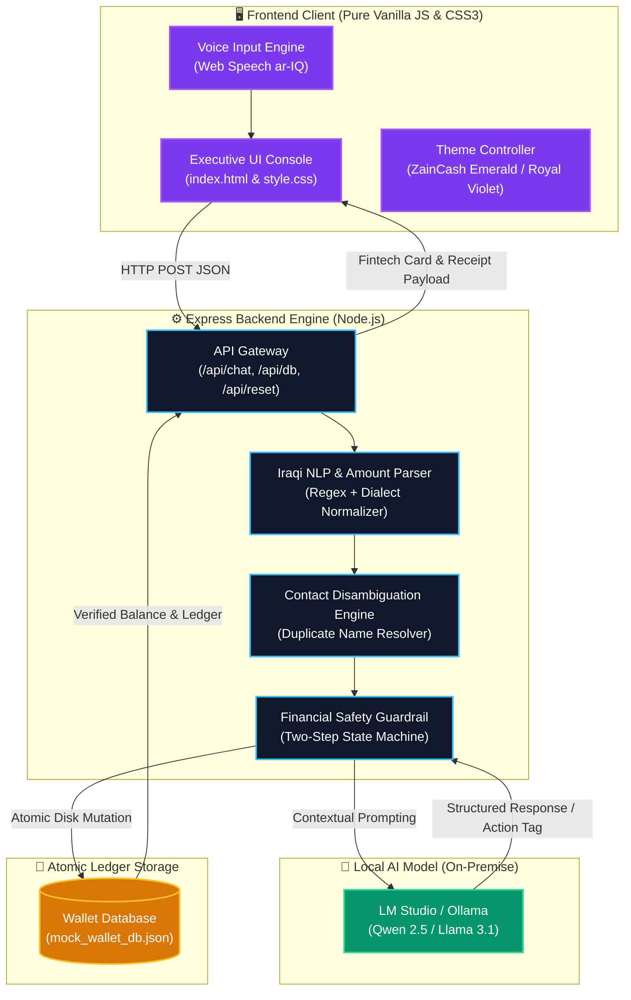

# 🏦 فاي (VI) - Local AI Financial Agent (المساعد المالي الذكي)
> **فاي (VI) — Next-Generation Autonomous Financial Assistant for Iraqi Digital Wallets powered by 100% Local LLMs, Zero Cloud Data Leakage, Deterministic Guardrails, and Luxury Executive Fintech UX.**

<div align="center">

[](https://nodejs.org/)
[](https://expressjs.com/)
[](https://lmstudio.ai/)
[](#)
[-0284c7?style=for-the-badge)](#)
[](#)
[](#license)

</div>

---

## 📑 Table of Contents
- [🌟 Executive Summary](#-executive-summary)
- [🎥 Video Demo Walkthrough](#-video-demo-walkthrough)
- [✨ Key Features](#-key-features)
- [🏗️ System Architecture & Data Flow](#️-system-architecture--data-flow)
- [📂 Project Structure](#-project-structure)
- [⚡ Quick Start & Installation Guide](#-quick-start--installation-guide)
  - [🛠️ Windows Setup & Troubleshooting](#3-windows-powershell-first-time-setup--troubleshooting)
- [💬 Interactive Test Scenarios](#-interactive-test-scenarios)
- [🛡️ Deterministic Financial Guardrails](#️-deterministic-financial-guardrails)
- [🎨 Luxury Fintech Design System](#-luxury-fintech-design-system)
- [🗺️ Future Roadmap](#️-future-roadmap)
- [📜 License](#-license)

---

## 🌟 Executive Summary

**Local AI Financial Agent** is a privacy-first, on-premise digital wallet assistant engineered specifically for Iraqi fintech ecosystems (such as **ZainCash** and **SuperQi**).

Modern cloud LLMs pose significant compliance, privacy, and hallucination risks for financial operations. This system solves those challenges through:

1. **100% Local & Offline Inference**: Runs entirely on your local machine using **LM Studio** or **Ollama** (e.g., `Qwen2.5-7B-Instruct` or `Llama-3.1-8B-Instruct`). Zero customer transaction data, contact names, or wallet balances ever leave the host machine.
2. **Deterministic Financial Safety Guardrails**: AI models can hallucinate math and intent. Our backend wraps model outputs in a strict, two-step confirmation state machine. Balance deductions and transaction executions are handled deterministically on disk—never hallucinated.
3. **Colloquial Iraqi Dialect & Currency Parser**: Deeply understands colloquial Iraqi Arabic idioms (*"حول لـ أحمد 50 ألف"*, *"شكد رصيدي هسة"*, *"ادفع مال كهرباء"*, *"بطلت ما أريد"*), supporting numeric, alphanumeric, and written numbers.
4. **Smart Contact Disambiguation Engine**: Resolves common ambiguity (e.g., having multiple contacts named *"Ahmed"*) by presenting interactive selections without guessing or erroneously sending money.
5. **Luxury Executive UI/UX**: Bespoke dual-theme console featuring a ZainCash Emerald Dark Mode and Royal Violet Light Mode with mathematical halftone wave particle physics and glassmorphism.

---

## 🎥 Video Demo Walkthrough

> [!IMPORTANT]
> **Dedicated Video Showcase Section**  
> Record your demo video showcasing the local AI financial flow (balance inquiry, disambiguation, confirmation cards, bill payment, voice input) and place it here.

<div align="center">

<!-- ======================================================== -->
<!-- 📹 EMBED YOUR VIDEO FILE OR YOUTUBE / LOOM LINK HERE      -->
<!-- ======================================================== -->

```html
<video src="assets/demo_walkthrough.mp4" controls width="100%" poster="frontend/logo-emerald.png" style="border-radius: 18px; box-shadow: 0 25px 60px rgba(0, 0, 0, 0.55); max-width: 960px;">
  Your browser does not support the video tag.
</video>
```

*(You can drop your video into the project folder as `demo.mp4` or link directly to YouTube / Loom)*

[](#-video-demo-walkthrough)

</div>

---

## ✨ Key Features

### 1. 🛡️ Strict Two-Step Confirmation State Machine
- **Zero Accidental Deductions**: The AI agent cannot trigger any financial mutation directly from an initial prompt.
- **Card-Based Verification**: Generates an interactive verification card displaying the recipient, verified phone number, exact amount, and remaining balance.
- **Explicit User Consent**: Requires explicit affirmative confirmation (`"نعم"`, `"أكد"`, `"تمام"`, `"yes"`) before executing changes.
- **Instant Cancellation**: Immediate rollback upon negative inputs (`"إلغاء"`, `"لا"`, `"بطلت"`, `"cancel"`).

### 2. 👥 Smart Contact Disambiguation Engine
- If a user requests a transfer to a common name (e.g., *"Ahmed"*):
  - The engine detects multiple matches in the address book.
  - Formats and displays all matching entries with aliases and masked phone numbers.
  - The user can select the target by number (`1`, `2`, `3`), alias (`"صديق الجامعة"`), or phone digits.

### 3. 🧾 Utility & Telecom Bill Payment System
- **Pre-Integrated Biller Types**: Electricity (*كهرباء الكرخ*), Water (*مياه البصرة*), Mobile Postpaid (*زين العراق*), and Fiber/4G Internet (*ZainFi*).
- **Aggregated or Single Settlement**: Query pending unpaid bills, pay an individual service (*"ادفع فاتورة الإنترنت"*), or settle all outstanding bills in one transaction (*"ادفع كل الفواتير"*).

### 4. 🎙️ Iraqi Arabic Voice-to-Text (Web Speech API)
- Real-time speech recognition tuned for Iraqi Arabic dialect (`ar-IQ`).
- Pulse-glow microphone UI with live recording state indicators.

### 5. 🎨 Dual Luxury Fintech Themes
- **🌙 ZainCash Luxury Emerald (Dark Theme)**: Cosmic Black `#04070b` surface, luminous emerald accents `#8acc44`, gold alert lines `#ffc83b`, and dark glassmorphic cards.
- **☀️ Royal Violet & Crisp White (Light Theme)**: Titanium White surface, deep royal violet `#7c3aed`, emerald success badges, and pristine high-contrast legibility.
- **Dynamic Halftone Wave Canvas**: Custom mathematical dot grid rendered in real time, reacting dynamically to viewport scaling, theme switches, and layout transitions.
- **Hero-to-Chat Seamless Transition**: Minimalist landing view centered on the brand logo smoothly shrinks and docks into an active conversation console upon the first interaction.

---

## 🏗️ System Architecture & Data Flow



---

## 📂 Project Structure

```text
local-ai-financial-agent/
│
├── 📁 backend/
│   ├── 📄 server.js               # Express server, NLP dialect parser, state machine & DB engine
│   └── 📄 mock_wallet_db.json      # Atomic mock wallet database (User, Contacts, Bills, Ledger)
│
├── 📁 frontend/
│   ├── 📄 index.html              # Semantic HTML5 layout (Header, Hero Dock, Interaction Capsule)
│   ├── 📄 style.css               # Luxury design system, dual themes, halftone canvas, cards
│   ├── 📄 script.js               # Client logic, speech recognition, DOM rendering, animations
│   ├── 🖼️ logo-emerald.png        # Brand logo for ZainCash Dark Theme (Emerald Green)
│   ├── 🖼️ logo-violet.png         # Brand logo for Royal Violet Light Theme (Royal Purple)
│   ├── 🖼️ bot-emerald.png         # Bot avatar for Dark Theme
│   └── 🖼️ bot-violet.png          # Bot avatar for Light Theme
│
├── 📄 wallet_db_schema.json       # Formal JSON Schema defining wallet data models
├── 📄 package.json                # Project dependencies and metadata
├── 📄 package-lock.json           # Locked dependency tree
└── 📄 README.md                   # Comprehensive project documentation
```

---

## ⚡ Quick Start & Installation Guide

### 1. Prerequisites
- **[Node.js](https://nodejs.org/)** (v18.0.0 or higher recommended).
- **[LM Studio](https://lmstudio.ai/)** or **[Ollama](https://ollama.ai/)** to host and run local LLMs.
- Standard terminal (**Windows PowerShell**, **Command Prompt**, or any IDE like **Antigravity** / **VS Code**).

---

### 2. Configure & Load Model in LM Studio
1. Launch **LM Studio**.
2. Search and download an instruction-tuned model with strong Arabic capabilities:
   - `Qwen2.5-7B-Instruct` *(Highly recommended for exceptional Arabic comprehension and speed)*
   - `Llama-3.1-8B-Instruct` *(High-quality reasoning)*
3. Load the model into memory:
   - Go to **Chat** or select the model in the top dropdown of the **Developer / Local Server** tab (`<->` icon on the left sidebar).
   - Verify the port is set to **`1234`** and click **Start Server**.
4. Ensure the OpenAI-compatible endpoint is running at:
   ```text
   http://127.0.0.1:1234/v1/chat/completions
   ```
   *(Node.js communicates directly with this endpoint over HTTP; no manual IDE or MCP setup is required).*

---

### 3. Windows PowerShell First-Time Setup & Troubleshooting
When running on a fresh Windows machine, PowerShell may display one of two common setup notices. Apply these quick one-time fixes:

#### A. Issue: `'node'` or `'npm'` is not recognized
> `node : The term 'node' is not recognized as the name of a cmdlet, function, script file...`
* **Cause**: The terminal was opened before or during the Node.js installation, so the system `PATH` has not yet been refreshed.
* **Quick Fix (Option 1)**: Close and re-open your terminal or IDE completely.
* **Instant Fix (Option 2)**: Refresh the environment `PATH` in the current terminal session without restarting:
  ```powershell
  $env:Path = [System.Environment]::GetEnvironmentVariable("Path","Machine") + ";" + [System.Environment]::GetEnvironmentVariable("Path","User")
  ```
  Then verify:
  ```powershell
  node -v
  npm -v
  ```

#### B. Issue: `npm.ps1 cannot be loaded because running scripts is disabled`
> `npm : File C:\Program Files\nodejs\npm.ps1 cannot be loaded because running scripts is disabled on this system (PSSecurityException).`
* **Cause**: Windows PowerShell restricts running third-party unsigned scripts by default.
* **Fix**: Run this one-time command in PowerShell (does not require Administrator rights):
  ```powershell
  Set-ExecutionPolicy -ExecutionPolicy RemoteSigned -Scope CurrentUser
  ```
  *(Type `Y` and press Enter if prompted to confirm).*

---

### 4. Install & Launch the Agent

```bash
# 1. Clone repository or navigate to directory (omit node_modules when copying to another PC)
cd "local ai agent"

# 2. Install lightweight dependencies (Express & CORS)
npm install

# 3. Start the financial agent backend
node backend/server.js
```

You should see the following console output:
```text
====================================================
  AI Financial Agent Backend running on port 3000
  Connected to LM Studio: http://127.0.0.1:1234/v1/chat/completions
  Database File: c:\...\backend\mock_wallet_db.json
====================================================
```

---

### 5. Access the Web Application
Open your browser and navigate to:
👉 **`http://localhost:3000`**

---

## 💬 Interactive Test Scenarios

Test the agent using these real-world scenarios:

| Scenario | User Message (Arabic) | Agent Expected Behavior |
| :--- | :--- | :--- |
| **Balance Inquiry** | `"شكد رصيدي هسة؟"` or `"كم عندي بالمحفظة؟"` | Reads deterministic balance directly from disk and warns of any pending payments. |
| **Contact Ambiguity** | `"أريد أحول 50 ألف لأحمد"` | Identifies multiple contacts named *Ahmed* and prompts the user to choose by index (`1`, `2`, `3`) or alias. |
| **Confirmation Flow** | `"أحمد كمال"` followed by `"نعم"` | Displays verification card with recipient, fee, and remaining balance. Executes upon `"نعم"` and issues a receipt. |
| **Operation Rollback** | `"بطلت ما أريد"` or `"إلغاء"` | Cancels pending action immediately without debiting any funds. |
| **Unpaid Bills Inquiry** | `"شنو الفواتير اللي ما مدفوعة عندي؟"` | Lists all unpaid bills (Electricity, Water, Internet, Line) with amounts and total balance needed. |
| **Single Bill Payment** | `"ادفع فاتورة الإنترنت"` | Verifies Internet bill balance, generates confirmation card, and updates bill status to `paid`. |
| **Bulk Bill Payment** | `"ادفع كل الفواتير اللي عليه"` | Aggregates all unpaid bills, verifies total against available balance, and settles them atomically. |

---

## 🛡️ Deterministic Financial Guardrails

```
🔒 Anti-Hallucination Gate ◄── Balances are read directly from disk; LLM never guesses figures
🔒 2-Step Consent Lock     ◄── No mutation occurs without an explicit secondary user confirmation
🔒 Overdraft Protection    ◄── Transfers exceeding available funds are blocked at the engine level
🔒 Ambiguity Interceptor   ◄── Duplicate recipient matches block execution until resolved
🔒 Secure Sanitization     ◄── Complete XSS escaping and prompt injection sanitization on all inputs
```

---

## 🎨 Luxury Fintech Design System

- **Dual Color Palette**:
  - **ZainCash Dark Theme**: Cosmic Black `#04070b` surface, Deep Emerald `#0c171e`, Neon Emerald `#8acc44`, Warning Gold `#ffc83b`.
  - **Royal Violet Light Theme**: Crisp Titanium White surface, Slate Mist `#f8fafc`, Royal Violet `#7c3aed`, Emerald Green `#10b981`.
- **Bespoke Typography**:
  - **Cairo**: Modern Arabic headings, body text, and dialogue cards.
  - **Plus Jakarta Sans**: High-precision tabular numerals and international currency formatting (`IQD`).
- **Mathematical Halftone Particle Wave**:
  - Interactive HTML5 canvas rendering dynamic particle grids that morph and react across viewports and themes without distorting on zoom.

---

## 🗺️ Future Roadmap

- [x] Full Iraqi dialect support for money transfers and utility bills.
- [x] Strict two-step confirmation engine and contact disambiguation.
- [x] Dual luxury themes with real-time responsive halftone animations.
- [x] Integrated voice input via Web Speech API (`ar-IQ`).
- [ ] Iraqi dialect Text-to-Speech (TTS) auditory feedback.
- [ ] QR code scanning for in-store merchant POS payments.
- [ ] Open Banking API connectors adhering to Central Bank of Iraq (CBI) standards.
- [ ] Automated PDF transaction receipt export and shareable receipts.

---

## 📜 License

This project is open-source and licensed under the **[MIT License](LICENSE)**.

<div align="center">

**Crafted with precision for the future of digital banking in Iraq 🇮🇶**

</div>
