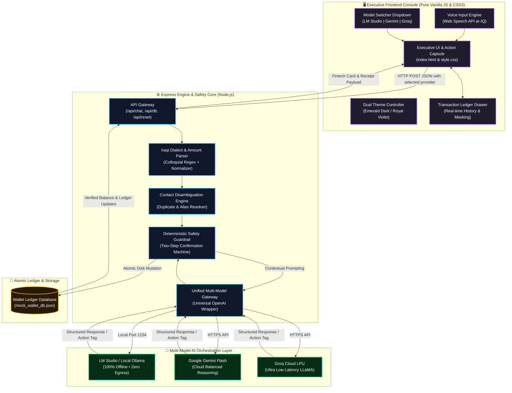

<div align="center">

# فاي • VI
### Bill Pay and Transfer Agent
**وكيل سداد الفواتير والتحويلات المالية الذكي**

<p align="center">
  <strong>Next-Generation Autonomous Financial Agent for Digital Wallets powered by Multi-Model AI Orchestration, 100% Local Privacy, Deterministic Safety Guardrails, and Executive Fintech UX.</strong>
</p>

[](https://nodejs.org/)
[](https://expressjs.com/)
[](#-multi-model-ai-orchestration-engine)
[](#-deterministic-financial-guardrails)
[-0284c7?style=for-the-badge)](#)
[](#)
[](#-license)

</div>

---

## 📑 Table of Contents
- [🌟 Executive Summary](#-executive-summary)
- [🎥 Video Demo Walkthrough](#-video-demo-walkthrough)
- [🧠 Multi-Model AI Orchestration Engine](#-multi-model-ai-orchestration-engine)
- [✨ Key Features](#-key-features)
- [🛡️ Deterministic Financial Guardrails](#️-deterministic-financial-guardrails)
- [🏗️ System Architecture & Data Flow](#️-system-architecture--data-flow)
- [📂 Project Structure](#-project-structure)
- [⚡ Quick Start & Installation Guide](#-quick-start--installation-guide)
  - [1. Prerequisites](#1-prerequisites)
  - [2. Environment Configuration (.env)](#2-environment-configuration-env)
  - [3. Running Locally with LM Studio (100% Offline)](#3-running-locally-with-lm-studio-100-offline)
  - [4. Optional: Adding Gemini & Groq Cloud Keys](#4-optional-adding-gemini--groq-cloud-keys)
  - [5. Windows PowerShell Setup & Troubleshooting](#5-windows-powershell-setup--troubleshooting)
  - [6. Launching the Application](#6-launching-the-application)
- [💬 Interactive Test Scenarios](#-interactive-test-scenarios)
- [🎨 Luxury Fintech Design System](#-luxury-fintech-design-system)
- [🗺️ Future Roadmap](#️-future-roadmap)
- [📜 License](#-license)

---

## 🌟 Executive Summary

**فاي (VI) — Bill Pay and Transfer Agent** is an enterprise-grade autonomous digital wallet assistant engineered specifically for modern Iraqi fintech workflows and colloquial Iraqi Arabic communications.

Handling real financial transactions through Generative AI models introduces critical vulnerabilities: **hallucinated balances**, **accidental fund deductions**, **prompt injection**, and **cloud data leakage**. **فاي (VI)** solves every one of these challenges by isolating mathematical calculations and state changes from the generative layer through:

1. **Multi-Model Orchestration Layer**: Switch on the fly between **100% Local On-Premise Inference** (via **LM Studio** / **Ollama**) with zero cloud data egress, **Google Gemini Flash** for high-precision reasoning, or **Groq Cloud** for instant sub-second LPU processing.
2. **Deterministic Financial Safety Guardrails**: All arithmetic, balance checks, transaction authorizations, and ledger updates are handled deterministically on disk via an atomic state machine. The LLM never hallucinates or modifies balances directly.
3. **Colloquial Iraqi Dialect & Currency Parser**: Deep native comprehension of everyday Iraqi Arabic idioms (*"حول لـ أحمد 50 ألف"*, *"شكد رصيدي هسة"*, *"ادفع مال كهرباء"*, *"بطلت ما أريد"*), supporting numeric, alphanumeric, and written numbers.
4. **Smart Contact Disambiguation Engine**: Resolves recipient ambiguity (e.g., multiple contacts named *"Ahmed"*) by presenting interactive selections without guessing or mistakenly sending funds.
5. **Luxury Executive UI/UX**: Bespoke dual-theme console featuring an Emerald Dark Mode and Royal Violet Light Mode with mathematical halftone wave particle physics, balance privacy masking (`*** IQD 👁`), a sliding transaction ledger drawer, and fluid micro-animations.

---

## 🎥 Video Demo Walkthrough

> [!TIP]
> **Video Demonstration**  
> Explore the interactive demo showcasing the multi-model switcher, balance privacy masking, contact disambiguation, confirmation cards, bill settlements, and voice input.

<div align="center">

<video src="assets/demo_walkthrough.mp4" controls width="100%" poster="frontend/logo-emerald.png" style="border-radius: 18px; box-shadow: 0 25px 60px rgba(0, 0, 0, 0.55); max-width: 960px;">
  Your browser does not support the video tag.
</video>

*(Place your recorded walkthrough as `assets/demo_walkthrough.mp4` or link directly to YouTube / Loom)*

</div>

---

## 🧠 Multi-Model AI Orchestration Engine

**فاي (VI)** implements a dynamic, multi-provider AI architecture. Users can seamlessly choose their preferred inference engine directly from the executive in-app dropdown header:

| Provider | Mode | Best For | Privacy / Data Residency | API Key Needed |
| :--- | :--- | :--- | :--- | :--- |
| **LM Studio** *(Default)* | **100% Local / Offline** | On-premise execution, complete privacy, zero internet dependency | **Zero Data Egress** (Runs entirely on local hardware) | ❌ **No (Free)** |
| **Google Gemini Flash** | **Cloud AI Engine** | Advanced linguistic reasoning, complex intent nuance | Encrypted HTTPS API | ✅ Yes (`GEMINI_API_KEY`) |
| **Groq Cloud** | **Ultra-Fast Cloud LPU** | Instantaneous sub-second replies, high-speed interactions | Encrypted HTTPS API | ✅ Yes (`GROQ_API_KEY`) |

### Key Architectural Highlights:
* **Unified Universal OpenAI Wrapper**: A single, robust wrapper function in `backend/server.js` dynamically routes requests to the selected provider without duplicating prompt engineering or state logic.
* **Instant In-Session Switch**: Change models at any time during an active session via the header trigger. No page reload, server restart, or context wipe required.
* **Graceful Fallback & Error Handling**: If a cloud key is missing or a local server is stopped, the agent delivers clear, friendly diagnostic guidance in colloquial Iraqi Arabic without crashing.

---

## ✨ Key Features

### 1. 🛡️ Strict Two-Step Confirmation State Machine
* **Zero Accidental Deductions**: The AI agent cannot trigger any financial mutation directly from an initial prompt.
* **Verification Cards**: Generates an interactive verification card displaying recipient details, verified phone number, exact fee, amount, and remaining balance.
* **Explicit User Consent**: Requires explicit affirmative confirmation (`"نعم"`, `"أكد"`, `"تمام"`, `"yes"`) before executing changes.
* **Instant Cancellation**: Immediate rollback upon negative inputs (`"إلغاء"`, `"لا"`, `"بطلت"`, `"cancel"`).

### 2. 👥 Smart Contact Disambiguation Engine
* If a user requests a transfer to a common name (e.g., *"أحمد"*):
  * The engine detects multiple matches in the verified address book.
  * Formats and presents all matching entries with aliases and masked phone numbers.
  * The user can select the target by number (`1`, `2`, `3`), alias (`"صديق الجامعة"`), or phone digits.

### 3. 🧾 Utility & Telecom Bill Payment System
* **Pre-Integrated Biller Categories**: National Electricity Grid (*الكهرباء الوطنية*), Municipal Water (*الماء والخدمات البلدية*), Mobile Telecommunications (*فواتير خط الهاتف والاتصالات*), and Fiber/4G Internet (*فواتير الإنترنت والألياف الضوئية*).
* **Aggregated or Single Settlement**: Query pending unpaid bills, pay an individual service (*"ادفع فاتورة الإنترنت"*), or settle all outstanding bills in one atomic transaction (*"ادفع كل الفواتير"*).

### 4. 👁️ Wallet Balance Privacy Toggle
* Header pill features a shoulder-surfing privacy mask (`*** IQD 👁`) enabled by default.
* One-click toggle reveals the live balance (`2,200,000 IQD`) with smooth SVG eye-animation and local storage persistence.

### 5. 📂 Sliding Transactions History Drawer
* Dedicated slide-out drawer accessible from the top-left navigation button.
* Displays verified transaction receipts, timestamps, recipient names, and real-time status badges (`مكتملة` / `قيد المراجعة`).

### 6. 🎙️ Iraqi Arabic Voice-to-Text (Web Speech API)
* Real-time speech recognition calibrated for colloquial Iraqi Arabic (`ar-IQ`).
* In-place morphing action capsule smoothly transforms the microphone button into a send button upon voice input or typing.

---

## 🛡️ Deterministic Financial Guardrails

```
┌────────────────────────────────────────────────────────────────────────┐
│                   DETERMINISTIC SAFETY PIPELINE                        │
├────────────────────────────────────────────────────────────────────────┤
│ 🔒 Anti-Hallucination Gate ◄── Balances read from disk only; LLM never │
│                                computes or guesses financial figures.  │
│ 🔒 2-Step Consent Lock     ◄── No balance mutation occurs without an  │
│                                explicit secondary confirmation.        │
│ 🔒 Overdraft Protection    ◄── Transfers exceeding available funds are │
│                                blocked at the backend engine level.    │
│ 🔒 Ambiguity Interceptor   ◄── Duplicate recipient matches block       │
│                                execution until explicitly resolved.    │
│ 🔒 Input Sanitization      ◄── Complete XSS escaping and prompt        │
│                                injection sanitization on all inputs.   │
└────────────────────────────────────────────────────────────────────────┘
```

---

## 🏗️ System Architecture & Data Flow



---

## 📂 Project Structure

```text
VI/
├── 📁 backend/
│   ├── 📄 server.js               # Express server, NLP dialect parser, state machine & multi-model router
│   ├── 📄 mock_wallet_db.json     # Atomic mock wallet database (User, Contacts, Bills, Ledger)
│   ├── 📄 feedback_likes.json     # Analytics on positive user feedback
│   └── 📄 feedback_dislikes.json  # Analytics on negative user feedback
│
├── 📁 frontend/
│   ├── 📄 index.html              # Semantic HTML5 layout (Header, Hero Dock, Interaction Capsule)
│   ├── 📄 style.css               # Luxury design system, dual themes, halftone canvas, cards
│   ├── 📄 script.js               # Client logic, model switcher, speech recognition, DOM rendering
│   ├── 🖼️ logo-emerald.png        # Brand logo for Dark Theme (Emerald Green)
│   ├── 🖼️ logo-violet.png         # Brand logo for Light Theme (Royal Purple)
│   ├── 🖼️ bot-emerald.png         # Assistant avatar for Dark Theme
│   └── 🖼️ bot-violet.png          # Assistant avatar for Light Theme
│
├── 📄 .env                        # Local environment variables & API keys (Git ignored)
├── 📄 .env.example                # Safe environment variable configuration template
├── 📄 .gitignore                  # Git leak protection (excludes .env, node_modules, temp files)
├── 📄 wallet_db_schema.json       # Formal JSON Schema defining wallet data models
├── 📄 package.json                # Project dependencies and npm scripts
├── 📄 package-lock.json           # Locked dependency tree
├── 📄 LICENSE                     # MIT Open Source License
└── 📄 README.md                   # Comprehensive project documentation
```

---

## ⚡ Quick Start & Installation Guide

### 1. Prerequisites
* **[Node.js](https://nodejs.org/)** (v18.0.0 or higher recommended).
* **Git** installed on your system.
* *(Optional)* **[LM Studio](https://lmstudio.ai/)** or **[Ollama](https://ollama.ai/)** for running 100% local, offline models.

---

### 2. Environment Configuration (.env)
Create a `.env` file in the project root by copying the template:

```bash
cp .env.example .env
```

Your `.env` file should look like this:

```env
# Local LM Studio (Default port is 1234)
LM_STUDIO_URL=http://127.0.0.1:1234/v1
LOCAL_API_KEY=lm-studio

# Optional Cloud Providers (Only required if you want to use them)
GEMINI_API_KEY=your_gemini_api_key_here
GROQ_API_KEY=your_groq_api_key_here

# Server Port (defaults to 3000)
PORT=3000
```

> [!NOTE]
> If you only plan to use **LM Studio**, you do **not** need any cloud API keys! The system runs 100% offline out of the box.

---

### 3. Running Locally with LM Studio (100% Offline)
1. Launch **LM Studio**.
2. Download an instruction-tuned model with strong Arabic capabilities:
   * **`Qwen2.5-7B-Instruct`** *(Recommended for exceptional Arabic comprehension and speed)*.
   * **`Llama-3.1-8B-Instruct`** *(High-quality reasoning)*.
3. In the **Developer / Local Server** tab (`<->` on the sidebar):
   * Select your downloaded model from the top dropdown.
   * Verify the port is set to **`1234`**.
   * Click **Start Server**.

---

### 4. Optional: Adding Gemini & Groq Cloud Keys
* **Google Gemini**: Get a free API key at [Google AI Studio](https://aistudio.google.com/) and paste it as `GEMINI_API_KEY`.
* **Groq Cloud**: Get a free API key at [Groq Console](https://console.groq.com/keys) and paste it as `GROQ_API_KEY`.

---

### 5. Windows PowerShell Setup & Troubleshooting
On a fresh Windows setup, PowerShell may restrict scripts or fail to recognize new Node.js paths. Apply these one-time fixes if needed:

* **If `node` or `npm` is not recognized**:
  Refresh the terminal environment path without restarting:
  ```powershell
  $env:Path = [System.Environment]::GetEnvironmentVariable("Path","Machine") + ";" + [System.Environment]::GetEnvironmentVariable("Path","User")
  ```
* **If running scripts is disabled (`PSSecurityException`)**:
  Allow local script execution (does not require Administrator privileges):
  ```powershell
  Set-ExecutionPolicy -ExecutionPolicy RemoteSigned -Scope CurrentUser
  ```

---

### 6. Launching the Application

```bash
# 1. Install dependencies
npm install

# 2. Start the financial agent server
node backend/server.js
```

You will see:
```text
====================================================
  AI Financial Agent Backend running on port 3000
  Connected to LM Studio: http://127.0.0.1:1234/v1
  Database File: .../backend/mock_wallet_db.json
====================================================
```

Open your browser and navigate to:
👉 **`http://localhost:3000`**

---

## 💬 Interactive Test Scenarios

| Scenario | User Prompt (Iraqi Arabic) | Agent Behavior |
| :--- | :--- | :--- |
| **Balance Inquiry** | `"شكد رصيدي هسة؟"` أو `"كم عندي بالمحفظة؟"` | Reads deterministic balance directly from disk and warns of any outstanding bills. |
| **Contact Ambiguity** | `"أريد أحول 50 ألف لأحمد"` | Identifies multiple contacts named *أحمد* and prompts the user to select by index (`1`, `2`) or alias. |
| **Confirmation Flow** | `"أحمد كمال"` ثم `"نعم"` | Renders a verification card with recipient, fee, and remaining balance. Executes upon `"نعم"` and issues a verified receipt. |
| **Operation Rollback** | `"بطلت ما أريد"` أو `"إلغاء"` | Cancels pending action immediately without debiting any funds. |
| **Unpaid Bills Inquiry** | `"شنو الفواتير اللي ما مدفوعة عندي؟"` | Lists all unpaid bills (Electricity, Water, Internet, Phone) with individual amounts and total sum. |
| **Single Bill Payment** | `"ادفع فاتورة الإنترنت"` | Verifies Internet bill balance, generates confirmation card, and updates bill status to `paid`. |
| **Bulk Bill Payment** | `"ادفع كل الفواتير اللي عليه"` | Aggregates all unpaid bills, verifies total against available balance, and settles them atomically. |

---

## 🎨 Luxury Fintech Design System

* **Dual Color Palette**:
  * **🌙 Luxury Emerald (Dark Theme)**: Cosmic Black `#04070b` surface, Deep Forest `#0c171e`, Neon Emerald `#4ade80`, Warning Gold `#ffc83b`.
  * **☀️ Royal Violet (Light Theme)**: Crisp Titanium White surface, Slate Mist `#f8fafc`, Royal Violet `#7c3aed`, Emerald Green `#10b981`.
* **Bespoke Typography**:
  * **Cairo**: Modern Arabic headings, body text, and dialogue cards.
  * **Plus Jakarta Sans**: High-precision tabular numerals and international currency formatting (`IQD`).
* **Mathematical Halftone Particle Wave**:
  * Interactive HTML5 canvas rendering dynamic particle grids that morph and react across viewports and themes without distorting on zoom.
* **Dual-State Dynamic New Chat Button**:
  * In Hero mode: displays a refined dotted perimeter icon indicating a fresh session.
  * In Active Chat mode: seamlessly transforms into a solid circle icon with fluid rotation.

---

## 🗺️ Future Roadmap

- [x] Full Iraqi dialect support for money transfers and utility bills.
- [x] Strict two-step confirmation engine and contact disambiguation.
- [x] Multi-Model AI Orchestration (LM Studio, Google Gemini, Groq).
- [x] Wallet balance privacy masking toggle (`*** IQD 👁`).
- [x] Sliding transaction ledger history drawer.
- [x] Dual luxury themes with real-time responsive halftone animations.
- [x] Integrated voice input via Web Speech API (`ar-IQ`).
- [ ] Iraqi dialect Text-to-Speech (TTS) auditory feedback.
- [ ] QR code scanning for in-store merchant POS payments.
- [ ] Open Banking API connectors adhering to Central Bank of Iraq (CBI) standards.
- [ ] Automated PDF transaction receipt export and shareable receipts.

---

## 📜 License

This project is open-source and licensed under the **[MIT License](LICENSE)**.

<div align="center">

**فاي (VI) — صُمم وصُقل ليكون المعيار الأعلى لمستقبل الخدمات المالية الرقمية 🇮🇶**

</div>
