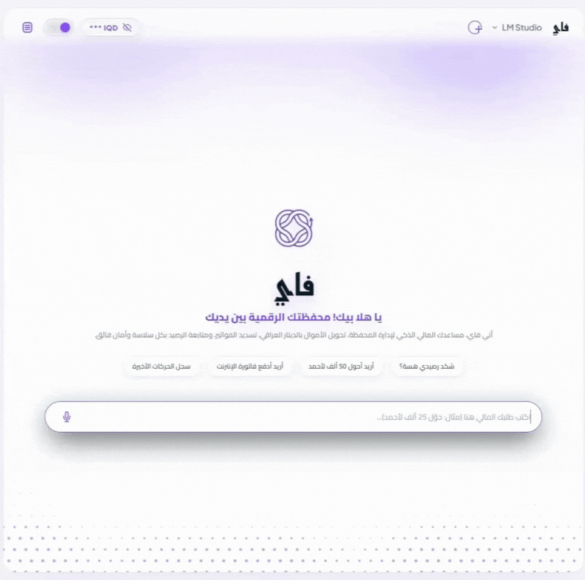
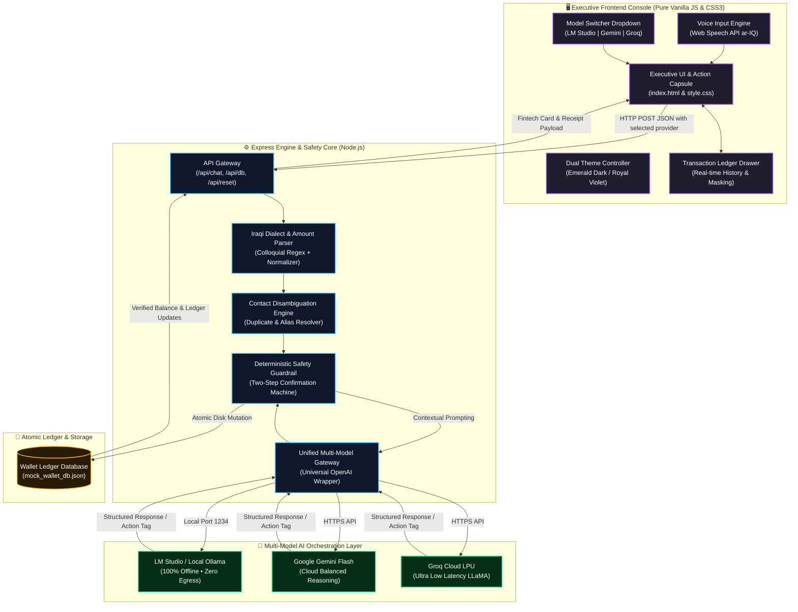

<div align="center">

# فاي • VI
### Bill Pay and Transfer Agent
**وكيل سداد الفواتير والتحويلات المالية الذكي**

<p align="center">
  <strong>Next-Generation Autonomous Financial Agent for Digital Wallets powered by Multi-Model AI Orchestration, 100% Local Privacy, Deterministic Safety Guardrails, and Executive Fintech UX.</strong>
</p>

[](https://nodejs.org/)
[](https://expressjs.com/)
[](#-multi-model-ai-orchestration-engine)
[](#-deterministic-financial-guardrails)
[-0284c7?style=for-the-badge)](#)
[](#)
[](#-license)

</div>

---

## 📑 Table of Contents
- [🌟 Executive Summary](#-executive-summary)
- [🎥 Interactive Demo Walkthrough](#-interactive-demo-walkthrough)
- [🧠 Multi-Model AI Orchestration Engine](#-multi-model-ai-orchestration-engine)
- [✨ Key Features](#-key-features)
- [🛡️ Deterministic Financial Guardrails](#️-deterministic-financial-guardrails)
- [🏗️ System Architecture & Data Flow](#️-system-architecture--data-flow)
- [📂 Project Structure](#-project-structure)
- [⚡ Quick Start & Step-by-Step Installation Guide](#-quick-start--step-by-step-installation-guide)
  - [Step 1: System Prerequisites & Verification](#step-1-system-prerequisites--verification)
  - [Step 2: Clone or Download the Repository](#step-2-clone-or-download-the-repository)
  - [Step 3: Install Project Dependencies](#step-3-install-project-dependencies)
  - [Step 4: Configure Environment Variables (.env)](#step-4-configure-environment-variables-env)
  - [Step 5: Configure AI Model Engine (Local vs. Cloud)](#step-5-configure-ai-model-engine-local-vs-cloud)
  - [Step 6: Launch Backend & Access Web Console](#step-6-launch-backend--access-web-console)
- [🛠️ Comprehensive Troubleshooting & FAQs](#️-comprehensive-troubleshooting--faqs)
- [💬 Interactive Test Scenarios](#-interactive-test-scenarios)
- [🎨 Luxury Fintech Design System](#-luxury-fintech-design-system)
- [🗺️ Future Roadmap](#️-future-roadmap)
- [📜 License](#-license)

---

## 🌟 Executive Summary

**فاي (VI) — Bill Pay and Transfer Agent** is an enterprise-grade autonomous digital wallet assistant engineered specifically for modern Iraqi fintech workflows and colloquial Iraqi Arabic communications.

Handling real financial transactions through Generative AI models introduces critical vulnerabilities: **hallucinated balances**, **accidental fund deductions**, **prompt injection**, and **cloud data leakage**. **فاي (VI)** solves every one of these challenges by isolating mathematical calculations and state changes from the generative layer through:

1. **Multi-Model Orchestration Layer**: Switch on the fly between **100% Local On-Premise Inference** (via **LM Studio** / **Ollama**) with zero cloud data egress, **Google Gemini Flash** for high-precision reasoning, or **Groq Cloud** for instant sub-second LPU processing.
2. **Deterministic Financial Safety Guardrails**: All arithmetic, balance checks, transaction authorizations, and ledger updates are handled deterministically on disk via an atomic state machine. The LLM never hallucinates or modifies balances directly.
3. **Colloquial Iraqi Dialect & Currency Parser**: Deep native comprehension of everyday Iraqi Arabic idioms (*"حول لـ أحمد 50 ألف"*, *"شكد رصيدي هسة"*, *"ادفع مال كهرباء"*, *"بطلت ما أريد"*), supporting numeric, alphanumeric, and written numbers.
4. **Smart Contact Disambiguation Engine**: Resolves recipient ambiguity (e.g., multiple contacts named *"Ahmed"*) by presenting interactive selections without guessing or mistakenly sending funds.
5. **Luxury Executive UI/UX**: Bespoke dual-theme console featuring an Emerald Dark Mode and Royal Violet Light Mode with mathematical halftone wave particle physics, balance privacy masking (`*** IQD 👁`), a sliding transaction ledger drawer, and fluid micro-animations.

---

## 🎥 Interactive Demo Walkthrough

> [!TIP]
> **Live Demonstration**  
> Explore the interactive walkthrough showcasing the multi-model switcher, balance privacy masking, contact disambiguation, confirmation cards, bill settlements, and voice input in action.

<div align="center">



<p align="center">
  <sub>🎬 <strong>فاي (VI) في العمل:</strong> استعراض عملي وتفاعلي لسداد الفواتير، التحويلات المالية، صمامات الأمان الحتمية، والتبديل اللحظي بين النماذج.</sub>
</p>

</div>

---

## 🧠 Multi-Model AI Orchestration Engine

**فاي (VI)** implements a dynamic, multi-provider AI architecture. Users can seamlessly choose their preferred inference engine directly from the executive in-app dropdown header:

| Provider | Mode | Best For | Privacy / Data Residency | API Key Needed |
| :--- | :--- | :--- | :--- | :--- |
| **LM Studio** *(Default)* | **100% Local / Offline** | On-premise execution, complete privacy, zero internet dependency | **Zero Data Egress** (Runs entirely on local hardware) | ❌ **No (Free)** |
| **Google Gemini Flash** | **Cloud AI Engine** | Advanced linguistic reasoning, complex intent nuance | Encrypted HTTPS API | ✅ Yes (`GEMINI_API_KEY`) |
| **Groq Cloud** | **Ultra-Fast Cloud LPU** | Instantaneous sub-second replies, high-speed interactions | Encrypted HTTPS API | ✅ Yes (`GROQ_API_KEY`) |

### Key Architectural Highlights:
* **Unified Universal OpenAI Wrapper**: A single, robust wrapper function in `backend/server.js` dynamically routes requests to the selected provider without duplicating prompt engineering or state logic.
* **Instant In-Session Switch**: Change models at any time during an active session via the header trigger. No page reload, server restart, or context wipe required.
* **Graceful Fallback & Error Handling**: If a cloud key is missing or a local server is stopped, the agent delivers clear, friendly diagnostic guidance in colloquial Iraqi Arabic without crashing.

---

## ✨ Key Features

### 1. 🛡️ Strict Two-Step Confirmation State Machine
* **Zero Accidental Deductions**: The AI agent cannot trigger any financial mutation directly from an initial prompt.
* **Verification Cards**: Generates an interactive verification card displaying recipient details, verified phone number, exact fee, amount, and remaining balance.
* **Explicit User Consent**: Requires explicit affirmative confirmation (`"نعم"`, `"أكد"`, `"تمام"`, `"yes"`) before executing changes.
* **Instant Cancellation**: Immediate rollback upon negative inputs (`"إلغاء"`, `"لا"`, `"بطلت"`, `"cancel"`).

### 2. 👥 Smart Contact Disambiguation Engine
* If a user requests a transfer to a common name (e.g., *"أحمد"*):
  * The engine detects multiple matches in the verified address book.
  * Formats and presents all matching entries with aliases and masked phone numbers.
  * The user can select the target by number (`1`, `2`, `3`), alias (`"صديق الجامعة"`), or phone digits.

### 3. 🧾 Utility & Telecom Bill Payment System
* **Pre-Integrated Biller Categories**: National Electricity Grid (*الكهرباء الوطنية*), Municipal Water (*الماء والخدمات البلدية*), Mobile Telecommunications (*فواتير خط الهاتف والاتصالات*), and Fiber/4G Internet (*فواتير الإنترنت والألياف الضوئية*).
* **Aggregated or Single Settlement**: Query pending unpaid bills, pay an individual service (*"ادفع فاتورة الإنترنت"*), or settle all outstanding bills in one atomic transaction (*"ادفع كل الفواتير"*).

### 4. 👁️ Wallet Balance Privacy Toggle
* Header pill features a shoulder-surfing privacy mask (`*** IQD 👁`) enabled by default.
* One-click toggle reveals the live balance (`2,200,000 IQD`) with smooth SVG eye-animation and local storage persistence.

### 5. 📂 Sliding Transactions History Drawer
* Dedicated slide-out drawer accessible from the top-left navigation button.
* Displays verified transaction receipts, timestamps, recipient names, and real-time status badges (`مكتملة` / `قيد المراجعة`).

### 6. 🎙️ Iraqi Arabic Voice-to-Text (Web Speech API)
* Real-time speech recognition calibrated for colloquial Iraqi Arabic (`ar-IQ`).
* In-place morphing action capsule smoothly transforms the microphone button into a send button upon voice input or typing.

---

## 🛡️ Deterministic Financial Guardrails

```
┌────────────────────────────────────────────────────────────────────────┐
│                   DETERMINISTIC SAFETY PIPELINE                        │
├────────────────────────────────────────────────────────────────────────┤
│ 🔒 Anti-Hallucination Gate ◄── Balances read from disk only; LLM never │
│                                computes or guesses financial figures.  │
│ 🔒 2-Step Consent Lock     ◄── No balance mutation occurs without an  │
│                                explicit secondary confirmation.        │
│ 🔒 Overdraft Protection    ◄── Transfers exceeding available funds are │
│                                blocked at the backend engine level.    │
│ 🔒 Ambiguity Interceptor   ◄── Duplicate recipient matches block       │
│                                execution until explicitly resolved.    │
│ 🔒 Input Sanitization      ◄── Complete XSS escaping and prompt        │
│                                injection sanitization on all inputs.   │
└────────────────────────────────────────────────────────────────────────┘
```

---

## 🏗️ System Architecture & Data Flow



---

## 📂 Project Structure

```text
VI/
├── 📁 assets/
│   ├── 🎬 demo_walkthrough.gif    # Animated walkthrough demonstration
│   ├── 🖼️ logo-emerald.png        # Brand logo for Dark Theme (Emerald Green)
│   ├── 🖼️ logo-violet.png         # Brand logo for Light Theme (Royal Purple)
│   ├── 🖼️ bot-emerald.png         # Assistant avatar for Dark Theme
│   └── 🖼️ bot-violet.png          # Assistant avatar for Light Theme
│
├── 📁 backend/
│   ├── 📄 server.js               # Express server, NLP dialect parser, state machine & multi-model router
│   ├── 📄 reset_db.js             # Standalone database and conversation state reset utility
│   ├── 📄 mock_wallet_db.json     # Atomic mock wallet database (User, Contacts, Bills, Ledger)
│   ├── 📄 feedback_likes.json     # Analytics on positive user feedback
│   └── 📄 feedback_dislikes.json  # Analytics on negative user feedback
│
├── 📁 frontend/
│   ├── 📄 index.html              # Semantic HTML5 layout (Header, Hero Dock, Interaction Capsule)
│   ├── 📄 style.css               # Luxury design system, dual themes, halftone canvas, cards
│   └── 📄 script.js               # Client logic, model switcher, speech recognition, DOM rendering
│
├── 📄 .env                        # Local environment variables & API keys (Git ignored)
├── 📄 .env.example                # Safe environment variable configuration template
├── 📄 .gitignore                  # Git leak protection (excludes .env, node_modules, temp files)
├── 📄 wallet_db_schema.json       # Formal JSON Schema defining wallet data models
├── 📄 package.json                # Project dependencies and npm scripts
├── 📄 package-lock.json           # Locked dependency tree
├── 📄 LICENSE                     # MIT Open Source License
└── 📄 README.md                   # Comprehensive project documentation
```

---

## ⚡ Quick Start & Step-by-Step Installation Guide

Follow these sequential steps to run **فاي (VI)** locally on your machine in under 5 minutes.

### Step 1: System Prerequisites & Verification

Ensure your environment meets the minimum requirements before proceeding:

| Prerequisite | Minimum Version | Recommended | Verification Command | Download Link |
| :--- | :--- | :--- | :--- | :--- |
| **Node.js** | `v18.0.0` | `v20.x LTS` or higher | `node -v` | [nodejs.org](https://nodejs.org/) |
| **npm** | `v9.0.0` | `v10.x` or higher | `npm -v` | Included with Node.js |
| **Git** | `v2.30+` | Latest stable | `git --version` | [git-scm.com](https://git-scm.com/) |
| **Browser** | Modern Chromium | Chrome / Edge / Brave | — | Required for Web Speech API (`ar-IQ`) |

> [!TIP]
> Run the verification commands in your terminal (PowerShell, Command Prompt, or Bash) to confirm Node.js and Git are detected:
> ```bash
> node -v
> npm -v
> git --version
> ```

---

### Step 2: Clone or Download the Repository

Clone the repository directly from GitHub:

```bash
# Clone the repository
git clone https://github.com/double-u9/VI.git

# Enter the project directory
cd VI
```

*(Alternatively, click the green **Code** button on GitHub -> **Download ZIP**, extract it, and open your terminal inside the extracted `VI` folder).*

---

### Step 3: Install Project Dependencies

Install all required production dependencies (`express`, `cors`, `dotenv`, `openai`):

```bash
npm install
```

When finished, you will see a confirmation such as `added 65 packages in 2s`.

---

### Step 4: Configure Environment Variables (.env)

The repository provides a secure template ([.env.example](.env.example)). Generate your actual local configuration file:

**On Windows PowerShell:**
```powershell
Copy-Item .env.example .env
```

**On Windows Command Prompt (CMD):**
```cmd
copy .env.example .env
```

**On macOS / Linux (Bash):**
```bash
cp .env.example .env
```

#### Detailed Environment Variable Reference:

Open your newly created `.env` file in VS Code or any text editor:

```env
# ==============================================================================
# Model Providers Configuration & API Keys
# ==============================================================================

# 1. Local LM Studio (Default local offline port is 1234)
LM_STUDIO_URL=http://127.0.0.1:1234/v1
LOCAL_API_KEY=lm-studio

# 2. Google Gemini Flash (Optional Cloud Provider)
GEMINI_API_KEY=your_gemini_api_key_here

# 3. Groq Cloud (Optional Ultra-fast Cloud Provider)
GROQ_API_KEY=your_groq_api_key_here

# 4. Web Server Port (Defaults to 3000)
PORT=3000
```

| Environment Variable | Default Value | Role & Explanation | Required? |
| :--- | :--- | :--- | :--- |
| `LM_STUDIO_URL` | `http://127.0.0.1:1234/v1` | URL of the local OpenAI-compatible server running in LM Studio. | ✅ For Local Mode |
| `LOCAL_API_KEY` | `lm-studio` | Dummy string required by the OpenAI client SDK when connecting locally. | ✅ For Local Mode |
| `GEMINI_API_KEY` | *(Empty)* | API key for Google Gemini Flash inference. | Optional (Cloud) |
| `GROQ_API_KEY` | *(Empty)* | API key for ultra-fast Groq LPU inference. | Optional (Cloud) |
| `PORT` | `3000` | Local port for the Express backend and frontend UI. | Optional |

> [!IMPORTANT]
> **Zero Cost & 100% Privacy**: If you only plan to run **LM Studio**, you do **not need any cloud keys**! You can leave `GEMINI_API_KEY` and `GROQ_API_KEY` untouched or blank.

---

### Step 5: Configure AI Model Engine (Local vs. Cloud)

**فاي (VI)** supports two distinct operational modes. You can configure one or both:

#### 🟢 Option A: 100% Offline Local Model with LM Studio (Recommended)

Run everything locally with complete data privacy, zero internet reliance, and zero subscription costs:

1. **Install LM Studio**: Download the free desktop app from **[lmstudio.ai](https://lmstudio.ai/)**.
2. **Download an Arabic-Optimized Model**:
   - In LM Studio, click the **Search (Magnifying Glass)** tab on the left.
   - Search for **`Qwen2.5-7B-Instruct`** *(Recommended for superior Iraqi Arabic comprehension and rapid token generation)*.
   - Click **Download** on the `Q4_K_M` or `Q5_K_M` quantization file.
   - *Alternative Model*: **`Meta-Llama-3.1-8B-Instruct`** (`Q4_K_M`).
3. **Start the Local Server**:
   - Click the **Developer / Local Server (`<->`)** icon in LM Studio's left sidebar.
   - In the top dropdown menu, select your downloaded model to load it into memory.
   - Under server settings on the right panel, verify:
     - **Port**: `1234`
     - **CORS**: Enabled (checked)
   - Click the green **Start Server** button.
4. **Health Check (Verify Server is Live)**:
   - Run this quick verification in PowerShell:
     ```powershell
     Invoke-RestMethod http://localhost:1234/v1/models
     ```
   - Or open `http://localhost:1234/v1/models` in your browser. You will see JSON confirming your model is active.

#### ☁️ Option B: Cloud AI Engines (Instant Setup without Local Downloads)

If your computer doesn't have sufficient RAM/VRAM to run local LLMs, you can activate high-speed cloud providers in seconds:

* **Google Gemini Flash (Free Tier Available)**:
  1. Visit **[Google AI Studio](https://aistudio.google.com/)**.
  2. Click **Get API key** ➔ **Create API key**.
  3. Copy your key and paste it in `.env`:
     ```env
     GEMINI_API_KEY=AIzaSy...
     ```
* **Groq Cloud (Sub-second LPU Speed)**:
  1. Visit **[Groq Console](https://console.groq.com/keys)**.
  2. Sign in with GitHub or Google and click **Create API Key**.
  3. Copy your key and paste it in `.env`:
     ```env
     GROQ_API_KEY=gsk_...
     ```

---

### Step 6: Launch Backend & Access Web Console

1. Start the financial agent server:
   ```bash
   npm start
   ```
   *(Or run: `node backend/server.js`)*

2. You will see the initialization banner in your terminal:
   ```text
   ====================================================
     AI Financial Agent Backend running on port 3000
     Connected to LM Studio: http://127.0.0.1:1234/v1
     Database File: C:\...\backend\mock_wallet_db.json
   ====================================================
   ```

3. Open your web browser and navigate to:
   👉 **`http://localhost:3000`**

4. **Select Your Desired Model**:
   Use the executive model switcher dropdown in the top header to choose between **LM Studio**, **Google Gemini**, or **Groq Cloud**. Any model change is instant and preserves your conversation state!

---

## 🛠️ Comprehensive Troubleshooting & FAQs

If you encounter any friction during setup or operation, consult these proven solutions:

### 1. 🛑 Windows PowerShell Script Execution Blocked (`PSSecurityException`)
* **Symptom**: Running `npm` or `node` scripts fails with:
  ```text
  File C:\...\npm.ps1 cannot be loaded because running scripts is disabled on this system.
  ```
* **Cause**: Windows PowerShell restricts execution of unsigned `.ps1` script wrappers by default.
* **Fix**: Run this one-time command in PowerShell (does **not** require Administrator privileges):
  ```powershell
  Set-ExecutionPolicy -ExecutionPolicy RemoteSigned -Scope CurrentUser
  ```

---

### 2. 🛑 Command Not Recognized: `'node'` or `'npm'` is not recognized
* **Symptom**: PowerShell outputs `The term 'node' is not recognized as the name of a cmdlet, function, script file...`
* **Cause**: Node.js was recently installed, but your open PowerShell session hasn't refreshed its environment PATH.
* **Fix**: Refresh your PATH environment variable without closing your terminal:
  ```powershell
  $env:Path = [System.Environment]::GetEnvironmentVariable("Path","Machine") + ";" + [System.Environment]::GetEnvironmentVariable("Path","User")
  ```
  *(Or close all PowerShell windows and open a fresh terminal).*

---

### 3. 🛑 LM Studio Connection Error (`ECONNREFUSED 127.0.0.1:1234`)
* **Symptom**: Chat displays a connection failure message: *"عذراً، فشل الاتصال بخادم الذكاء الاصطناعي المحلي..."*
* **Fix Steps**:
  1. Open LM Studio and navigate to the **Local Server (`<->`)** tab.
  2. Verify that a model is selected in the top bar.
  3. Ensure the green **Start Server** button has been pressed (it should say **Stop Server** while active).
  4. Ensure the port is set to **`1234`**. If you configured a different port (e.g., `8080`), update `LM_STUDIO_URL` in your `.env` to match.
  5. **Instant Fallback**: If you do not wish to run LM Studio, click the model dropdown in the header of the web app and select **Google Gemini** or **Groq Cloud**!

---

### 4. 🛑 Port 3000 Already in Use (`EADDRINUSE: address already in use :::3000`)
* **Symptom**: Starting the server results in `Error: listen EADDRINUSE: address already in use :::3000`.
* **Cause**: A previous instance of `server.js` or another local application is already bound to port 3000.
* **Fix Option A (Change Port)**: Edit `.env` and change `PORT=3000` to `PORT=3001`. Then start with `npm start` and visit `http://localhost:3001`.
* **Fix Option B (Kill Existing Process on Port 3000)**:
  - In **PowerShell**:
    ```powershell
    Get-Process -Id (Get-NetTCPConnection -LocalPort 3000).OwningProcess | Stop-Process -Force
    ```
  - In **Command Prompt (CMD)**:
    ```cmd
    netstat -ano | findstr :3000
    taskkill /PID <PID_NUMBER> /F
    ```

---

### 5. 🛑 Microphone / Speech-to-Text Not Responding
* **Symptom**: Clicking the microphone icon fails to transcribe speech or reports a permission error.
* **Cause**: Browser microphone permissions are blocked, or browser lacks Web Speech API support.
* **Fix Steps**:
  1. Use a Chromium-based browser (Google Chrome, Microsoft Edge, or Brave).
  2. In your address bar, click the **Settings / Lock icon** next to `http://localhost:3000`.
  3. Ensure **Microphone** is toggled to **Allow**.
  4. Ensure your machine has an active default microphone device set under Windows Sound Settings.

---

### 6. 🛑 Cloud API Key Errors (401 Unauthorized / 429 Rate Limit)
* **Symptom**: Gemini or Groq returns an authentication or quota failure message.
* **Fix Steps**:
  1. Open `.env` and ensure there are no surrounding quotes, spaces, or line breaks around your key. Example:
     ```env
     GEMINI_API_KEY=AIzaSyBFAu...
     GROQ_API_KEY=gsk_KzXal...
     ```
  2. **Important**: Whenever you edit `.env`, you **must restart the server** (`Ctrl + C` in your terminal, then run `npm start`). Environment variables are only read when Node initializes.

---

### 7. 🛑 Resetting the Wallet Database to Default
* **Question**: How do I reset balances, paid bills, and contacts back to the pristine initial state?
* **Option A (Terminal - Works even if server is stopped)**:
  ```bash
  npm run reset-db
  ```
* **Option B (One-Click UI - When server is running)**:
  Click the **"Reset DB"** button in the top navigation bar at `http://localhost:3000`.
* **Option C (HTTP API - When server is running)**:
  - In **Windows PowerShell**:
    ```powershell
    Invoke-RestMethod -Method Post http://localhost:3000/api/reset
    ```
  - In **Bash / Linux / macOS / CMD**:
    ```bash
    curl -X POST http://localhost:3000/api/reset
    ```
  All options immediately rewrite `mock_wallet_db.json` with fresh initial balances (`2,200,000 IQD`) and reset all utility bills to `unpaid`.

---

## 💬 Interactive Test Scenarios

| Scenario | User Prompt (Iraqi Arabic) | Agent Behavior |
| :--- | :--- | :--- |
| **Balance Inquiry** | `"شكد رصيدي هسة؟"` أو `"كم عندي بالمحفظة؟"` | Reads deterministic balance directly from disk and warns of any outstanding bills. |
| **Contact Ambiguity** | `"أريد أحول 50 ألف لأحمد"` | Identifies multiple contacts named *أحمد* and prompts the user to select by index (`1`, `2`) or alias. |
| **Confirmation Flow** | `"أحمد كمال"` ثم `"نعم"` | Renders a verification card with recipient, fee, and remaining balance. Executes upon `"نعم"` and issues a verified receipt. |
| **Operation Rollback** | `"بطلت ما أريد"` أو `"إلغاء"` | Cancels pending action immediately without debiting any funds. |
| **Unpaid Bills Inquiry** | `"شنو الفواتير اللي ما مدفوعة عندي؟"` | Lists all unpaid bills (Electricity, Water, Internet, Phone) with individual amounts and total sum. |
| **Single Bill Payment** | `"ادفع فاتورة الإنترنت"` | Verifies Internet bill balance, generates confirmation card, and updates bill status to `paid`. |
| **Bulk Bill Payment** | `"ادفع كل الفواتير اللي عليه"` | Aggregates all unpaid bills, verifies total against available balance, and settles them atomically. |

---

## 🎨 Luxury Fintech Design System

* **Dual Color Palette**:
  * **🌙 Luxury Emerald (Dark Theme)**: Cosmic Black `#04070b` surface, Deep Forest `#0c171e`, Neon Emerald `#4ade80`, Warning Gold `#ffc83b`.
  * **☀️ Royal Violet (Light Theme)**: Crisp Titanium White surface, Slate Mist `#f8fafc`, Royal Violet `#7c3aed`, Emerald Green `#10b981`.
* **Bespoke Typography**:
  * **Cairo**: Modern Arabic headings, body text, and dialogue cards.
  * **Plus Jakarta Sans**: High-precision tabular numerals and international currency formatting (`IQD`).
* **Mathematical Halftone Particle Wave**:
  * Interactive HTML5 canvas rendering dynamic particle grids that morph and react across viewports and themes without distorting on zoom.
* **Dual-State Dynamic New Chat Button**:
  * In Hero mode: displays a refined dotted perimeter icon indicating a fresh session.
  * In Active Chat mode: seamlessly transforms into a solid circle icon with fluid rotation.

---

## 🗺️ Future Roadmap

- [x] Full Iraqi dialect support for money transfers and utility bills.
- [x] Strict two-step confirmation engine and contact disambiguation.
- [x] Multi-Model AI Orchestration (LM Studio, Google Gemini, Groq).
- [x] Wallet balance privacy masking toggle (`*** IQD 👁`).
- [x] Sliding transaction ledger history drawer.
- [x] Dual luxury themes with real-time responsive halftone animations.
- [x] Integrated voice input via Web Speech API (`ar-IQ`).
- [ ] Iraqi dialect Text-to-Speech (TTS) auditory feedback.
- [ ] QR code scanning for in-store merchant POS payments.
- [ ] Open Banking API connectors adhering to Central Bank of Iraq (CBI) standards.
- [ ] Automated PDF transaction receipt export and shareable receipts.

---

## 📜 License

This project is open-source and licensed under the **[MIT License](LICENSE)**.

<div align="center">

**فاي (VI) — صُمم وصُقل ليكون المعيار الأعلى لمستقبل الخدمات المالية الرقمية 🇮🇶**

</div>
