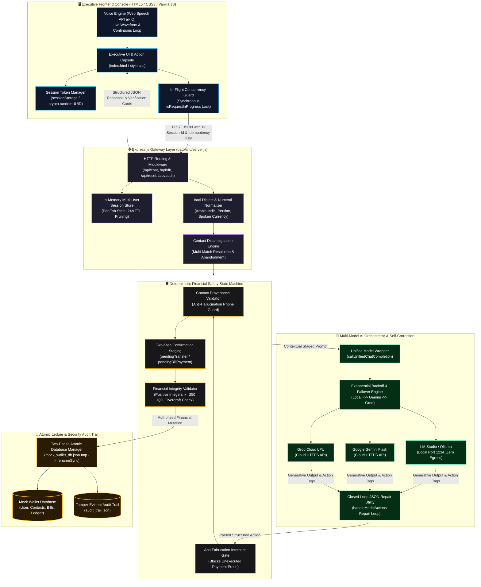

<div align="center">

# فاي • VI
### Autonomous Iraqi AI Financial Agent for Digital Wallets
**وكيل سداد الفواتير والتحويلات المالية الذكي باللهجة العراقية**

<p align="center">
  <strong>An enterprise-grade, autonomous financial agent engineered for Iraqi digital wallets. Features dynamic multi-model LLM failover, deterministic financial safety guardrails, closed-loop self-correction, per-tab session isolation, and resilient self-healing persistence.</strong>
</p>

[](https://nodejs.org/)
[](https://expressjs.com/)
[-10b981?style=for-the-badge&logo=node.js&logoColor=white)](#-automated-testing--quality-assurance)
[](#-multi-model-orchestration-engine)
[](#-failure-handling--self-healing-architecture)
[-f59e0b?style=for-the-badge)](#)
[](LICENSE)

</div>

---

## 📑 Table of Contents
- [🌟 Executive Summary & Vision](#-executive-summary--vision)
- [🎥 Interactive Demo Walkthrough](#-interactive-demo-walkthrough)
- [🏗️ System Architecture & Operational Data Flow](#️-system-architecture--operational-data-flow)
  - [Architectural Flowchart](#architectural-flowchart)
  - [Tier-by-Tier Architectural Breakdown](#tier-by-tier-architectural-breakdown)
  - [End-to-End Financial Transaction Lifecycle](#end-to-end-financial-transaction-lifecycle)
- [✨ In-Depth Core Features](#-in-depth-core-features)
  - [1. Strict Two-Step Confirmation State Machine](#1-strict-two-step-confirmation-state-machine)
  - [2. Colloquial Iraqi Dialect & Verbal Numeral NLP Engine](#2-colloquial-iraqi-dialect--verbal-numeral-nlp-engine)
  - [3. Smart Contact Disambiguation & Abandonment Engine](#3-smart-contact-disambiguation--abandonment-engine)
  - [4. Complete Utility & Telecom Bill Payment System](#4-complete-utility--telecom-bill-payment-system)
  - [5. Tamper-Evident Security Audit Logging Layer](#5-tamper-evident-security-audit-logging-layer)
  - [6. Financial Integrity, Validation & Anti-Tampering Guards](#6-financial-integrity-validation--anti-tampering-guards)
  - [7. Cryptographic Per-Tab Session Isolation](#7-cryptographic-per-tab-session-isolation)
  - [8. Executive Fintech UX System](#8-executive-fintech-ux-system)
- [🧠 Multi-Model Orchestration Engine](#-multi-model-orchestration-engine)
  - [Provider Comparison & Specification Matrix](#provider-comparison--specification-matrix)
  - [Automated Exponential Backoff & Failover Chain](#automated-exponential-backoff--failover-chain)
- [🛡️ Deterministic Security & Guardrail Specifications](#️-deterministic-security--guardrail-specifications)
- [🩺 Failure Handling & Self-Healing Architecture](#-failure-handling--self-healing-architecture)
  - [1. Upstream LLM Failures, Rate Limits & Outages](#1-upstream-llm-failures-rate-limits--outages)
  - [2. Generative Action Tag Parsing & Closed-Loop Repair](#2-generative-action-tag-parsing--closed-loop-repair)
  - [3. Database Ledger Corruption & Atomic Disk I/O](#3-database-ledger-corruption--atomic-disk-io)
  - [4. Multi-User & Multi-Tab State Isolation](#4-multi-user--multi-tab-state-isolation)
  - [5. Ambient Contact Ambiguity & Intent Abandonment](#5-ambient-contact-ambiguity--intent-abandonment)
  - [6. Frontend Network Faults & Continuous Speech Recovery](#6-frontend-network-faults--continuous-speech-recovery)
- [📡 API Specifications & Route Reference](#-api-specifications--route-reference)
- [📂 Project Directory Layout](#-project-directory-layout)
- [⚡ Quick Start & Installation Guide](#-quick-start--installation-guide)
  - [Step 1: System Prerequisites & Verification](#step-1-system-prerequisites--verification)
  - [Step 2: Clone the Repository](#step-2-clone-the-repository)
  - [Step 3: Install Dependencies](#step-3-install-dependencies)
  - [Step 4: Configure Environment Variables (.env)](#step-4-configure-environment-variables-env)
  - [Step 5: Setup AI Model Provider (Local vs. Cloud)](#step-5-setup-ai-model-provider-local-vs-cloud)
  - [Step 6: Launch Backend & Open Web Console](#step-6-launch-backend--open-web-console)
- [🧪 Automated Testing & Quality Assurance](#-automated-testing--quality-assurance)
- [💬 Colloquial Iraqi Dialect Showcase & Scenarios](#-colloquial-iraqi-dialect-showcase--scenarios)
- [🛠️ Comprehensive Troubleshooting & FAQs](#️-comprehensive-troubleshooting--faqs)
  - [Operational Troubleshooting](#operational-troubleshooting)
  - [Frequently Asked Questions (FAQ)](#frequently-asked-questions-faq)
- [🗺️ Future Roadmap](#️-future-roadmap)
- [📜 License](#-license)

---

## 🌟 Executive Summary & Vision

**فاي (VI)** is an enterprise-grade autonomous digital wallet assistant engineered specifically for colloquial Iraqi Arabic (*اللهجة العراقية*) and mission-critical financial workflows.

Deploying generative AI directly into banking or payment applications poses severe structural risks: **hallucinated balances**, **silent double debits**, **accidental funds transfers**, and **server downtime on upstream provider outages**. **فاي (VI)** solves these structural problems through a strict **Zero-Trust AI Architecture**:

1. **Deterministic Core Separation**: The language model never performs arithmetic, never computes wallet balances, and cannot directly mutate financial ledgers. All funds transfers, utility settlements, and account records are managed exclusively by an atomic, validated backend state machine.
2. **Multi-Model Dynamic Orchestration**: Seamless runtime switching between **100% Local On-Premise Inference** (via **LM Studio** / **Ollama**) with zero cloud data egress, **Google Gemini Flash** for deep dialectal reasoning, and **Groq Cloud** for sub-second LPU throughput.
3. **Automated Self-Healing Pipeline**: Upstream timeouts and HTTP 429 rate limits trigger exponential backoff and transparent provider failover; malformed JSON action tags undergo closed-loop AI self-correction; corrupted or missing ledger files automatically reconstruct from verified templates without server crashes.
4. **Per-Tab Cryptographic Session Isolation**: Every browser tab receives an isolated, cryptographically generated session token stored in `sessionStorage` and transmitted via `X-Session-Id`, eliminating state bleed across concurrent users or tabs.
5. **Native Iraqi Linguistic Comprehension**: Comprehensive parsing of real Iraqi financial colloquialisms (*"دزله 50 ألف"*, *"شكد رصيدي هسة"*, *"ادفع مال كهرباء"*, *"ولا واحد منهم"*, *"عوفه وبطلت"*), supporting Arabic-Indic digits, Persian numerals, and spelled-out verbal monetary expressions.

---

## 🎥 Interactive Demo Walkthrough

<div align="center">


<p align="center">
  <sub>🎬 <strong>فاي (VI) في العمل:</strong> استعراض عملي وتفاعلي لسداد الفواتير، التحويلات المالية، صمامات الأمان الحتمية، والتبديل اللحظي بين النماذج.</sub>
</p>

</div>

---

## 🏗️ System Architecture & Operational Data Flow

### Architectural Flowchart



### Tier-by-Tier Architectural Breakdown

#### 1. Executive Frontend Client Tier
* **Module**: [frontend/script.js](file:///c:/Users/moham/Desktop/VI/frontend/script.js), [frontend/index.html](file:///c:/Users/moham/Desktop/VI/frontend/index.html), [frontend/style.css](file:///c:/Users/moham/Desktop/VI/frontend/style.css)
* **Cryptographic Tab Session Isolation**: On application load, `getOrCreateSessionId()` checks `sessionStorage` for an existing token. If none exists, it generates a cryptographically random UUID using `crypto.randomUUID()` (with a timestamp-random mathematical fallback). This token is transmitted in every HTTP request as the `X-Session-Id` header and body payload.
* **Synchronous In-Flight Concurrency Guard**: When a message submission is triggered (via text input, voice transcription, or quick suggestion chip), `handleFormSubmit()` immediately and synchronously asserts `if (isRequestInProgress) return;`. It locks the interface (`isRequestInProgress = true`), disables the input textarea, send button, microphone button, and suggestion chips via `setInputState(false)`, and attaches ARIA disabled attributes. Cleanup occurs inside an unconditional `finally` block.
* **Continuous Voice Engine**: Implements the Web Speech API configured for Iraqi Arabic (`ar-IQ`). An integrated HTML5 canvas visualizer maps live volume oscillation waveforms. An `onend` auto-recovery listener automatically calls `recognition.start()` when short speech pauses occur, ensuring fluid dictation without premature microphone termination.

#### 2. Express.js Gateway & Normalization Tier
* **Module**: [backend/server.js](file:///c:/Users/moham/Desktop/VI/backend/server.js)
* **In-Memory Multi-User Session Store**: In-memory `Map` keyed by `sessionId`. Each session maintains an independent conversation history (trimmed to the last 12 messages with system prompt retention), active contact disambiguation contexts, pending transfers, pending bill payments, and rate metrics. Inactive sessions are automatically evicted after 24 hours (`SESSION_TTL_MS = 86,400,000`).
* **Dialectal & Verbal Numeral NLP Normalizer**: Converts Eastern Arabic-Indic digits (`٠, ١, ٢, ٣, ٤, ٥, ٦, ٧, ٨, ٩`) and Persian digits (`۰, ۱, ۲, ۳, ۴, ۵, ۶, ۷, ۸, ۹`) to standard ASCII numbers. Spoken Iraqi expressions for currency are parsed deterministically:
  * *"مليونين ونص"* $\rightarrow$ `2,500,000 IQD`
  * *"ميتين وخمسين ألف"* $\rightarrow$ `250,000 IQD`
  * *"خمسين ألف"* $\rightarrow$ `50,000 IQD`
  * *"ورقة"* $\rightarrow$ `150,000 IQD` (colloquial $100 reference)

#### 3. Deterministic Safety & Guardrail Tier
* **Module**: [backend/server.js](file:///c:/Users/moham/Desktop/VI/backend/server.js#L268-L450)
* **Contact Provenance Verification**: When `ADD_CONTACT` is requested, `isContactProvenanceValid()` verifies that the digits of the target phone number exist verbatim in the incoming user message or verified previous turn candidates. Fabricated or hallucinated phone numbers generated by the LLM are blocked immediately.
* **Two-Step Confirmation Machine**: Financial mutations are never executed on initial turn prompts. The transaction parameters are staged in `session.pendingTransfer` or `session.pendingBillPayment`. Execution is locked until an explicit affirmative utterance (`"نعم"`, `"أكد"`, `"تمام"`, `"توكل"`) is received.
* **Anti-Fabrication Prose Interceptor**: If an LLM generates conversational text asserting *"تم التحويل بنجاح"* without emitting the corresponding authorized `<<<DB_ACTION>>>` tag, the gateway intercepts the text and appends an explicit security disclaimer informing the user that no balance was deducted.

#### 4. Multi-Model AI Orchestrator Tier
* **Module**: [backend/server.js](file:///c:/Users/moham/Desktop/VI/backend/server.js#L123-L198)
* **Centralized Completion Wrapper**: [callUnifiedChatCompletion](file:///c:/Users/moham/Desktop/VI/backend/server.js#L123) normalizes OpenAI-compatible payloads across LM Studio, Google Gemini Flash, and Groq Cloud.
* **Closed-Loop JSON Self-Correction**: When an LLM produces malformed or unclosed JSON in action tags, the parser catches the syntax error and initiates an immediate repair sub-request ($T = 0.1$, `max_tokens: 300`) containing the raw snippet, error offset, and strict JSON schema rules.

#### 5. Deterministic Storage & Audit Trail Tier
* **Module**: [backend/mock_wallet_db.json](file:///c:/Users/moham/Desktop/VI/backend/mock_wallet_db.json), [backend/audit_trail.json](file:///c:/Users/moham/Desktop/VI/backend/audit_trail.json), [backend/reset_db.js](file:///c:/Users/moham/Desktop/VI/backend/reset_db.js)
* **Two-Phase Atomic Disk I/O**: State updates write to a temporary file (`mock_wallet_db.json.tmp`) and then call atomic `fs.renameSync()`. If a Windows file indexing lock (`EPERM` / `EBUSY`) occurs, the engine automatically catches the error and executes `fs.copyFileSync()` followed by `fs.unlinkSync()`.
* **Tamper-Evident Audit Logging**: Every executed or blocked financial operation is appended to `audit_trail.json` with an immutable UUID, UTC timestamp, session ID, action type, source account, destination, amount, and idempotency key.

---

### End-to-End Financial Transaction Lifecycle

```
[User Utterance: "دز 50 ألف لأحمد"] 
       │
       ▼
[Client: Attach X-Session-Id & X-Idempotency-Key] ──► [Lock UI Controls]
       │
       ▼
[Gateway: Map to Per-Tab Session State]
       │
       ▼
[Dialect Normalizer: 50 ألف ──► 50,000 IQD]
       │
       ▼
[Disambiguation Engine: Multiple Contacts Named 'أحمد' Detected]
       │
       ▼
[Response to User: Interactive Selection (1. أحمد كمال / 2. أحمد جاسم)]
       │
       ▼
[User Input: "أحمد كمال"] ──► [Staging: pendingTransfer staged in Session]
       │
       ▼
[Response to User: Interactive Verification Card Rendered]
       │
       ▼
[User Consent: "نعم توكل"] 
       │
       ▼
[Safety Gate: Verify Idempotency, Provenance, & Strict Balance >= 50,000 IQD]
       │
       ▼
[Atomic Mutation: Deduct User Balance & Credit Contact in mock_wallet_db.json]
       │
       ▼
[Audit Logging: Append Immutable Audit Record to audit_trail.json]
       │
       ▼
[Client: Unlock UI, Play Confirmation Sound, Sync Balance Pill & Drawer]
```

---

## ✨ In-Depth Core Features

### 1. Strict Two-Step Confirmation State Machine
* **Zero Accidental Deductions**: The AI agent cannot trigger any financial mutation directly from an initial request.
* **Interactive Verification Cards**: Renders an interactive verification card displaying recipient name, verified phone number, fee breakdown, deduction amount, and remaining balance.
* **Explicit User Consent**: Requires explicit affirmative confirmation (`"نعم"`, `"أكد"`, `"تمام"`, `"توكل"`) before committing changes to disk.
* **Instant Cancellation & Rollback**: Immediate clean state rollback upon negative inputs (`"إلغاء"`, `"لا"`, `"بطلت"`, `"cancel"`).

### 2. Colloquial Iraqi Dialect & Verbal Numeral NLP Engine
* **Native Iraqi Vocabulary**: Comprehends colloquial terms such as *"دزله"*, *"حول"*, *"سدد"*, *"شكد رصيدي"*, *"ما عندي"*, *"عوف الموضوع"*, *"توكل"*.
* **Numeral Normalization**: Automatically normalizes Eastern Arabic-Indic digits (`٠١٢٣٤٥٦٧٨٩`) and Persian digits (`۰۱۲۳۴۵۶۷۸۹`) to ASCII integers.
* **Spoken Monetary Phrasing**: Robust regex rules translate complex spoken verbal monetary amounts into integer IQD values.
* **Carrier Validation**: Strictly enforces valid Iraqi mobile carrier formats (Zain 078, Asiacell 077, Korek 075).

### 3. Smart Contact Disambiguation & Abandonment Engine
* When transferring to a common name (e.g., *"أحمد"*):
  * The engine detects all matches in the verified address book.
  * Presents numbered options with aliases and masked phone numbers.
  * The user can select the target by index (`1`, `2`), alias (*"صديق الجامعة"*), or phone digits.
  * If the user abandons the intent (*"عوفه وبطلت"*, *"مو ذولي"*), `isDisambiguationAbandonment()` purges all pending states immediately.

### 4. Complete Utility & Telecom Bill Payment System
* **Pre-Integrated Biller Categories**: National Electricity Grid (*الكهرباء الوطنية*), Municipal Water (*الماء والخدمات البلدية*), Mobile Telecommunications (*فواتير خط الهاتف والاتصالات*), and Fiber/4G Internet (*فواتير الإنترنت والألياف الضوئية*).
* **Single or Bulk Settlement**: Query pending unpaid bills, pay an individual service (*"ادفع فاتورة الإنترنت"*), or settle all outstanding bills in one atomic transaction (*"ادفع كل الفواتير اللي عليه"*).

### 5. Tamper-Evident Security Audit Logging Layer
* Every financial operation (successful or blocked) is appended atomically to [backend/audit_trail.json](file:///c:/Users/moham/Desktop/VI/backend/audit_trail.json).
* Each record captures: `id`, `timestamp` (ISO 8601), `sessionId`, `actionType`, `sourceAccount`, `destination`, `amount`, `currency`, `idempotencyKey`, and `executionStatus` (`SUCCESS` / `BLOCKED`).

### 6. Financial Integrity, Validation & Anti-Tampering Guards
* **Strict Integer Validation**: Rejects non-numeric, negative, zero, and fractional decimal transfer values.
* **Minimum Threshold**: Enforces a minimum transaction limit of $250\text{ IQD}$.
* **Overdraft Prevention**: Blocks transfers or bill payments exceeding the available balance before disk I/O.
* **Idempotency Replay Protection**: Cached transaction receipts indexed by idempotency tokens guarantee that replayed network requests return the original receipt without double debiting.

### 7. Cryptographic Per-Tab Session Isolation
* Distinct browser tabs maintain separate conversation contexts, pending transfers, and disambiguation states via per-tab UUID tokens in `sessionStorage` and `X-Session-Id` headers.

### 8. Executive Fintech UX System
* **Dual Luxury Color Palettes**:
  * **🌙 Luxury Emerald (Dark Theme)**: Obsidian `#04070b`, Deep Forest `#0c171e`, Neon Emerald `#4ade80`, Gold `#ffc83b`.
  * **☀️ Royal Violet (Light Theme)**: Titanium White, Slate Mist `#f8fafc`, Royal Violet `#7c3aed`, Emerald Green `#10b981`.
* **Privacy Balance Masking (`*** IQD 👁`)**: Real-time shoulder-surfing protection in the header with one-click toggle and local storage persistence.
* **Sliding Transactions Drawer**: Fast slide-out ledger drawer with category filters (`كل العمليات`, `تحويلات`, `فواتير`).
* **Mathematical Halftone Particle Wave**: Interactive HTML5 canvas rendering dynamic particle grids that morph and react across viewports and themes without distorting on zoom.

---

## 🧠 Multi-Model Orchestration Engine

**فاي (VI)** incorporates dynamic multi-provider routing through a centralized completion wrapper ([callUnifiedChatCompletion](file:///c:/Users/moham/Desktop/VI/backend/server.js#L123)):

### Provider Comparison & Specification Matrix

| Feature / Metric | LM Studio *(Recommended Default)* | Google Gemini Flash | Groq Cloud |
| :--- | :--- | :--- | :--- |
| **Execution Mode** | **100% Local / On-Premise** | Cloud HTTPS API | Cloud HTTPS API (LPU) |
| **Data Privacy** | **Zero Data Egress** (Local Hardware) | Encrypted Transit | Encrypted Transit |
| **Recommended Model** | `Qwen2.5-7B-Instruct` / `Llama-3.1-8B` | `gemini-1.5-flash` | `llama-3.3-70b-versatile` |
| **Quantization** | `Q4_K_M` or `Q5_K_M` GGUF | Cloud Full Precision | Cloud Full Precision |
| **Inference Latency** | ~20–40 ms/token (Hardware dependent) | ~300–800 ms TTFT | **< 150 ms TTFT (Ultra-Fast)** |
| **API Key Required** | ❌ **None** (`lm-studio`) | ✅ `GEMINI_API_KEY` | ✅ `GROQ_API_KEY` |
| **Cost** | **$0.00 (Completely Free & Offline)** | Free Tier / Pay-as-you-go | Free Tier / Pay-as-you-go |

### Automated Exponential Backoff & Failover Chain

If an active model experiences network connection drops, timeouts, or HTTP 429 rate limits, the system shifts automatically through a deterministic failover chain without dropping user session state:

```javascript
const FAILOVER_CHAIN = {
    local: ['gemini', 'groq'],
    gemini: ['groq', 'local'],
    groq: ['gemini', 'local']
};
```

1. **Retry Logic**: `callProviderWithBackoff()` initiates a 3-attempt exponential backoff sequence (500ms $\rightarrow$ 1000ms $\rightarrow$ 2000ms).
2. **Transparent Failover**: If retries are exhausted on the active model, `callUnifiedChatCompletion()` automatically redirects the request down `FAILOVER_CHAIN`.
3. **Graceful Fallback**: If all configured options fail, the gateway returns an informative diagnostic message in colloquial Iraqi Arabic with clear instructions on starting LM Studio or verifying API keys.

---

## 🛡️ Deterministic Security & Guardrail Specifications

| Guardrail Layer | Implementation Function | Enforcement Rule | Security Guarantee |
| :--- | :--- | :--- | :--- |
| **Anti-Hallucination Gate** | `readDatabase()` | Balances and bills are read strictly from disk; LLM never computes arithmetic. | Impossible for the model to guess or hallucinate wallet balances. |
| **Contact Provenance** | `isContactProvenanceValid()` | Phone digits must exist verbatim in the user's input buffer or verified history. | Prevents LLM from inventing fake contact phone numbers. |
| **Two-Step Consent Lock** | `isUserConfirmation()` | Operations are staged in memory; execution requires explicit secondary verbal consent. | Zero accidental balance deductions or unauthenticated transfers. |
| **Strict Integer Validator** | `executeTransferMutation()` | Transfer amounts must be integers $\ge 250\text{ IQD}$; fractions and negative values rejected. | Eliminates fractional rounding bugs and negative balance exploits. |
| **Overdraft Protection** | `executeTransferMutation()` | Amount is verified against available balance before atomic disk write. | Prevents account balance from dropping below zero. |
| **Idempotency Guard** | `executeTransferMutation()` | Unique request keys return cached receipts for identical payloads. | Prevents duplicate debit transactions on network retries. |
| **Anti-Fabrication Intercept** | `server.js` Response Gate | Verbal claims of payment without verified `<<<DB_ACTION>>>` tags are intercepted. | Guarantees user is alerted if an LLM claims payment without executing it. |
| **Security Audit Trail** | `appendAuditLog()` | Every financial operation is appended atomically to `audit_trail.json`. | Creates an immutable, tamper-evident record for security audits. |

---

## 🩺 Failure Handling & Self-Healing Architecture

### 1. Upstream LLM Failures, Rate Limits & Outages
- **Trigger**: Upstream engine returns HTTP 429 (rate limit/quota exhaustion), HTTP 500–504, `ECONNREFUSED`, `ETIMEDOUT`, or `ECONNRESET`.
- **Self-Healing Process**:
  1. `isRetryableError()` detects transient connection errors or quota exhaustion.
  2. `callProviderWithBackoff()` initiates a 3-attempt exponential backoff sequence (500ms $\rightarrow$ 1000ms $\rightarrow$ 2000ms).
  3. If retries are exhausted on the active model, `callUnifiedChatCompletion()` automatically redirects the request down the `FAILOVER_CHAIN`.
  4. Missing cloud API keys are cleanly bypassed without runtime exceptions.
  5. If all providers are unavailable, the gateway returns a user-friendly diagnostic message in colloquial Iraqi Arabic with setup guidance.
- **Outcome**: **Graceful Degradation** — The backend process does not crash, HTTP 500 errors are prevented, and conversation context remains intact.

### 2. Generative Action Tag Parsing & Closed-Loop Repair
- **Trigger**: The LLM outputs malformed, unclosed, or invalid JSON syntax within structured action tags (`<<<DB_ACTION>>>`).
- **Self-Healing Process**:
  1. Primary `JSON.parse()` fails and triggers the closed-loop recovery handler in `handleModelActions`.
  2. The gateway constructs a targeted repair prompt containing the raw syntax snippet, the exact parser error, and strict JSON schema rules.
  3. The repair request is dispatched to the model with deterministic sampling ($T = 0.1$, `max_tokens: 300`).
  4. Markdown code fences are stripped from the repaired response, and the clean payload is re-parsed.
  5. If self-correction fails, the mutation is **aborted cleanly**.
- **Outcome**: **Self-Healing with Fail-Safe Abort** — The database is protected from partial mutations, zero funds are deducted, and the user receives a clean retry prompt.

### 3. Database Ledger Corruption & Atomic Disk I/O
- **Trigger**: `mock_wallet_db.json` is missing, deleted, empty (0 bytes), or corrupted with invalid JSON/schema; or a Windows indexer/antivirus locks the file (`EPERM` / `EBUSY`).
- **Self-Healing Process**:
  1. **Read Self-Healing**: `readDatabase()` verifies file existence, non-zero size, and schema validity. If corrupted, it logs a warning, clones `INITIAL_DB` from `reset_db.js`, writes it to disk, and continues execution.
  2. **Two-Phase Atomic Write**: `saveDatabase()` writes to `mock_wallet_db.json.tmp` first, then executes atomic `fs.renameSync()`.
  3. **Windows Lock Recovery**: If `renameSync()` encounters `EPERM` or `EBUSY`, it falls back to `copyFileSync()` and unlinks the temporary file.
  4. **Orphan Cleanup**: Temporary files are unlinked in `catch` blocks if writes fail.
  5. **Fail-Safe Audit Logging**: Failures during audit trail logging emit a warning without aborting verified database transactions.
- **Outcome**: **Self-Healing & Tamper-Proof** — The server boots and operates even if database files are deleted from the disk mid-flight.

### 4. Multi-User & Multi-Tab State Isolation
- **Trigger**: Multiple users access the console simultaneously, or a single user opens multiple browser tabs.
- **Self-Healing Process**:
  1. The client initializes a unique session token using `sessionStorage` and `crypto.randomUUID()` (with timestamp-random fallback).
  2. The session token is transmitted in every HTTP request via the `X-Session-Id` header and JSON body.
  3. The backend maps requests to distinct memory instances in `sessions = new Map()`.
  4. Pending transfers, disambiguation options, and bill settlements in Tab A do not leak into Tab B.
  5. Inactive sessions are automatically pruned from memory after 24 hours (`SESSION_TTL_MS`).
- **Outcome**: **Strict State Encapsulation** — Multiple tabs operate independently without cross-contamination.

### 5. Ambient Contact Ambiguity & Intent Abandonment
- **Trigger**: The user requests a transfer to a non-unique name (*"حول لأحمد"*), provides missing parameters, or abandons the operation (*"ما أعرفه"*, *"مو ذولي"*, *"عوفه وبطلت"*).
- **Self-Healing Process**:
  1. `findAmbiguousContacts()` detects multiple name matches and halts execution without balance deduction.
  2. The system responds with an interactive numbered disambiguation list.
  3. If the user replies with colloquial abandonment phrases, `isDisambiguationAbandonment()` immediately purges `pendingDisambiguation`, `pendingTransfer`, and `pendingTransferRecipient`.
  4. If the user cancels (*"إلغاء"*), all pending operations are wiped cleanly.
- **Outcome**: **Graceful Degradation** — Stale transactions never linger in memory; accidental transfers to wrong recipients are prevented.

### 6. Frontend Network Faults & Continuous Speech Recovery
- **Trigger**: Local backend takes longer than 30 seconds to respond, network connection drops, or Web Speech API pauses during vocal pauses.
- **Self-Healing Process**:
  1. **Client-Side Timeout**: `sendMessageToBackend()` wraps the request in an `AbortController` set to 30,000 ms. If exceeded, the request aborts gracefully.
  2. **Unconditional UI Unlocking**: The submission cycle runs inside a `try...catch...finally` block. The `finally` clause unconditionally sets `isRequestInProgress = false`, calls `setInputState(true)`, and hides the typing indicator.
  3. **Duplicate Prevention**: Synchronous guard flags reject rapid-fire clicks on the send button, Enter key, or prompt chips while an existing request is in-flight.
  4. **Continuous Speech Recognition**: If speech pauses trigger recognition `onend`, the handler automatically re-initializes `recognition.start()` unless explicitly stopped by the user.
- **Outcome**: **Self-Healing Interface** — The UI never locks permanently, and speech recording handles natural vocal pauses without premature termination.

---

## 📡 API Specifications & Route Reference

### 1. `POST /api/chat`
* **Description**: Primary conversational reasoning and action execution endpoint.
* **Headers**: `Content-Type: application/json`, `X-Session-Id: string`, `X-Idempotency-Key: string`
* **Request Body**:
  ```json
  {
    "message": "حول 50 ألف لأحمد كمال",
    "provider": "local",
    "sessionId": "sess_9b1deb4d-3b7d-4bad-9bdd-2b0d7b3dcb6d",
    "idempotency_key": "req_1729198200000_abc123"
  }
  ```
* **Response Body (200 OK)**:
  ```json
  {
    "text": "تمام، راح أحول 50,000 د.ع لأحمد كمال. متأكد من التحويل؟",
    "status": "CONFIRMATION_REQUIRED",
    "openDrawer": false
  }
  ```

### 2. `GET /api/db`
* **Description**: Returns the active wallet state (user profile, balance, contacts, utility bills, and recent ledger).
* **Response Body (200 OK)**:
  ```json
  {
    "user": {
      "id": "usr_1001",
      "name": "محمد",
      "phone": "+9647801234567",
      "balance": 2200000,
      "currency": "IQD"
    },
    "contacts": [ ... ],
    "bills": [ ... ],
    "transactions": [ ... ]
  }
  ```

### 3. `GET /api/transactions`
* **Description**: Returns the verified transaction ledger history with totals and metrics.
* **Response Body (200 OK)**:
  ```json
  {
    "transactions": [
      {
        "id": "trx_1729198200000",
        "type": "TRANSFER",
        "recipient": "أحمد كمال",
        "amount": 50000,
        "currency": "IQD",
        "status": "SUCCESS",
        "date": "2026-10-17"
      }
    ],
    "totalCount": 1
  }
  ```

### 4. `POST /api/reset`
* **Description**: Resets conversation state for the calling session and restores wallet database to defaults.
* **Headers**: `X-Session-Id: string`
* **Response Body (200 OK)**:
  ```json
  {
    "success": true,
    "message": "Database and session state successfully reset to initial default values."
  }
  ```

### 5. `GET /api/audit`
* **Description**: Retrieves the immutable security audit trail entries.
* **Response Body (200 OK)**:
  ```json
  {
    "success": true,
    "count": 1,
    "logs": [
      {
        "id": "audit_1729198200000_xyz789",
        "timestamp": "2026-10-17T21:00:00.000Z",
        "sessionId": "sess_9b1deb4d-3b7d-4bad-9bdd-2b0d7b3dcb6d",
        "actionType": "TRANSFER",
        "sourceAccount": "usr_1001",
        "destination": "+9647801122334",
        "amount": 50000,
        "currency": "IQD",
        "idempotencyKey": "req_1729198200000_abc123",
        "executionStatus": "SUCCESS"
      }
    ]
  }
  ```

---

## 📂 Project Directory Layout

```text
VI/
├── 📁 assets/
│   ├── 🎬 demo_walkthrough.gif        # Animated interactive demonstration
│   ├── 🖼️ logo-emerald.png            # Luxury Emerald brand logo (Dark Theme)
│   ├── 🖼️ logo-violet.png             # Royal Violet brand logo (Light Theme)
│   ├── 🖼️ bot-emerald.png             # Assistant avatar for Dark Theme
│   └── 🖼️ bot-violet.png              # Assistant avatar for Light Theme
│
├── 📁 backend/
│   ├── 📄 server.js                   # Express core, multi-model router, NLP parser, safety gates, audit logger
│   ├── 📄 reset_db.js                 # Standalone database and conversation state reset utility
│   ├── 📄 mock_wallet_db.json         # Primary JSON wallet database (User, Contacts, Bills, Ledger)
│   ├── 📄 audit_trail.json            # Immutable security audit trail of financial mutations
│   ├── 📄 feedback_likes.json         # User satisfaction feedback (Likes)
│   ├── 📄 feedback_dislikes.json      # User satisfaction feedback (Dislikes)
│   └── 📁 tests/
│       └── 📄 regression_suite.test.js # Comprehensive 99-test automated regression and security suite
│
├── 📁 frontend/
│   ├── 📄 index.html                  # Semantic HTML5 executive layout (Header, Hero Dock, Interaction Capsule)
│   ├── 📄 style.css                   # Glassmorphism design system, dual themes, halftone particle canvas
│   └── 📄 script.js                   # Client controller, per-tab session manager, speech recognition, visualizer
│
├── 📄 .env                            # Environment variables & API credentials (Git-ignored)
├── 📄 .env.example                    # Safe configuration template
├── 📄 .gitignore                      # Git exclusion rules
├── 📄 wallet_db_schema.json           # Formal JSON Schema defining wallet data models
├── 📄 package.json                    # Project dependencies and test runner scripts
├── 📄 package-lock.json               # Locked dependency tree
├── 📄 LICENSE                         # MIT Open Source License
└── 📄 README.md                       # Comprehensive documentation
```

---

## ⚡ Quick Start & Installation Guide

Follow these steps to launch **فاي (VI)** locally:

### Step 1: System Prerequisites & Verification

Ensure Node.js and Git are installed:

| Prerequisite | Minimum Version | Recommended | Verification Command |
| :--- | :--- | :--- | :--- |
| **Node.js** | `v18.0.0` | `v20.x LTS` or higher | `node -v` |
| **npm** | `v9.0.0` | `v10.x` or higher | `npm -v` |
| **Git** | `v2.30+` | Latest stable | `git --version` |
| **Browser** | Chromium-based | Chrome / Edge / Brave | Required for Web Speech API (`ar-IQ`) |

```bash
node -v
npm -v
git --version
```

### Step 2: Clone the Repository

```bash
git clone https://github.com/double-u9/VI.git
cd VI
```

### Step 3: Install Dependencies

```bash
npm install
```

### Step 4: Configure Environment Variables (.env)

Create your local `.env` configuration file from the template:

**PowerShell (Windows):**
```powershell
Copy-Item .env.example .env
```

**Bash (Linux / macOS) or Command Prompt:**
```bash
cp .env.example .env
```

Open `.env` and verify settings:

```env
# 1. Local LM Studio (Default port is 1234)
LM_STUDIO_URL=http://127.0.0.1:1234/v1
LOCAL_API_KEY=lm-studio

# 2. Google Gemini Flash (Optional Cloud Provider)
GEMINI_API_KEY=your_gemini_api_key_here

# 3. Groq Cloud (Optional Cloud Provider)
GROQ_API_KEY=your_groq_api_key_here

# 4. Web Server Port (Defaults to 3000)
PORT=3000
```

> [!NOTE]
> If you are running **LM Studio locally**, you do **not need any cloud API keys**! You can leave `GEMINI_API_KEY` and `GROQ_API_KEY` blank.

### Step 5: Setup AI Model Provider (Local vs. Cloud)

#### Option A: Local Model with LM Studio (Recommended)
1. Download and install **[LM Studio](https://lmstudio.ai/)**.
2. Search for and download **`Qwen2.5-7B-Instruct`** (Recommended) or **`Meta-Llama-3.1-8B-Instruct`** (`Q4_K_M` quantization).
3. In LM Studio, navigate to the **Developer / Local Server (`<->`)** tab.
4. Select the model from the top bar, ensure port is set to **`1234`**, and click **Start Server**.

#### Option B: Cloud AI Engines (Instant Setup)
- **Google Gemini**: Obtain an API key from **[Google AI Studio](https://aistudio.google.com/)** and set `GEMINI_API_KEY`.
- **Groq Cloud**: Obtain an API key from **[Groq Console](https://console.groq.com/)** and set `GROQ_API_KEY`.

### Step 6: Launch Backend & Open Web Console

```bash
npm start
```

Open your browser and navigate to:  
👉 **`http://localhost:3000`**

---

## 🧪 Automated Testing & Quality Assurance

The repository includes a comprehensive automated test suite built with Node.js's native test runner (`node:test` and `node:assert/strict`).

Run the complete test suite:

```bash
npm test
```

### Test Coverage Summary: 99 Tests Across 25 Suites (100% Pass Rate)

| Task Suite | Tested Capabilities | Suite Count | Test Count | Status |
| :--- | :--- | :---: | :---: | :---: |
| **Task 1: Phone Numbers, Accounts & Dialect Normalization** | Valid 078 formats, invalid lengths, unsupported carriers (075/077), account & card formats (10-16 digits), Arabic-Indic digit normalization (`٠-٩`), Persian digit normalization (`۰-۹`), monetary phrasing (*مليونين ونص*, *ميتين وخمسين الف*), transfer limits, and `/api/chat` E2E workflow. | 12 Suites | 60 Tests | ✅ **Passed** |
| **Task 2: Bill Payments, Disambiguation & Contact Creation** | Utility bill settlement (single, bulk, overdraft, paid status), contact disambiguation and abandonment handling (*عوفه وبطلت*), multi-message contact creation, and phone provenance validation. | 3 Suites | 18 Tests | ✅ **Passed** |
| **Task 3: History Trimming & Concurrency Protection** | Conversation history trimming without state loss, frontend in-flight submission guard, and backend idempotency protection. | 2 Suites | 6 Tests | ✅ **Passed** |
| **Task 4: Security Audit Logging & Financial Integrity** | Multi-user session isolation across distinct `sessionId` tokens, double-spend prevention via idempotency keys, financial validation (negative, zero, fractional, below 250 IQD amounts), and audit trail immutability with atomic disk I/O. | 4 Suites | 15 Tests | ✅ **Passed** |
| **Total Test Suite** | **Comprehensive End-to-End System & Security Verification** | **25 Suites** | **99 Tests** | **✅ 100% Pass** |

---

## 💬 Colloquial Iraqi Dialect Showcase & Scenarios

| Category | Example Iraqi Phrase | System Execution & Response |
| :--- | :--- | :--- |
| **Balance Inquiry** | *"شكد رصيدي هسة؟"* | Reads deterministic balance directly from disk; reminds user of outstanding bills. |
| **Direct Transfer** | *"حول 50 ألف لحسين"* | Resolves contact, checks balance, stages transfer, and presents confirmation card. |
| **Contact Disambiguation** | *"دز 100 ألف لأحمد"* | Detects multiple contacts named *أحمد*, lists options with aliases, and awaits selection (`1`, `2`, or alias). |
| **Intent Abandonment** | *"ما أعرفه، عوف الموضوع"* | Identifies abandonment intent via `isDisambiguationAbandonment()`, purges pending states, and confirms cancellation. |
| **Two-Step Confirmation** | *"نعم توكل"* / *"أكد التحويل"* | Confirms consent via `isUserConfirmation()`, deducts balance, and logs receipt. |
| **Explicit Cancellation** | *"بطلت، الغي العملية"* | Cancels transaction via `isUserCancellation()`; guarantees zero balance deduction. |
| **Single Bill Payment** | *"ادفع فاتورة الإنترنت"* | Identifies unpaid Fiber/4G bill, stages payment confirmation, and settles on approval. |
| **Bulk Bill Payment** | *"سدد كل الفواتير اللي عليه"* | Aggregates all unpaid utilities, validates combined sum against balance, and executes atomically. |
| **Contact Registration** | *"احفظ رقم 07804455667 باسم علي"* | Validates phone provenance against user input, adds contact to disk, and confirms. |

---

## 🛠️ Comprehensive Troubleshooting & FAQs

### Operational Troubleshooting

### 1. 🛑 Windows PowerShell Script Execution Blocked (`PSSecurityException`)
* **Symptom**: Running `npm` or `node` scripts fails with:
  ```text
  File C:\...\npm.ps1 cannot be loaded because running scripts is disabled on this system.
  ```
* **Cause**: Windows PowerShell restricts execution of unsigned `.ps1` script wrappers by default.
* **Fix**: Run this one-time command in PowerShell (does **not** require Administrator privileges):
  ```powershell
  Set-ExecutionPolicy -ExecutionPolicy RemoteSigned -Scope CurrentUser
  ```

---

### 2. 🛑 Command Not Recognized: `'node'` or `'npm'` is not recognized
* **Symptom**: PowerShell outputs `The term 'node' is not recognized as the name of a cmdlet, function, script file...`
* **Cause**: Node.js was recently installed, but your open PowerShell session hasn't refreshed its environment PATH.
* **Fix**: Refresh your PATH environment variable without closing your terminal:
  ```powershell
  $env:Path = [System.Environment]::GetEnvironmentVariable("Path","Machine") + ";" + [System.Environment]::GetEnvironmentVariable("Path","User")
  ```
  *(Or close all PowerShell windows and open a fresh terminal).*

---

### 3. 🛑 LM Studio Connection Error (`ECONNREFUSED 127.0.0.1:1234`)
* **Symptom**: Chat displays a connection failure message: *"عذراً، فشل الاتصال بخادم الذكاء الاصطناعي المحلي..."*
* **Fix Steps**:
  1. Open LM Studio and navigate to the **Local Server (`<->`)** tab.
  2. Verify that a model is selected in the top bar.
  3. Ensure the green **Start Server** button has been pressed (it should say **Stop Server** while active).
  4. Ensure the port is set to **`1234`**. If you configured a different port (e.g., `8080`), update `LM_STUDIO_URL` in your `.env` to match.
  5. **Instant Fallback**: If you do not wish to run LM Studio, click the model dropdown in the header of the web app and select **Google Gemini** or **Groq Cloud**!

---

### 4. 🛑 Port 3000 Already in Use (`EADDRINUSE: address already in use :::3000`)
* **Symptom**: Starting the server results in `Error: listen EADDRINUSE: address already in use :::3000`.
* **Cause**: A previous instance of `server.js` or another local application is already bound to port 3000.
* **Fix Option A (Change Port)**: Edit `.env` and change `PORT=3000` to `PORT=3001`. Then start with `npm start` and visit `http://localhost:3001`.
* **Fix Option B (Kill Existing Process on Port 3000)**:
  - In **PowerShell**:
    ```powershell
    Get-Process -Id (Get-NetTCPConnection -LocalPort 3000).OwningProcess | Stop-Process -Force
    ```
  - In **Command Prompt (CMD)**:
    ```cmd
    netstat -ano | findstr :3000
    taskkill /PID <PID_NUMBER> /F
    ```

---

### 5. 🛑 Microphone / Speech-to-Text Not Responding
* **Symptom**: Clicking the microphone icon fails to transcribe speech or reports a permission error.
* **Cause**: Browser microphone permissions are blocked, or browser lacks Web Speech API support.
* **Fix Steps**:
  1. Use a Chromium-based browser (Google Chrome, Microsoft Edge, or Brave).
  2. In your address bar, click the **Settings / Lock icon** next to `http://localhost:3000`.
  3. Ensure **Microphone** is toggled to **Allow**.
  4. Ensure your machine has an active default microphone device set under Windows Sound Settings.

---

### 6. 🛑 Cloud API Key Errors (401 Unauthorized / 429 Rate Limit)
* **Symptom**: Gemini or Groq returns an authentication or quota failure message.
* **Fix Steps**:
  1. Open `.env` and ensure there are no surrounding quotes, spaces, or line breaks around your key. Example:
     ```env
     GEMINI_API_KEY=AIzaSyBFAu...
     GROQ_API_KEY=gsk_KzXal...
     ```
  2. **Important**: Whenever you edit `.env`, you **must restart the server** (`Ctrl + C` in your terminal, then run `npm start`). Environment variables are only read when Node initializes.

---

### 7. 🛑 Resetting the Wallet Database to Default
* **Question**: How do I reset balances, paid bills, and contacts back to the pristine initial state?
* **Option A (Terminal - Works even if server is stopped)**:
  ```bash
  npm run reset-db
  ```
* **Option B (One-Click UI - When server is running)**:
  Click the **"Reset DB"** button in the top navigation bar at `http://localhost:3000`.
* **Option C (HTTP API - When server is running)**:
  - In **Windows PowerShell**:
    ```powershell
    Invoke-RestMethod -Method Post http://localhost:3000/api/reset
    ```
  - In **Bash / Linux / macOS / CMD**:
    ```bash
    curl -X POST http://localhost:3000/api/reset
    ```
  All options immediately rewrite `mock_wallet_db.json` with fresh initial balances (`2,200,000 IQD`) and reset all utility bills to `unpaid`.

---

### Frequently Asked Questions (FAQ)

#### Q1: Can I run this system completely offline without an internet connection?
**Yes.** When running with LM Studio or Ollama on `http://127.0.0.1:1234/v1`, 100% of reasoning occurs locally on your machine. Zero prompts, balances, or data egress to the cloud.

#### Q2: How does the system prevent the AI from hallucinating account balances?
The LLM prompt never asks the AI to guess or calculate balances. When balance queries or transfers occur, the server reads the balance strictly from `mock_wallet_db.json`. The AI only acts as a natural language interface to present the verified number.

#### Q3: What happens if `mock_wallet_db.json` or `audit_trail.json` is deleted?
The system features built-in self-healing. If either file is deleted, `readDatabase()` and `readAuditLog()` detect the missing file and automatically reconstruct a pristine database from `INITIAL_DB` without crashing the server.

#### Q4: How are concurrent browser tabs isolated?
Each tab generates a distinct session UUID stored in `sessionStorage` and transmitted via `X-Session-Id`. The backend isolates conversation history, pending transfers, and disambiguation states per session ID in an in-memory `Map`.

#### Q5: Is it safe to delete `backend/audit_trail.json`?
**Yes, 100% safe.** `audit_trail.json` is an append-only compliance log. Deleting it will not reset wallet balances or contacts. The server will recreate the file automatically on the next financial transaction.

---

## 🗺️ Future Roadmap

- [x] Full Iraqi dialect support for money transfers and utility bills.
- [x] Strict two-step confirmation engine and contact disambiguation.
- [x] Multi-Model AI Orchestration (LM Studio, Google Gemini, Groq).
- [x] Wallet balance privacy masking toggle (`*** IQD 👁`).
- [x] Sliding transaction ledger history drawer with category filters.
- [x] Dual luxury themes with real-time responsive halftone particle canvas.
- [x] Integrated voice input via Web Speech API (`ar-IQ`).
- [x] Tamper-evident security audit logging layer (`audit_trail.json`).
- [x] Per-tab cryptographic session isolation via `X-Session-Id`.
- [x] Automated closed-loop JSON action repair and multi-provider failover.
- [ ] Iraqi dialect Text-to-Speech (TTS) auditory response.
- [ ] QR code scanning for in-store merchant POS payments.
- [ ] Open Banking API connectors adhering to Central Bank of Iraq (CBI) standards.
- [ ] Automated PDF transaction receipt export.

---

## 📜 License

This project is open-source under the **[MIT License](LICENSE)**.

<div align="center">

**فاي (VI) — صُمم وصُقل ليكون المعيار الأعلى لمستقبل الخدمات المالية الرقمية 🇮🇶**

</div>
