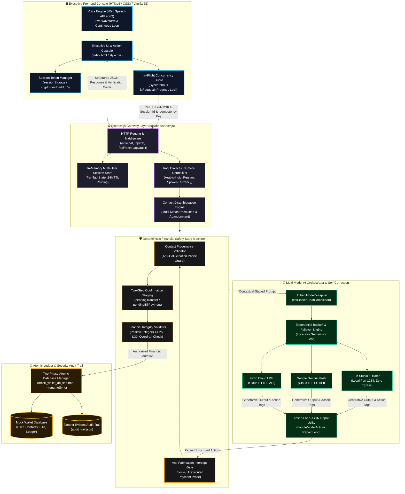

<div align="center">

# فاي • VI
### Autonomous Iraqi AI Financial Agent for Digital Wallets
**وكيل سداد الفواتير والتحويلات المالية الذكي باللهجة العراقية**

<p align="center">
  <strong>An enterprise-grade, autonomous financial agent engineered for Iraqi digital wallets. Features dynamic multi-model LLM failover, deterministic financial safety guardrails, closed-loop self-correction, per-tab session isolation, and resilient self-healing persistence.</strong>
</p>

[](https://nodejs.org/)
[](https://expressjs.com/)
[-10b981?style=for-the-badge&logo=node.js&logoColor=white)](#-automated-testing--quality-assurance)
[](#-multi-model-orchestration-engine)
[](#-failure-handling--self-healing-architecture)
[-f59e0b?style=for-the-badge)](#)
[](LICENSE)

</div>

---

## 📑 Table of Contents
- [🌟 Executive Summary & Vision](#-executive-summary--vision)
- [🎥 Interactive Demo Walkthrough](#-interactive-demo-walkthrough)
- [🏗️ System Architecture & Operational Data Flow](#️-system-architecture--operational-data-flow)
  - [Architectural Deep-Dive by Tier](#architectural-deep-dive-by-tier)
  - [End-to-End Transaction Request Lifecycle](#end-to-end-transaction-request-lifecycle)
- [✨ Key Features](#-key-features)
- [🧠 Multi-Model Orchestration Engine](#-multi-model-orchestration-engine)
  - [Provider Comparison Matrix](#provider-comparison-matrix)
  - [Dynamic Failover Chain](#dynamic-failover-chain)
- [🛡️ Deterministic Security & Financial Guardrails](#️-deterministic-security--financial-guardrails)
- [🩺 Failure Handling & Self-Healing Architecture](#-failure-handling--self-healing-architecture)
  - [1. Upstream LLM Failures, Rate Limits & Outages](#1-upstream-llm-failures-rate-limits--outages)
  - [2. Generative Action Tag Parsing & Closed-Loop Repair](#2-generative-action-tag-parsing--closed-loop-repair)
  - [3. Database Ledger Corruption & Atomic Disk I/O](#3-database-ledger-corruption--atomic-disk-io)
  - [4. Multi-User & Multi-Tab State Isolation](#4-multi-user--multi-tab-state-isolation)
  - [5. Ambient Contact Ambiguity & Intent Abandonment](#5-ambient-contact-ambiguity--intent-abandonment)
  - [6. Frontend Network Faults & Continuous Speech Recovery](#6-frontend-network-faults--continuous-speech-recovery)
- [📡 API Specifications & Route Reference](#-api-specifications--route-reference)
- [📂 Project Directory Layout](#-project-directory-layout)
- [⚡ Quick Start & Installation Guide](#-quick-start--installation-guide)
  - [Step 1: Prerequisites & Verification](#step-1-prerequisites--verification)
  - [Step 2: Clone the Repository](#step-2-clone-the-repository)
  - [Step 3: Install Dependencies](#step-3-install-dependencies)
  - [Step 4: Configure Environment Variables (.env)](#step-4-configure-environment-variables-env)
  - [Step 5: Configure AI Model Engine (Local vs. Cloud)](#step-5-configure-ai-model-engine-local-vs-cloud)
  - [Step 6: Launch Backend & Open Web Console](#step-6-launch-backend--open-web-console)
- [🧪 Automated Testing & Quality Assurance](#-automated-testing--quality-assurance)
- [💬 Interactive Test Scenarios (Colloquial Iraqi)](#-interactive-test-scenarios-colloquial-iraqi)
- [🎨 Executive Fintech UX Design System](#-executive-fintech-ux-design-system)
- [🛠️ Comprehensive Troubleshooting & FAQs](#️-comprehensive-troubleshooting--faqs)
- [🗺️ Future Roadmap](#️-future-roadmap)
- [📜 License](#-license)

---

## 🌟 Executive Summary & Vision

**فاي (VI)** is an enterprise-grade autonomous digital wallet assistant engineered specifically for colloquial Iraqi Arabic (*اللهجة العراقية*) and mission-critical financial workflows.

Deploying generative AI directly into banking or payment applications poses severe risks: **hallucinated balances**, **silent double debits**, **accidental funds transfers**, and **server downtime on upstream provider outages**. **فاي (VI)** solves these structural problems through a strict **Zero-Trust AI Architecture**:

1. **Deterministic Core Separation**: The language model never performs arithmetic, never computes wallet balances, and cannot directly mutate financial ledgers. All funds transfers, utility settlements, and account records are managed exclusively by an atomic, validated backend state machine.
2. **Multi-Model Orchestration Layer**: Switch seamlessly at runtime between **100% Local On-Premise Inference** (via **LM Studio** / **Ollama**) with zero cloud data egress, **Google Gemini Flash** for deep dialectal reasoning, and **Groq Cloud** for sub-second LPU throughput.
3. **Automated Self-Healing Pipeline**: Upstream timeouts and HTTP 429 rate limits trigger exponential backoff and transparent provider failover; malformed JSON action tags undergo closed-loop AI self-correction; corrupted or missing ledger files automatically reconstruct from verified templates without server crashes.
4. **Per-Tab Cryptographic Session Isolation**: Every browser tab receives an isolated, cryptographically generated session token stored in `sessionStorage` and transmitted via `X-Session-Id`, eliminating state bleed across concurrent users or tabs.
5. **Native Iraqi Linguistic Comprehension**: Comprehensive parsing of real Iraqi financial colloquialisms (*"دزله 50 ألف"*, *"شكد رصيدي هسة"*, *"ادفع مال كهرباء"*, *"ولا واحد منهم"*, *"عوفه وبطلت"*), supporting Arabic-Indic digits, Persian numerals, and spelled-out verbal monetary expressions.

---

## 🎥 Interactive Demo Walkthrough

<div align="center">


<p align="center">
  <sub>🎬 <strong>فاي (VI) في العمل:</strong> استعراض عملي وتفاعلي لسداد الفواتير، التحويلات المالية، صمامات الأمان الحتمية، والتبديل اللحظي بين النماذج.</sub>
</p>

</div>

---

## 🏗️ System Architecture & Operational Data Flow



### Architectural Deep-Dive by Tier

1. **Client Tier ([frontend/script.js](file:///c:/Users/moham/Desktop/VI/frontend/script.js))**:
   - **Per-Tab Isolation**: Generates a cryptographically secure UUID stored in `sessionStorage` and sent as `X-Session-Id` on every request.
   - **In-Flight Lock**: Synchronously sets `isRequestInProgress = true` before DOM mutations, disabling input elements and suggestion chips to prevent duplicate in-flight requests.
   - **Voice Engine**: Integrates Web Speech API configured for Iraqi Arabic (`ar-IQ`) with live waveform visualizer and automatic restart on speech pauses.
2. **Gateway Tier ([backend/server.js](file:///c:/Users/moham/Desktop/VI/backend/server.js))**:
   - **Session Store**: In-memory `Map` keyed by `sessionId` containing isolated history, pending transfers, pending bill payments, and disambiguation contexts with 24-hour TTL pruning.
   - **Linguistic Normalization**: Normalizes Eastern Arabic-Indic digits (`٠-٩`) and Persian digits (`۰-۹`) to standard ASCII integers, and parses colloquial currency idioms (*"مليونين ونص"*, *"ميتين وخمسين ألف"*, *"خمسين ورقة"*).
3. **Safety & Guardrail Tier**:
   - **Contact Provenance**: Rejects contact creation if phone number digits are not found in the user's raw message or conversation context, preventing AI number hallucinations.
   - **Two-Step Consent**: Stages operations into memory; zero funds are deducted until explicit verbal confirmation is provided.
   - **Anti-Fabrication**: Intercepts verbal claims of payment made in conversational text when no programmatic `<<<DB_ACTION>>>` tag was executed.
4. **AI Orchestration Tier**:
   - **Unified Wrapper**: Routes requests dynamically to LM Studio, Gemini, or Groq with identical prompt structures and error boundaries.
   - **Closed-Loop Self-Correction**: Automatically sends syntax errors and JSON schema specifications back to the model at $T = 0.1$ if generative action tags fail parsing.
5. **Storage & Persistence Tier**:
   - **Atomic File Swaps**: Writes data to temporary `.tmp` files first, then executes atomic filesystem rename (`renameSync`), falling back to `copyFileSync` + `unlinkSync` on Windows file lock (`EPERM`/`EBUSY`) conditions.
   - **Security Audit Trail**: Every transaction and blocked mutation is appended to [backend/audit_trail.json](file:///c:/Users/moham/Desktop/VI/backend/audit_trail.json) with timestamps, session tokens, and idempotency keys.

### End-to-End Transaction Request Lifecycle

```
[User Utterance: "دز 50 ألف لأحمد"] 
       │
       ▼
[Client: Attach X-Session-Id & X-Idempotency-Key] ──► [Lock UI Controls]
       │
       ▼
[Gateway: Map to Per-Tab Session State]
       │
       ▼
[Dialect Normalizer: 50 ألف ──► 50,000 IQD]
       │
       ▼
[Disambiguation Engine: Multiple Contacts Named 'أحمد' Detected]
       │
       ▼
[Response to User: Interactive Selection (1. أحمد كمال / 2. أحمد جاسم)]
       │
       ▼
[User Input: "أحمد كمال"] ──► [Staging: pendingTransfer staged in Session]
       │
       ▼
[Response to User: Interactive Verification Card Rendered]
       │
       ▼
[User Consent: "نعم توكل"] 
       │
       ▼
[Safety Gate: Verify Idempotency, Provenance, & Strict Balance >= 50,000 IQD]
       │
       ▼
[Atomic Mutation: Deduct User Balance & Credit Contact in mock_wallet_db.json]
       │
       ▼
[Audit Logging: Append Immutable Audit Record to audit_trail.json]
       │
       ▼
[Client: Unlock UI, Play Confirmation Sound, Sync Balance Pill & Drawer]
```

---

## ✨ Key Features

### 1. 🛡️ Strict Two-Step Confirmation State Machine
* **Zero Accidental Deductions**: The AI agent cannot trigger any financial mutation directly from an initial request.
* **Interactive Verification Cards**: Renders a rich verification card displaying recipient name, verified phone number, fee breakdown, deduction amount, and remaining balance.
* **Explicit User Consent**: Requires explicit affirmative confirmation (`"نعم"`, `"أكد"`, `"تمام"`, `"توكل"`) before committing changes to disk.
* **Instant Cancellation & Rollback**: Immediate clean state rollback upon negative inputs (`"إلغاء"`, `"لا"`, `"بطلت"`, `"cancel"`).

### 2. 👥 Smart Contact Disambiguation Engine
* When transferring to a common name (e.g., *"أحمد"*):
  * The engine detects all matches in the verified address book.
  * Presents numbered options with aliases and masked phone numbers.
  * The user can select the target by index (`1`, `2`), alias (*"صديق الجامعة"*), or phone digits.
  * If the user abandons the intent (*"عوفه وبطلت"*, *"مو ذولي"*), the pending state is wiped immediately.

### 3. 🧾 Utility & Telecom Bill Payment System
* **Pre-Integrated Biller Categories**: National Electricity Grid (*الكهرباء الوطنية*), Municipal Water (*الماء والخدمات البلدية*), Mobile Telecommunications (*فواتير خط الهاتف والاتصالات*), and Fiber/4G Internet (*فواتير الإنترنت والألياف الضوئية*).
* **Single or Bulk Settlement**: Query pending unpaid bills, pay an individual service (*"ادفع فاتورة الإنترنت"*), or settle all outstanding bills in one atomic transaction (*"ادفع كل الفواتير اللي عليه"*).

### 4. 👁️ Wallet Balance Privacy Toggle
* Header pill features a shoulder-surfing privacy mask (`*** IQD 👁`) enabled by default to protect financial privacy in public environments.
* One-click toggle reveals the live balance (`2,200,000 IQD`) with smooth SVG eye animations and local storage persistence.

### 5. 📂 Sliding Transactions History Drawer
* Dedicated slide-out drawer accessible from the navigation header.
* Displays verified transaction receipts, timestamps, recipient names, and real-time status badges (`مكتملة` / `قيد المراجعة`) with category filters (`كل العمليات`, `تحويلات`, `فواتير`).

### 6. 🔒 Idempotency Replay Protection
* Every financial request accepts an idempotency key. Subsequent requests with identical tokens replay the cached receipt without double deduction.

---

## 🧠 Multi-Model Orchestration Engine

**فاي (VI)** incorporates dynamic multi-provider routing through a centralized completion wrapper ([callUnifiedChatCompletion](file:///c:/Users/moham/Desktop/VI/backend/server.js#L123)):

### Provider Comparison Matrix

| Provider | Operating Mode | Primary Advantage | Data Privacy & Residency | API Key Required |
| :--- | :--- | :--- | :--- | :--- |
| **LM Studio** *(Default)* | **100% Local / Offline** | On-premise execution, zero cloud dependency | **Complete Local Hardware Residency** (Zero data egress) | ❌ **None** (`lm-studio`) |
| **Google Gemini Flash** | **Cloud AI Engine** | Advanced linguistic reasoning, complex dialect nuances | Encrypted HTTPS API | ✅ Yes (`GEMINI_API_KEY`) |
| **Groq Cloud** | **Ultra-Fast Cloud LPU** | Sub-second streaming responses, high concurrency | Encrypted HTTPS API | ✅ Yes (`GROQ_API_KEY`) |

### Dynamic Failover Chain

If an active model experiences network connection drops, timeouts, or HTTP 429 rate limits, the system shifts automatically through a deterministic failover chain without dropping user session state:

```javascript
const FAILOVER_CHAIN = {
    local: ['gemini', 'groq'],
    gemini: ['groq', 'local'],
    groq: ['gemini', 'local']
};
```

---

## 🛡️ Deterministic Security & Financial Guardrails

| Guardrail Layer | Enforcement Mechanism | Failure Response |
| :--- | :--- | :--- |
| **Anti-Hallucination Gate** | Balances and records are read directly from disk; the LLM never calculates balances. | Rejects LLM-generated math; forces deterministic calculation. |
| **Contact Provenance** | Phone digits must exist in the user's raw input buffer or verified history. | Rejects contact creation; prompts user for real digits. |
| **Two-Step Consent Lock** | Financial mutations require an explicit affirmative secondary confirmation. | Transactions remain staged in memory; zero funds deducted. |
| **Strict Integer Validator** | Amounts must be positive integers $\ge 250\text{ IQD}$; decimals and fractions are rejected. | Rejects transaction; returns descriptive currency error. |
| **Overdraft Protection** | Requested transfer or bill payment total is checked against available wallet balance. | Blocks transaction; alerts user of insufficient funds. |
| **Idempotency Guard** | Cached transaction receipts are indexed by unique request tokens. | Replays cached transaction; prevents duplicate debit. |
| **Anti-Fabrication Intercept** | Verbal claims of payment without verified `<<<DB_ACTION>>>` tags are intercepted. | Overrides message; informs user that no funds were deducted. |
| **Security Audit Trail** | Every successful or blocked mutation is appended to `audit_trail.json` with metadata. | Atomic disk append; preserves tamper-evident log. |

---

## 🩺 Failure Handling & Self-Healing Architecture

### 1. Upstream LLM Failures, Rate Limits & Outages
- **Trigger**: Upstream engine returns HTTP 429 (rate limit/quota exhaustion), HTTP 500–504, `ECONNREFUSED`, `ETIMEDOUT`, or `ECONNRESET`.
- **Self-Healing Process**:
  1. `isRetryableError()` detects transient connection errors or quota exhaustion.
  2. `callProviderWithBackoff()` initiates a 3-attempt exponential backoff sequence (500ms $\rightarrow$ 1000ms $\rightarrow$ 2000ms).
  3. If retries are exhausted on the active model, `callUnifiedChatCompletion()` automatically redirects the request down the `FAILOVER_CHAIN`.
  4. Missing cloud API keys are cleanly bypassed without runtime exceptions.
  5. If all providers are unavailable, the gateway returns a user-friendly diagnostic message in colloquial Iraqi Arabic with setup guidance.
- **Outcome**: **Graceful Degradation** — The backend process does not crash, HTTP 500 errors are prevented, and conversation context remains intact.

### 2. Generative Action Tag Parsing & Closed-Loop Repair
- **Trigger**: The LLM outputs malformed, unclosed, or invalid JSON syntax within structured action tags (`<<<DB_ACTION>>>`).
- **Self-Healing Process**:
  1. Primary `JSON.parse()` fails and triggers the closed-loop recovery handler in `handleModelActions`.
  2. The gateway constructs a targeted repair prompt containing the raw syntax snippet, the exact parser error, and strict JSON schema rules.
  3. The repair request is dispatched to the model with deterministic sampling ($T = 0.1$, `max_tokens: 300`).
  4. Markdown code fences are stripped from the repaired response, and the clean payload is re-parsed.
  5. If self-correction fails, the mutation is **aborted cleanly**.
- **Outcome**: **Self-Healing with Fail-Safe Abort** — The database is protected from partial mutations, zero funds are deducted, and the user receives a clean retry prompt.

### 3. Database Ledger Corruption & Atomic Disk I/O
- **Trigger**: `mock_wallet_db.json` is missing, deleted, empty (0 bytes), or corrupted with invalid JSON/schema; or a Windows indexer/antivirus locks the file (`EPERM` / `EBUSY`).
- **Self-Healing Process**:
  1. **Read Self-Healing**: `readDatabase()` verifies file existence, non-zero size, and schema validity. If corrupted, it logs a warning, clones `INITIAL_DB` from `reset_db.js`, writes it to disk, and continues execution.
  2. **Two-Phase Atomic Write**: `saveDatabase()` writes to `mock_wallet_db.json.tmp` first, then executes atomic `fs.renameSync()`.
  3. **Windows Lock Recovery**: If `renameSync()` encounters `EPERM` or `EBUSY`, it falls back to `copyFileSync()` and unlinks the temporary file.
  4. **Orphan Cleanup**: Temporary files are unlinked in `catch` blocks if writes fail.
  5. **Fail-Safe Audit Logging**: Failures during audit trail logging emit a warning without aborting verified database transactions.
- **Outcome**: **Self-Healing & Tamper-Proof** — The server boots and operates even if database files are deleted from the disk mid-flight.

### 4. Multi-User & Multi-Tab State Isolation
- **Trigger**: Multiple users access the console simultaneously, or a single user opens multiple browser tabs.
- **Self-Healing Process**:
  1. The client initializes a unique session token using `sessionStorage` and `crypto.randomUUID()` (with timestamp-random fallback).
  2. The session token is transmitted in every HTTP request via the `X-Session-Id` header and JSON body.
  3. The backend maps requests to distinct memory instances in `sessions = new Map()`.
  4. Pending transfers, disambiguation options, and bill settlements in Tab A do not leak into Tab B.
  5. Inactive sessions are automatically pruned from memory after 24 hours (`SESSION_TTL_MS`).
- **Outcome**: **Strict State Encapsulation** — Multiple tabs operate independently without cross-contamination.

### 5. Ambient Contact Ambiguity & Intent Abandonment
- **Trigger**: The user requests a transfer to a non-unique name (*"حول لأحمد"*), provides missing parameters, or abandons the operation (*"ما أعرفه"*, *"مو ذولي"*, *"عوفه وبطلت"*).
- **Self-Healing Process**:
  1. `findAmbiguousContacts()` detects multiple name matches and halts execution without balance deduction.
  2. The system responds with an interactive numbered disambiguation list.
  3. If the user replies with colloquial abandonment phrases, `isDisambiguationAbandonment()` immediately purges `pendingDisambiguation`, `pendingTransfer`, and `pendingTransferRecipient`.
  4. If the user cancels (*"إلغاء"*), all pending operations are wiped cleanly.
- **Outcome**: **Graceful Degradation** — Stale transactions never linger in memory; accidental transfers to wrong recipients are prevented.

### 6. Frontend Network Faults & Continuous Speech Recovery
- **Trigger**: Local backend takes longer than 30 seconds to respond, network connection drops, or Web Speech API pauses during vocal pauses.
- **Self-Healing Process**:
  1. **Client-Side Timeout**: `sendMessageToBackend()` wraps the request in an `AbortController` set to 30,000 ms. If exceeded, the request aborts gracefully.
  2. **Unconditional UI Unlocking**: The submission cycle runs inside a `try...catch...finally` block. The `finally` clause unconditionally sets `isRequestInProgress = false`, calls `setInputState(true)`, and hides the typing indicator.
  3. **Duplicate Prevention**: Synchronous guard flags reject rapid-fire clicks on the send button, Enter key, or prompt chips while an existing request is in-flight.
  4. **Continuous Speech Recognition**: If speech pauses trigger recognition `onend`, the handler automatically re-initializes `recognition.start()` unless explicitly stopped by the user.
- **Outcome**: **Self-Healing Interface** — The UI never locks permanently, and speech recording handles natural vocal pauses without premature termination.

---

## 📡 API Specifications & Route Reference

| Method | Endpoint | Description | Request Headers | Payload / Parameters | Response Structure |
| :--- | :--- | :--- | :--- | :--- | :--- |
| `POST` | `/api/chat` | Main conversational reasoning and action execution endpoint. | `X-Session-Id`, `X-Idempotency-Key` | `{ message: string, provider?: string, sessionId?: string }` | `{ text: string, status: string, openDrawer?: boolean }` |
| `GET` | `/api/db` | Retrieves complete active wallet state (user, balance, contacts, bills). | — | — | `{ user: object, contacts: array, bills: array, transactions: array }` |
| `GET` | `/api/transactions` | Retrieves recent transaction ledger with totals and metrics. | — | — | `{ transactions: array, totalCount: number }` |
| `POST` | `/api/reset` | Resets session memory and restores wallet database to defaults. | `X-Session-Id` | `{ sessionId?: string }` | `{ success: true, message: string }` |
| `GET` | `/api/audit` | Retrieves tamper-evident security audit logs. | — | — | `{ success: true, count: number, logs: array }` |
| `POST` | `/api/feedback` | Records user satisfaction ratings (likes / dislikes) for AI responses. | — | `{ type: "like"\|"dislike"\|"remove", msgId: string, userMessage: string, botResponse: string }` | `{ success: true }` |
| `GET` | `/api/feedback/likes` | Retrieves all positive evaluation entries. | — | — | `[ { id, msgId, userMessage, botResponse, timestamp } ]` |
| `GET` | `/api/feedback/dislikes` | Retrieves all negative evaluation entries for alignment review. | — | — | `[ { id, msgId, userMessage, botResponse, timestamp } ]` |

---

## 📂 Project Directory Layout

```text
VI/
├── 📁 assets/
│   ├── 🎬 demo_walkthrough.gif        # Animated interactive demonstration
│   ├── 🖼️ logo-emerald.png            # Luxury Emerald brand logo (Dark Theme)
│   ├── 🖼️ logo-violet.png             # Royal Violet brand logo (Light Theme)
│   ├── 🖼️ bot-emerald.png             # Assistant avatar for Dark Theme
│   └── 🖼️ bot-violet.png              # Assistant avatar for Light Theme
│
├── 📁 backend/
│   ├── 📄 server.js                   # Express core, multi-model router, NLP parser, safety gates, audit logger
│   ├── 📄 reset_db.js                 # Standalone database and conversation state reset utility
│   ├── 📄 mock_wallet_db.json         # Primary JSON wallet database (User, Contacts, Bills, Ledger)
│   ├── 📄 audit_trail.json            # Immutable security audit trail of financial mutations
│   ├── 📄 feedback_likes.json         # User satisfaction feedback (Likes)
│   ├── 📄 feedback_dislikes.json      # User satisfaction feedback (Dislikes)
│   └── 📁 tests/
│       └── 📄 regression_suite.test.js # Comprehensive 99-test automated regression and security suite
│
├── 📁 frontend/
│   ├── 📄 index.html                  # Semantic HTML5 executive layout (Header, Hero Dock, Interaction Capsule)
│   ├── 📄 style.css                   # Glassmorphism design system, dual themes, halftone particle canvas
│   └── 📄 script.js                   # Client controller, per-tab session manager, speech recognition, visualizer
│
├── 📄 .env                            # Environment variables & API credentials (Git-ignored)
├── 📄 .env.example                    # Safe configuration template
├── 📄 .gitignore                      # Git exclusion rules
├── 📄 wallet_db_schema.json           # Formal JSON Schema defining wallet data models
├── 📄 package.json                    # Project dependencies and test runner scripts
├── 📄 package-lock.json               # Locked dependency tree
├── 📄 LICENSE                         # MIT Open Source License
└── 📄 README.md                       # Comprehensive documentation
```

---

## ⚡ Quick Start & Installation Guide

Follow these steps to launch **فاي (VI)** locally:

### Step 1: Prerequisites & Verification

Ensure Node.js and Git are installed:

| Prerequisite | Minimum Version | Recommended | Verification Command |
| :--- | :--- | :--- | :--- |
| **Node.js** | `v18.0.0` | `v20.x LTS` or higher | `node -v` |
| **npm** | `v9.0.0` | `v10.x` or higher | `npm -v` |
| **Git** | `v2.30+` | Latest stable | `git --version` |
| **Browser** | Chromium-based | Chrome / Edge / Brave | Required for Web Speech API (`ar-IQ`) |

```bash
node -v
npm -v
git --version
```

### Step 2: Clone the Repository

```bash
git clone https://github.com/double-u9/VI.git
cd VI
```

### Step 3: Install Dependencies

```bash
npm install
```

### Step 4: Configure Environment Variables (.env)

Create your local `.env` configuration file from the template:

**PowerShell (Windows):**
```powershell
Copy-Item .env.example .env
```

**Bash (Linux / macOS) or Command Prompt:**
```bash
cp .env.example .env
```

Open `.env` and configure your preferences:

```env
# 1. Local LM Studio (Default port is 1234)
LM_STUDIO_URL=http://127.0.0.1:1234/v1
LOCAL_API_KEY=lm-studio

# 2. Google Gemini Flash (Optional Cloud Provider)
GEMINI_API_KEY=your_gemini_api_key_here

# 3. Groq Cloud (Optional Cloud Provider)
GROQ_API_KEY=your_groq_api_key_here

# 4. Web Server Port (Defaults to 3000)
PORT=3000
```

> [!NOTE]
> If you are running **LM Studio locally**, you do **not need any cloud API keys**! You can leave `GEMINI_API_KEY` and `GROQ_API_KEY` blank.

### Step 5: Configure AI Model Engine (Local vs. Cloud)

#### Option A: Local Model with LM Studio (Recommended)
1. Download and install **[LM Studio](https://lmstudio.ai/)**.
2. Search for and download **`Qwen2.5-7B-Instruct`** (Recommended) or **`Meta-Llama-3.1-8B-Instruct`** (`Q4_K_M` quantization).
3. In LM Studio, navigate to the **Developer / Local Server (`<->`)** tab.
4. Select the model from the top bar, ensure port is set to **`1234`**, and click **Start Server**.

#### Option B: Cloud AI Engines (Instant Setup)
- **Google Gemini**: Obtain an API key from **[Google AI Studio](https://aistudio.google.com/)** and set `GEMINI_API_KEY`.
- **Groq Cloud**: Obtain an API key from **[Groq Console](https://console.groq.com/)** and set `GROQ_API_KEY`.

### Step 6: Launch Backend & Open Web Console

```bash
npm start
```

Open your browser and navigate to:  
👉 **`http://localhost:3000`**

---

## 🧪 Automated Testing & Quality Assurance

The repository includes a comprehensive automated test suite built with Node.js's native test runner (`node:test` and `node:assert/strict`).

Run the complete test suite:

```bash
npm test
```

### Test Coverage Summary: 99 Tests Across 25 Suites (100% Pass Rate)

| Task Suite | Tested Capabilities | Suite Count | Test Count | Status |
| :--- | :--- | :---: | :---: | :---: |
| **Task 1: Phone Numbers, Accounts & Dialect Normalization** | Valid 078 formats, invalid lengths, unsupported carriers (075/077), account & card formats (10-16 digits), Arabic-Indic digit normalization (`٠-٩`), Persian digit normalization (`۰-۹`), monetary phrasing (*مليونين ونص*, *ميتين وخمسين الف*), transfer limits, and `/api/chat` E2E workflow. | 12 Suites | 60 Tests | ✅ **Passed** |
| **Task 2: Bill Payments, Disambiguation & Contact Creation** | Utility bill settlement (single, bulk, overdraft, paid status), contact disambiguation and abandonment handling (*عوفه وبطلت*), multi-message contact creation, and phone provenance validation. | 3 Suites | 18 Tests | ✅ **Passed** |
| **Task 3: History Trimming & Concurrency Protection** | Conversation history trimming without state loss, frontend in-flight submission guard, and backend idempotency protection. | 2 Suites | 6 Tests | ✅ **Passed** |
| **Task 4: Security Audit Logging & Financial Integrity** | Multi-user session isolation across distinct `sessionId` tokens, double-spend prevention via idempotency keys, financial validation (negative, zero, fractional, below 250 IQD amounts), and audit trail immutability with atomic disk I/O. | 4 Suites | 15 Tests | ✅ **Passed** |
| **Total Test Suite** | **Comprehensive End-to-End System & Security Verification** | **25 Suites** | **99 Tests** | **✅ 100% Pass** |

---

## 💬 Interactive Test Scenarios (Colloquial Iraqi)

| Category | Example Iraqi Phrase | System Execution & Response |
| :--- | :--- | :--- |
| **Balance Inquiry** | *"شكد رصيدي هسة؟"* | Reads deterministic balance directly from disk; reminds user of outstanding bills. |
| **Direct Transfer** | *"حول 50 ألف لحسين"* | Resolves contact, checks balance, stages transfer, and presents confirmation card. |
| **Contact Disambiguation** | *"دز 100 ألف لأحمد"* | Detects multiple contacts named *أحمد*, lists options with aliases, and awaits selection (`1`, `2`, or alias). |
| **Intent Abandonment** | *"ما أعرفه، عوف الموضوع"* | Identifies abandonment intent via `isDisambiguationAbandonment()`, purges pending states, and confirms cancellation. |
| **Two-Step Confirmation** | *"نعم توكل"* / *"أكد التحويل"* | Confirms consent via `isUserConfirmation()`, deducts balance, and logs receipt. |
| **Explicit Cancellation** | *"بطلت، الغي العملية"* | Cancels transaction via `isUserCancellation()`; guarantees zero balance deduction. |
| **Single Bill Payment** | *"ادفع فاتورة الإنترنت"* | Identifies unpaid Fiber/4G bill, stages payment confirmation, and settles on approval. |
| **Bulk Bill Payment** | *"سدد كل الفواتير اللي عليه"* | Aggregates all unpaid utilities, validates combined sum against balance, and executes atomically. |
| **Contact Registration** | *"احفظ رقم 07804455667 باسم علي"* | Validates phone provenance against user input, adds contact to disk, and confirms. |

---

## 🎨 Executive Fintech UX Design System

* **Dual-Themed Visual Architecture**:
  * **🌙 Luxury Emerald (Dark Theme)**: Deep Obsidian `#04070b`, Forest Slate `#0c171e`, Neon Emerald `#4ade80`, Gold accents `#ffc83b`.
  * **☀️ Royal Violet (Light Theme)**: Titanium White, Slate Mist `#f8fafc`, Royal Violet `#7c3aed`, Emerald Green `#10b981`.
* **Bespoke Typography**:
  * **Cairo**: Modern Arabic headings, body text, and dialogue cards.
  * **Plus Jakarta Sans**: High-precision tabular numerals and international currency formatting (`IQD`).
* **Privacy Balance Masking (`*** IQD 👁`)**: Real-time balance masking in the header pill protects user financial privacy in public environments with one-click SVG toggle.
* **Sliding Transactions Drawer**: Accessible via the header ledger button, offering filtered transaction history (`كل العمليات`, `تحويلات`, `فواتير`) with live spend metrics.
* **Mathematical Halftone Particle Canvas**: Dynamic HTML5 canvas simulating interactive wave particle physics that adapt smoothly across viewports without zoom distortion.
* **Voice Visualizer Dock**: Integrated voice recording visualizer with live waveform animations and real-time speech transcription preview.

---

## 🛠️ Comprehensive Troubleshooting & FAQs

### 1. 🛑 Windows PowerShell Script Execution Blocked (`PSSecurityException`)
* **Symptom**: Running `npm` or `node` scripts fails with:
  ```text
  File C:\...\npm.ps1 cannot be loaded because running scripts is disabled on this system.
  ```
* **Cause**: Windows PowerShell restricts execution of unsigned `.ps1` script wrappers by default.
* **Fix**: Run this one-time command in PowerShell (does **not** require Administrator privileges):
  ```powershell
  Set-ExecutionPolicy -ExecutionPolicy RemoteSigned -Scope CurrentUser
  ```

---

### 2. 🛑 Command Not Recognized: `'node'` or `'npm'` is not recognized
* **Symptom**: PowerShell outputs `The term 'node' is not recognized as the name of a cmdlet, function, script file...`
* **Cause**: Node.js was recently installed, but your open PowerShell session hasn't refreshed its environment PATH.
* **Fix**: Refresh your PATH environment variable without closing your terminal:
  ```powershell
  $env:Path = [System.Environment]::GetEnvironmentVariable("Path","Machine") + ";" + [System.Environment]::GetEnvironmentVariable("Path","User")
  ```
  *(Or close all PowerShell windows and open a fresh terminal).*

---

### 3. 🛑 LM Studio Connection Error (`ECONNREFUSED 127.0.0.1:1234`)
* **Symptom**: Chat displays a connection failure message: *"عذراً، فشل الاتصال بخادم الذكاء الاصطناعي المحلي..."*
* **Fix Steps**:
  1. Open LM Studio and navigate to the **Local Server (`<->`)** tab.
  2. Verify that a model is selected in the top bar.
  3. Ensure the green **Start Server** button has been pressed (it should say **Stop Server** while active).
  4. Ensure the port is set to **`1234`**. If you configured a different port (e.g., `8080`), update `LM_STUDIO_URL` in your `.env` to match.
  5. **Instant Fallback**: If you do not wish to run LM Studio, click the model dropdown in the header of the web app and select **Google Gemini** or **Groq Cloud**!

---

### 4. 🛑 Port 3000 Already in Use (`EADDRINUSE: address already in use :::3000`)
* **Symptom**: Starting the server results in `Error: listen EADDRINUSE: address already in use :::3000`.
* **Cause**: A previous instance of `server.js` or another local application is already bound to port 3000.
* **Fix Option A (Change Port)**: Edit `.env` and change `PORT=3000` to `PORT=3001`. Then start with `npm start` and visit `http://localhost:3001`.
* **Fix Option B (Kill Existing Process on Port 3000)**:
  - In **PowerShell**:
    ```powershell
    Get-Process -Id (Get-NetTCPConnection -LocalPort 3000).OwningProcess | Stop-Process -Force
    ```
  - In **Command Prompt (CMD)**:
    ```cmd
    netstat -ano | findstr :3000
    taskkill /PID <PID_NUMBER> /F
    ```

---

### 5. 🛑 Microphone / Speech-to-Text Not Responding
* **Symptom**: Clicking the microphone icon fails to transcribe speech or reports a permission error.
* **Cause**: Browser microphone permissions are blocked, or browser lacks Web Speech API support.
* **Fix Steps**:
  1. Use a Chromium-based browser (Google Chrome, Microsoft Edge, or Brave).
  2. In your address bar, click the **Settings / Lock icon** next to `http://localhost:3000`.
  3. Ensure **Microphone** is toggled to **Allow**.
  4. Ensure your machine has an active default microphone device set under Windows Sound Settings.

---

### 6. 🛑 Cloud API Key Errors (401 Unauthorized / 429 Rate Limit)
* **Symptom**: Gemini or Groq returns an authentication or quota failure message.
* **Fix Steps**:
  1. Open `.env` and ensure there are no surrounding quotes, spaces, or line breaks around your key. Example:
     ```env
     GEMINI_API_KEY=AIzaSyBFAu...
     GROQ_API_KEY=gsk_KzXal...
     ```
  2. **Important**: Whenever you edit `.env`, you **must restart the server** (`Ctrl + C` in your terminal, then run `npm start`). Environment variables are only read when Node initializes.

---

### 7. 🛑 Resetting the Wallet Database to Default
* **Question**: How do I reset balances, paid bills, and contacts back to the pristine initial state?
* **Option A (Terminal - Works even if server is stopped)**:
  ```bash
  npm run reset-db
  ```
* **Option B (One-Click UI - When server is running)**:
  Click the **"Reset DB"** button in the top navigation bar at `http://localhost:3000`.
* **Option C (HTTP API - When server is running)**:
  - In **Windows PowerShell**:
    ```powershell
    Invoke-RestMethod -Method Post http://localhost:3000/api/reset
    ```
  - In **Bash / Linux / macOS / CMD**:
    ```bash
    curl -X POST http://localhost:3000/api/reset
    ```
  All options immediately rewrite `mock_wallet_db.json` with fresh initial balances (`2,200,000 IQD`) and reset all utility bills to `unpaid`.

---

## 🗺️ Future Roadmap

- [x] Full Iraqi dialect support for money transfers and utility bills.
- [x] Strict two-step confirmation engine and contact disambiguation.
- [x] Multi-Model AI Orchestration (LM Studio, Google Gemini, Groq).
- [x] Wallet balance privacy masking toggle (`*** IQD 👁`).
- [x] Sliding transaction ledger history drawer with category filters.
- [x] Dual luxury themes with real-time responsive halftone particle canvas.
- [x] Integrated voice input via Web Speech API (`ar-IQ`).
- [x] Tamper-evident security audit logging layer (`audit_trail.json`).
- [x] Per-tab cryptographic session isolation via `X-Session-Id`.
- [x] Automated closed-loop JSON action repair and multi-provider failover.
- [ ] Iraqi dialect Text-to-Speech (TTS) auditory response.
- [ ] QR code scanning for in-store merchant POS payments.
- [ ] Open Banking API connectors adhering to Central Bank of Iraq (CBI) standards.
- [ ] Automated PDF transaction receipt export.

---

## 📜 License

This project is open-source under the **[MIT License](LICENSE)**.

<div align="center">

**فاي (VI) — صُمم وصُقل ليكون المعيار الأعلى لمستقبل الخدمات المالية الرقمية 🇮🇶**

</div>
