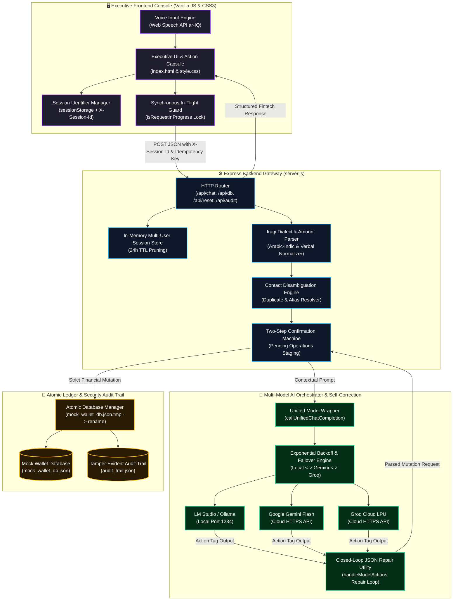

<div align="center">

# فاي • VI
### Autonomous Iraqi AI Financial Agent for Digital Wallets
**وكيل سداد الفواتير والتحويلات المالية الذكي باللهجة العراقية**

<p align="center">
  <strong>Production-Ready Autonomous Financial Agent engineered for Iraqi digital wallets, featuring multi-model LLM failover, deterministic financial safety guardrails, closed-loop self-correction, per-tab session isolation, and resilient self-healing persistence.</strong>
</p>

[](https://nodejs.org/)
[](https://expressjs.com/)
[](#-automated-testing--regression-suite)
[](#-multi-model-orchestration-engine)
[](#-failure-handling--self-healing-architecture)
[-f59e0b?style=for-the-badge)](#)
[](LICENSE)

</div>

---

## 📑 Table of Contents
- [🌟 Executive Summary & Vision](#-executive-summary--vision)
- [🎥 Interactive Demo Walkthrough](#-interactive-demo-walkthrough)
- [🏗️ System Architecture & Request Lifecycle](#️-system-architecture--request-lifecycle)
- [🧠 Multi-Model Orchestration Engine](#-multi-model-orchestration-engine)
- [🛡️ Deterministic Security & Financial Guardrails](#️-deterministic-security--financial-guardrails)
- [🩺 Failure Handling & Self-Healing Architecture](#-failure-handling--self-healing-architecture)
  - [1. Upstream LLM Failures, Rate Limits & Outages](#1-upstream-llm-failures-rate-limits--outages)
  - [2. Generative Action Tag Parsing & Closed-Loop Repair](#2-generative-action-tag-parsing--closed-loop-repair)
  - [3. Database Ledger Corruption & Atomic Disk I/O](#3-database-ledger-corruption--atomic-disk-io)
  - [4. Multi-User & Multi-Tab State Isolation](#4-multi-user--multi-tab-state-isolation)
  - [5. Ambient Contact Ambiguity & Intent Abandonment](#5-ambient-contact-ambiguity--intent-abandonment)
  - [6. Frontend Network Faults & Speech Pause Recovery](#6-frontend-network-faults--speech-pause-recovery)
- [📡 API Specifications & Routes](#-api-specifications--routes)
- [📂 Project Directory Layout](#-project-directory-layout)
- [⚡ Quick Start & Installation Guide](#-quick-start--installation-guide)
  - [Step 1: Prerequisites & Verification](#step-1-prerequisites--verification)
  - [Step 2: Clone the Repository](#step-2-clone-the-repository)
  - [Step 3: Install Dependencies](#step-3-install-dependencies)
  - [Step 4: Configure Environment Variables (.env)](#step-4-configure-environment-variables-env)
  - [Step 5: Setup Model Providers (Local vs. Cloud)](#step-5-setup-model-providers-local-vs-cloud)
  - [Step 6: Launch Backend & Console](#step-6-launch-backend--console)
- [🧪 Automated Testing & Regression Suite](#-automated-testing--regression-suite)
- [💬 Colloquial Iraqi Dialect Showcase](#-colloquial-iraqi-dialect-showcase)
- [🎨 Executive Fintech UX System](#-executive-fintech-ux-system)
- [🛠️ Troubleshooting & FAQ](#️-troubleshooting--faq)
- [📜 License](#-license)

---

## 🌟 Executive Summary & Vision

**فاي (VI)** is an enterprise-grade autonomous digital wallet assistant engineered specifically for Iraqi Arabic colloquial communication (*اللهجة العراقية*) and high-security financial operations.

When Generative AI models handle financial ledgers directly, systems are vulnerable to **hallucinated balances**, **silent double-spend executions**, **prompt injection**, and **server crashes on upstream outages**. **فاي (VI)** resolves these challenges by decoupling natural language understanding from transactional logic:

1. **Deterministic Core Separation**: The LLM never computes arithmetic, modifies balances, or queries external ledgers directly. All balances, transaction deductions, and bill settlements are executed through a validated backend state machine.
2. **Multi-Model Dynamic Orchestration**: Seamless runtime switching between **100% Local On-Premise Inference** (via **LM Studio** / **Ollama**) with zero cloud data egress, **Google Gemini**, and ultra-low latency **Groq Cloud**.
3. **Automated Self-Healing Pipeline**: Upstream timeouts trigger exponential backoff and provider failover; malformed action tags undergo closed-loop JSON self-correction; corrupted database files auto-reconstruct from verified default templates without 500 crashes.
4. **Per-Tab Session Isolation**: Every browser tab receives an isolated, cryptographically sound session token stored in `sessionStorage` and transmitted via `X-Session-Id`, preventing concurrent state collisions.
5. **Native Iraqi Linguistic Comprehension**: Comprehensive parsing of Iraqi financial terminology (*"دزله 50 ألف"*, *"شكد رصيدي هسة"*, *"ادفع مال كهرباء"*, *"ولا واحد منهم"*, *"عوفه وبطلت"*), supporting Arabic-Indic, Persian, and localized spelled-out monetary values.

---

## 🎥 Interactive Demo Walkthrough

<div align="center">


<p align="center">
  <sub>🎬 <strong>فاي (VI) في العمل:</strong> استعراض عملي وتفاعلي لسداد الفواتير، التحويلات المالية، صمامات الأمان الحتمية، والتبديل اللحظي بين النماذج.</sub>
</p>

</div>

---

## 🏗️ System Architecture & Request Lifecycle



---

## 🧠 Multi-Model Orchestration Engine

**فاي (VI)** incorporates dynamic multi-provider routing through a centralized completion wrapper ([callUnifiedChatCompletion](file:///backend/server.js#L123)):

| Provider | Mode | Key Strength | Data Privacy | Required API Key |
| :--- | :--- | :--- | :--- | :--- |
| **LM Studio** *(Default)* | **100% Local / Offline** | On-premise execution, zero data egress | Complete local hardware residency | ❌ None (`lm-studio`) |
| **Google Gemini Flash** | **Cloud Engine** | Deep linguistic reasoning, dialect nuances | Encrypted HTTPS API | ✅ `GEMINI_API_KEY` |
| **Groq Cloud** | **Cloud LPU** | Sub-second streaming responses | Encrypted HTTPS API | ✅ `GROQ_API_KEY` |

### Provider Failover Matrix
If an active model experiences network connection drops, timeouts, or rate limits, the system shifts through a deterministic failover chain without dropping user session state:

```javascript
const FAILOVER_CHAIN = {
    local: ['gemini', 'groq'],
    gemini: ['groq', 'local'],
    groq: ['gemini', 'local']
};
```

---

## 🛡️ Deterministic Security & Financial Guardrails

```
┌────────────────────────────────────────────────────────────────────────┐
│                   DETERMINISTIC SECURITY CONTROLS                      │
├────────────────────────────────────────────────────────────────────────┤
│ 🔒 Anti-Hallucination Gate ◄── Balances read from disk only; LLM never │
│                                computes or guesses financial figures.  │
│ 🔒 Contact Provenance      ◄── Contact creation rejected if phone is   │
│                                not present in user input buffer.       │
│ 🔒 2-Step Consent Lock     ◄── No balance mutation occurs without an   │
│                                explicit secondary confirmation.        │
│ 🔒 Strict Integer Check    ◄── Rejects negative, zero, fractional, or │
│                                non-numeric amounts; min 250 IQD limit. │
│ 🔒 Overdraft Protection    ◄── Transfers exceeding available funds are │
│                                rejected before disk write.             │
│ 🔒 Idempotency Replay      ◄── Duplicate request keys return cached    │
│                                transaction without double deduction.   │
│ 🔒 Anti-Fabrication        ◄── Verbal payment claims without execution │
│                                tags are intercepted and blocked.       │
└────────────────────────────────────────────────────────────────────────┘
```

1. **Two-Step Confirmation Machine**: Operations are staged into session memory (`pendingTransfer`, `pendingBillPayment`). No funds are deducted until the user provides explicit verbal affirmation (`"نعم"`, `"أكد"`, `"تمام"`, `"توكل"`).
2. **Contact Provenance Anti-Hallucination**: When `ADD_CONTACT` is requested, the system verifies that the target digits exist in the incoming user message or verified previous turn candidates. Fabricated phone numbers are intercepted.
3. **Anti-Fabrication Prose Intercept**: If the model claims *"تم تحويل 50 ألف دينار بنجاح"* in conversational text without executing the authorized `<<<DB_ACTION>>>` tag, the gateway intercepts the text and informs the user that no funds were deducted.
4. **Idempotency Replay Protection**: Each mutation accepts an `idempotency_key`. Subsequent submissions matching an existing key return the cached receipt, guaranteeing zero duplicate debits.
5. **Tamper-Evident Security Audit Trail**: Every executed or blocked financial operation is appended atomically to [backend/audit_trail.json](file:///backend/audit_trail.json) with session, account, amount, and timestamp metadata.

---

## 🩺 Failure Handling & Self-Healing Architecture

This system is engineered under the assumption that networks drop, local models halt, disk operations lock, and generative models produce invalid syntax. Below is the operational failure response matrix:

### 1. Upstream LLM Failures, Rate Limits & Outages
- **Trigger**: Upstream engine returns HTTP 429 (rate limit/quota), HTTP 500–504, `ECONNREFUSED`, `ETIMEDOUT`, or `ECONNRESET`.
- **System Behavior**:
  1. `isRetryableError()` detects the error pattern.
  2. `callProviderWithBackoff()` initiates a 3-attempt exponential backoff loop ($500\text{ ms} \rightarrow 1000\text{ ms} \rightarrow 2000\text{ ms}$).
  3. If retries are exhausted on the primary model, `callUnifiedChatCompletion()` automatically redirects the request down `FAILOVER_CHAIN`.
  4. Missing secondary API keys are cleanly skipped without runtime exceptions.
  5. If all failover options are unavailable, the gateway intercepts the failure and returns a user-friendly diagnostic message in colloquial Iraqi Arabic (e.g., instructions on starting LM Studio on port 1234 or adding keys).
- **Result**: **Graceful Degradation** — The backend process does not crash, HTTP 500 is prevented, and the conversation session remains intact.

### 2. Generative Action Tag Parsing & Closed-Loop Repair
- **Trigger**: The LLM outputs malformed, broken, or unclosed JSON within structured action tags (`<<<DB_ACTION>>>`).
- **System Behavior**:
  1. Primary `JSON.parse()` fails and enters the self-correction catch handler.
  2. The gateway automatically generates a targeted repair prompt containing the raw syntax snippet, the exact parser error, and strict JSON schema definitions.
  3. The repair request is sent to the LLM with deterministic sampling ($T = 0.1$, `max_tokens: 300`).
  4. Markdown code fences are stripped from the repaired response, and the clean payload is re-parsed.
  5. If self-correction fails, the mutation is **aborted cleanly**.
- **Result**: **Self-Healing with Fail-Safe Abort** — The database is protected from partial mutations, zero balance is deducted, and the user receives an informative retry prompt.

### 3. Database Ledger Corruption & Atomic Disk I/O
- **Trigger**: `mock_wallet_db.json` is missing, deleted, empty (0 bytes), or corrupted with invalid JSON/schema; or a Windows indexer/antivirus locks the file (`EPERM` / `EBUSY`).
- **System Behavior**:
  1. **Read Self-Healing**: `readDatabase()` checks file existence, size, and schema validity. If corrupted, it logs a warning, clones `INITIAL_DB` from [reset_db.js](file:///backend/reset_db.js), writes it to disk, and continues execution seamlessly.
  2. **Two-Phase Atomic Write**: `saveDatabase()` writes to `mock_wallet_db.json.tmp` first, then executes atomic `fs.renameSync()`.
  3. **Windows Lock Recovery**: If `renameSync()` encounters `EPERM` or `EBUSY`, it falls back to `copyFileSync()` and unlinks the temporary file.
  4. **Orphan Cleanup**: Temporary files are deleted in `catch` blocks if writes fail.
  5. **Fail-Safe Audit Logging**: Failures during audit log writing log a warning without aborting verified database transactions.
- **Result**: **Self-Healing & Tamper-Proof** — Server boots and runs even if database files are deleted from the operating system mid-flight.

### 4. Multi-User & Multi-Tab State Isolation
- **Trigger**: A single user opens multiple browser tabs or distinct users access the web console concurrently.
- **System Behavior**:
  1. The frontend client initializes a unique session token using `sessionStorage` and `crypto.randomUUID()` (with timestamp-random fallback).
  2. The session token is transmitted in every HTTP request via the `X-Session-Id` header and JSON payload.
  3. The backend maps requests to distinct memory instances in `sessions = new Map()`.
  4. Pending transfers, disambiguation options, and bill settlements in Tab A do not leak into Tab B.
  5. Inactive sessions are automatically pruned from memory after 24 hours (`SESSION_TTL_MS`).
- **Result**: **Strict State Encapsulation** — Multiple tabs operate independently without cross-contamination.

### 5. Ambient Contact Ambiguity & Intent Abandonment
- **Trigger**: The user requests a transfer to a non-unique name (*"حول لأحمد"*), provides missing parameters, or abandons the operation (*"ما أعرفه"*, *"مو ذولي"*, *"عوفه وبطلت"*).
- **System Behavior**:
  1. `findAmbiguousContacts()` detects multiple name matches and halts execution without balance deduction.
  2. The system responds with an interactive numbered disambiguation list.
  3. If the user replies with colloquial abandonment phrases, `isDisambiguationAbandonment()` immediately purges `pendingDisambiguation`, `pendingTransfer`, and `pendingTransferRecipient`.
  4. If the user cancels (*"إلغاء"*), all pending operations are wiped cleanly.
- **Result**: **Graceful Degradation** — Stale transactions never linger in memory; accidental transfers to wrong recipients are prevented.

### 6. Frontend Network Faults & Speech Pause Recovery
- **Trigger**: Local backend takes longer than 30 seconds to generate a response, network connection drops, or Web Speech API pauses during speech pauses.
- **System Behavior**:
  1. **Client-Side Timeout**: `sendMessageToBackend()` wraps the request in an `AbortController` set to 30,000 ms. If exceeded, the request aborts gracefully.
  2. **Unconditional UI Unlocking**: The submission cycle runs inside a `try...catch...finally` block. The `finally` clause unconditionally sets `isRequestInProgress = false`, calls `setInputState(true)`, and hides the typing indicator.
  3. **Duplicate Prevention**: Synchronous guard flags reject rapid-fire clicks on the send button, Enter key, or prompt chips while an existing request is in-flight.
  4. **Continuous Speech Recognition**: If speech pauses trigger recognition `onend`, the handler automatically re-initializes `recognition.start()` unless explicitly stopped by the user.
- **Result**: **Self-Healing Interface** — The UI never locks permanently, and speech recording handles natural vocal pauses without premature termination.

---

## 📡 API Specifications & Routes

### Backend HTTP Endpoints

| Method | Endpoint | Description | Headers | Payload / Query |
| :--- | :--- | :--- | :--- | :--- |
| `POST` | `/api/chat` | Main conversational reasoning and action execution endpoint. | `X-Session-Id`, `X-Idempotency-Key` | `{ message: string, provider?: string, sessionId?: string }` |
| `GET` | `/api/db` | Retrieves complete active wallet state (user, balance, contacts, bills). | — | — |
| `GET` | `/api/transactions` | Retrieves recent transaction ledger with totals and metrics. | — | — |
| `POST` | `/api/reset` | Resets current session memory and restores wallet database to defaults. | `X-Session-Id` | `{ sessionId?: string }` |
| `GET` | `/api/audit` | Retrieves tamper-evident security audit logs. | — | — |
| `POST` | `/api/feedback` | Records user satisfaction ratings (likes / dislikes) for AI responses. | — | `{ type: "like"\|"dislike"\|"remove", msgId: string, userMessage: string, botResponse: string }` |
| `GET` | `/api/feedback/likes` | Retrieves all positive evaluation entries. | — | — |
| `GET` | `/api/feedback/dislikes` | Retrieves all negative evaluation entries for alignment review. | — | — |

---

## 📂 Project Directory Layout

```text
VI/
├── 📁 assets/
│   ├── 🎬 demo_walkthrough.gif        # Animated interactive demonstration
│   ├── 🖼️ logo-emerald.png            # Luxury Emerald brand logo (Dark Theme)
│   ├── 🖼️ logo-violet.png             # Royal Violet brand logo (Light Theme)
│   ├── 🖼️ bot-emerald.png             # Assistant avatar for Dark Theme
│   └── 🖼️ bot-violet.png              # Assistant avatar for Light Theme
│
├── 📁 backend/
│   ├── 📄 server.js                   # Express core, multi-model router, NLP parser, safety gates, audit logger
│   ├── 📄 reset_db.js                 # Standalone database and conversation state reset utility
│   ├── 📄 mock_wallet_db.json         # Primary JSON wallet database (User, Contacts, Bills, Ledger)
│   ├── 📄 audit_trail.json            # Immutable security audit trail of financial mutations
│   ├── 📄 feedback_likes.json         # User satisfaction feedback (Likes)
│   ├── 📄 feedback_dislikes.json      # User satisfaction feedback (Dislikes)
│   └── 📁 tests/
│       └── 📄 regression_suite.test.js # Comprehensive 99-test automated regression and security suite
│
├── 📁 frontend/
│   ├── 📄 index.html                  # Semantic HTML5 executive layout (Header, Hero Dock, Interaction Capsule)
│   ├── 📄 style.css                   # Glassmorphism design system, dual themes, halftone particle canvas
│   └── 📄 script.js                   # Client controller, per-tab session manager, speech recognition, visualizer
│
├── 📄 .env                            # Environment variables & API credentials (Git-ignored)
├── 📄 .env.example                    # Safe configuration template
├── 📄 .gitignore                      # Git exclusion rules
├── 📄 wallet_db_schema.json           # Formal JSON Schema defining wallet data models
├── 📄 package.json                    # Project dependencies and test runner scripts
├── 📄 package-lock.json               # Locked dependency tree
├── 📄 LICENSE                         # MIT Open Source License
└── 📄 README.md                       # Comprehensive documentation
```

---

## ⚡ Quick Start & Installation Guide

Follow these steps to launch **فاي (VI)** locally:

### Step 1: Prerequisites & Verification

Ensure Node.js and Git are installed:

| Prerequisite | Minimum Version | Recommended | Verification Command |
| :--- | :--- | :--- | :--- |
| **Node.js** | `v18.0.0` | `v20.x LTS` or higher | `node -v` |
| **npm** | `v9.0.0` | `v10.x` or higher | `npm -v` |
| **Git** | `v2.30+` | Latest stable | `git --version` |
| **Browser** | Chromium-based | Chrome / Edge / Brave | Required for Web Speech API (`ar-IQ`) |

```bash
node -v
npm -v
git --version
```

### Step 2: Clone the Repository

```bash
git clone https://github.com/double-u9/VI.git
cd VI
```

### Step 3: Install Dependencies

```bash
npm install
```

### Step 4: Configure Environment Variables (.env)

Create your local `.env` configuration file from the template:

**PowerShell (Windows):**
```powershell
Copy-Item .env.example .env
```

**Bash (Linux / macOS) or Command Prompt:**
```bash
cp .env.example .env
```

Open `.env` and verify the settings:

```env
# 1. Local LM Studio (Default port is 1234)
LM_STUDIO_URL=http://127.0.0.1:1234/v1
LOCAL_API_KEY=lm-studio

# 2. Google Gemini Flash (Optional Cloud Provider)
GEMINI_API_KEY=your_gemini_api_key_here

# 3. Groq Cloud (Optional Cloud Provider)
GROQ_API_KEY=your_groq_api_key_here

# 4. Web Server Port (Defaults to 3000)
PORT=3000
```

> [!NOTE]
> If you are running **LM Studio locally**, you do **not need any cloud API keys**! You can leave `GEMINI_API_KEY` and `GROQ_API_KEY` blank.

### Step 5: Setup Model Providers (Local vs. Cloud)

#### Option A: Local Model with LM Studio (Recommended)
1. Download and install **[LM Studio](https://lmstudio.ai/)**.
2. Search for and download **`Qwen2.5-7B-Instruct`** (Recommended) or **`Meta-Llama-3.1-8B-Instruct`** (`Q4_K_M` quantization).
3. In LM Studio, navigate to the **Developer / Local Server (`<->`)** tab.
4. Select the model from the top bar, ensure port is set to **`1234`**, and click **Start Server**.

#### Option B: Cloud AI Engines (Instant Setup)
- **Google Gemini**: Obtain an API key from **[Google AI Studio](https://aistudio.google.com/)** and set `GEMINI_API_KEY`.
- **Groq Cloud**: Obtain an API key from **[Groq Console](https://console.groq.com/)** and set `GROQ_API_KEY`.

### Step 6: Launch Backend & Console

```bash
npm start
```

Open your browser and navigate to:  
👉 **`http://localhost:3000`**

---

## 🧪 Automated Testing & Regression Suite

The repository includes a comprehensive automated test suite built with Node.js's native test runner (`node:test` and `node:assert/strict`).

Run the complete test suite:

```bash
npm test
```

### Test Coverage Summary (99 Passing Tests / 25 Suites)

```text
▶ VI Wallet Regression Suite - Task 1 (12 Suites / 60 Tests)
  ✔ 1. Valid 11-digit 078 phone numbers
  ✔ 2. Invalid 078 numbers with incorrect lengths
  ✔ 3. Unsupported 11-digit 075 and 077 phone numbers
  ✔ 4. Valid account and card numbers (10-16 digits)
  ✔ 5. Arabic-Indic digit normalization (٠١٢٣٤٥٦٧٨٩ -> 0123456789)
  ✔ 6. Persian digit normalization (۰۱۲۳۴۵۶۷۸۹ -> 0123456789)
  ✔ 7. Monetary expressions (مليونين ونص, ميتين وخمسين الف, etc.)
  ✔ 8. Mixed numerical input
  ✔ 9. Missing or ambiguous amounts and recipients
  ✔ 10. Balance checks and transfer limits
  ✔ 11. Display formatting & regressions
  ✔ 12. End-to-End HTTP /api/chat Workflow Tests
✔ Task 1: Phone Numbers, Accounts, Dialect Normalization & Transfer Flow (60 tests)

▶ VI Wallet Regression Suite - Task 2 (3 Suites / 18 Tests)
  ✔ 1. Bill payments handling (Single, Bulk, Overdraft, Paid Status)
  ✔ 2. Ambiguous contacts state management & abandonment handling
  ✔ 3. Multi-message contact creation & provenance verification
✔ Task 2: Bill Payments, Disambiguation & Contact Creation (18 tests)

▶ VI Wallet Regression Suite - Task 3 (2 Suites / 6 Tests)
  ✔ 1. Conversation history trimming & limits
  ✔ 2. Frontend in-flight submission guard & backend idempotency
✔ Task 3: History Trimming & Concurrency Protection (6 tests)

▶ VI Wallet Regression Suite - Task 4: Security Audit Logging & Financial Integrity (4 Suites / 15 Tests)
  ✔ 1. Session Isolation Across Distinct sessionId Tokens (3 tests)
  ✔ 2. Prevention of Double-Spend & Replay Attacks via Idempotency (2 tests)
  ✔ 3. Financial Integrity: Rejection of Negative, Fractional & Invalid Amounts (6 tests)
  ✔ 4. Audit Trail Immutability & Accurate Transaction Logging (4 tests)
✔ Task 4: Security Audit Logging & Financial Integrity (15 tests)

ℹ tests 99 | suites 25 | pass 99 | fail 0 | cancelled 0 | duration_ms ~7100ms
```

---

## 💬 Colloquial Iraqi Dialect Showcase

| Category | Example Iraqi Phrase | System Execution & Response |
| :--- | :--- | :--- |
| **Balance Check** | *"شكد رصيدي هسة؟"* | Reads deterministic balance directly from disk; reminds user of unpaid bills. |
| **Direct Transfer** | *"حول 50 ألف لحسين"* | Resolves contact, checks balance, stages transfer, and presents confirmation card. |
| **Contact Disambiguation** | *"دز 100 ألف لأحمد"* | Detects multiple contacts named *أحمد*, lists options with aliases, and awaits choice (`1`, `2`, or alias). |
| **Intent Abandonment** | *"ما أعرفه، عوف الموضوع"* | Identifies abandonment intent via `isDisambiguationAbandonment()`, purges pending states, and confirms cancellation. |
| **Two-Step Confirmation** | *"نعم توكل"* / *"أكد التحويل"* | Confirms consent via `isUserConfirmation()`, deducts balance, and logs receipt. |
| **Explicit Cancellation** | *"بطلت، الغي العملية"* | Cancels transaction via `isUserCancellation()`; guarantees zero balance deduction. |
| **Single Bill Payment** | *"ادفع فاتورة الإنترنت"* | Identifies unpaid Fiber/4G bill, stages payment confirmation, and settles on approval. |
| **Bulk Bill Payment** | *"سدد كل الفواتير اللي عليه"* | Aggregates all unpaid utilities, validates combined sum against balance, and executes atomically. |
| **Contact Registration** | *"احفظ رقم 07804455667 باسم علي"* | Validates phone provenance against user input, adds contact to disk, and confirms. |

---

## 🎨 Executive Fintech UX System

- **Dual-Themed Visual Architecture**:
  - **🌙 Luxury Emerald (Dark Theme)**: Deep Obsidian `#04070b`, Forest Slate `#0c171e`, Neon Emerald `#4ade80`, Gold accents `#ffc83b`.
  - **☀️ Royal Violet (Light Theme)**: Titanium White, Slate Mist `#f8fafc`, Royal Violet `#7c3aed`, Emerald Green `#10b981`.
- **Privacy Balance Masking (`*** IQD 👁`)**: Real-time balance masking in the header pill protects user financial privacy in public environments with one-click SVG toggle.
- **Sliding Transactions Drawer**: Accessible via the header ledger button, offering filtered transaction history (`كل العمليات`, `تحويلات`, `فواتير`) with live spend metrics.
- **Mathematical Halftone Particle Canvas**: Dynamic HTML5 canvas simulating interactive wave particle physics that adapt smoothly across viewports without zoom distortion.
- **Voice Visualizer Dock**: Integrated voice recording visualizer with live waveform animations and real-time speech transcription preview.

---

## 🛠️ Troubleshooting & FAQ

### 1. Windows PowerShell Execution Policy Error
- **Error**: `File C:\...\npm.ps1 cannot be loaded because running scripts is disabled...`
- **Solution**: Run this in PowerShell (does not require Administrator privileges):
  ```powershell
  Set-ExecutionPolicy -ExecutionPolicy RemoteSigned -Scope CurrentUser
  ```

### 2. LM Studio Connection Refused (`ECONNREFUSED 127.0.0.1:1234`)
- **Cause**: LM Studio is not running or the server has not been started.
- **Solution**:
  1. Open LM Studio $\rightarrow$ Developer tab (`<->`).
  2. Select your loaded model.
  3. Ensure the port is set to `1234` and CORS is enabled.
  4. Click the green **Start Server** button.
  5. *Alternative*: Select **Google Gemini** or **Groq Cloud** in the header dropdown if you wish to run without local models.

### 3. Port 3000 Already in Use (`EADDRINUSE`)
- **Solution A**: Change the port in `.env` (e.g. `PORT=3001`).
- **Solution B (PowerShell kill process on 3000)**:
  ```powershell
  Get-Process -Id (Get-NetTCPConnection -LocalPort 3000).OwningProcess | Stop-Process -Force
  ```

### 4. Resetting the Wallet Database to Default
- **Terminal Command**:
  ```bash
  npm run reset-db
  ```
- **Web Interface**: Click the **"Reset DB"** button in the header at `http://localhost:3000`.
- **HTTP Endpoint**:
  ```bash
  curl -X POST http://localhost:3000/api/reset
  ```

---

## 📜 License

This project is open-source under the **[MIT License](LICENSE)**.

<div align="center">

**فاي (VI) — المعيار المتكامل للذكاء المالي الذاتي باللهجة العراقية 🇮🇶**

</div>
