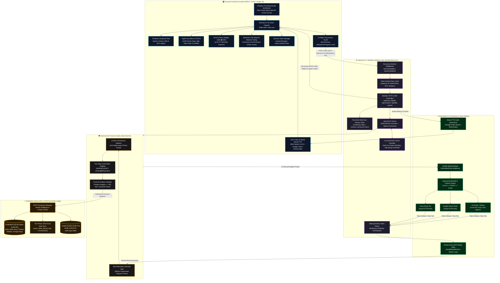

<div align="center">

# فاي • VI
### Autonomous Iraqi AI Financial Agent for Digital Wallets
**وكيل سداد الفواتير والتحويلات المالية الذكي باللهجة العراقية**

<p align="center">
  <strong>An enterprise-grade, autonomous financial agent engineered for Iraqi digital wallets. Features dynamic multi-model LLM failover, deterministic financial safety guardrails, embedded SQLite WAL persistence with ACID transactions, zero-dependency sub-millisecond semantic intent classification, Server-Sent Events (SSE) token streaming with sliding-window action delimiter buffering, procedural Web Audio API haptic sound synthesis (ViHaptics), Apple Pay-style Slide-to-Confirm gesture (0.88 threshold & high-value protection), dual-perspective Fintech Pulse analytics (Expenses vs. Obligations), continuous horizontal banknote chip wheel with balance ceiling guard, interactive contact picker, live dual-currency IQD ⇄ USD conversion, hybrid neural TTS voice synthesis, desktop companion workstation, and resilient self-healing persistence.</strong>
</p>

[](https://nodejs.org/)
[](https://expressjs.com/)
[](#5-embedded-sqlite-persistence-layer--acid-transaction-engine)
[-10b981?style=for-the-badge&logo=node.js&logoColor=white)](#-automated-testing--quality-assurance)
[](#-multi-model-orchestration-engine)
[](#3-high-performance-local-semantic-vector-similarity-classifier-sub-ms-latency)
[](#4-server-sent-events-sse-token-streaming--sliding-window-delimiter-interception)
[](#7-procedural-web-audio-api-haptic-sound-synthesizer-vihaptics)
[-f59e0b?style=for-the-badge)](#15-dual-currency-financial-converter--live-micro-calculator-popover-iqd--usd)
[](#6-algorithmic-token-bucket-rate-limiting--burst-protection)
[](LICENSE)

</div>

---

## 📑 Table of Contents

<details open>
<summary><b>Click to expand or collapse Table of Contents</b></summary>

| Section | Focus Area |
| :--- | :--- |
| [🌟 Executive Summary & Vision](#-executive-summary--vision) | Architectural philosophy, problem space, and the 7 zero-trust financial pillars |
| [🎥 Interactive Demo Walkthrough](#-interactive-demo-walkthrough) | Visual walkthrough of multi-model switching, confirmation cards, slide-to-confirm, and voice flow |
| [🏗️ System Architecture & Data Flow](#️-system-architecture--data-flow) | High-level Mermaid diagram, tier-by-tier deep dive, and request lifecycle |
| [✨ Core Feature Modules](#-core-feature-modules) | Detailed breakdown of the 20 core operational, fintech, and UX capabilities |
| [🧠 Multi-Model Orchestration Engine](#-multi-model-orchestration-engine) | Provider matrix, local offline execution, and automated failover routing |
| [🛡️ Deterministic Security & Guardrails](#️-deterministic-security--guardrails) | Financial integrity rules, contact provenance, and anti-fabrication gates |
| [🩺 Failure Handling & Self-Healing Architecture](#-failure-handling--self-healing-architecture) | The 7 resilience pillars: rate limits, JSON repair, corruption, isolation, faults |
| [📡 API Specifications & Route Reference](#-api-specifications--route-reference) | Endpoints, headers, SSE event protocols, request/response JSON schemas, and status codes |
| [📂 Project Directory Layout](#-project-directory-layout) | Annotated file tree structure reflecting the new modular architecture |
| [⚡ Quick Start & Installation Guide](#-quick-start--installation-guide) | Prerequisites, environment configuration, LM Studio setup, and launch |
| [🧪 Automated Testing & Quality Assurance](#-automated-testing--quality-assurance) | 272-test regression coverage across 59 suites with 100% pass rate |
| [💬 Colloquial Iraqi Dialect Showcase](#-colloquial-iraqi-dialect-showcase) | Real-world linguistic scenarios, slang verbs, and deterministic execution examples |
| [🛠️ Troubleshooting & Extended FAQs](#️-troubleshooting--extended-faqs) | Solutions for common setup issues, audio permissions, and technical Q&A |
| [🗺️ Future Roadmap & License](#️-future-roadmap--license) | Milestones, open-source license, and project credits |

</details>

---

## 🌟 Executive Summary & Vision

**فاي (VI)** is an enterprise-grade autonomous digital wallet assistant engineered specifically for colloquial Iraqi Arabic (*اللهجة العراقية*) and mission-critical financial workflows.

Deploying generative AI directly into banking or payment applications poses severe structural risks: **hallucinated balances**, **silent double debits**, **accidental funds transfers**, and **server downtime on upstream provider outages**. **فاي (VI)** solves these structural problems through a strict **Zero-Trust AI Architecture**:

> ### 🏛️ The 7 Pillars of the Zero-Trust Architecture
>
> 1. **🔒 Deterministic Core Separation**  
>    The language model never performs arithmetic, never computes wallet balances, and cannot directly mutate financial ledgers. All funds transfers, utility settlements, and account records are managed exclusively by an atomic, validated backend state machine.
>
> 2. **💾 Embedded SQLite WAL Engine & ACID Transactional Dual-Write**  
>    High-concurrency Write-Ahead Logging (`PRAGMA journal_mode = WAL`) guarantees full ACID transactions with atomic rollbacks on failure, unique transaction UUIDs across bulk bill operations, and automated disk JSON synchronization for backward compatibility.
>
> 3. **⚡ Zero-Dependency Sub-Millisecond Semantic Intent Classifier**  
>    Offline semantic intent classifier utilizing character n-grams (3-gram, 4-gram), word n-grams (unigram, bigram), L2-normalized sparse vector embeddings, and cosine similarity dot products (<1ms latency), calibrated to a rich colloquial Iraqi financial slang seed corpus.
>
> 4. **🌊 SSE Token Streaming & Sliding-Window Delimiter Interception**  
>    True real-time typewriter token streaming via Server-Sent Events (`text/event-stream`), coupled with a sliding-window delimiter buffer that intercepts and hides raw technical markup (`<<<DB_ACTION>>>`) from user view.
>
> 5. **🛡️ Algorithmic Token Bucket Rate Limiting & Per-Tab Cryptographic Isolation**  
>    Token Bucket algorithm with configurable burst capacity and continuous per-millisecond refill rates, emitting standard RFC headers (`X-RateLimit-*`, `Retry-After`). Every browser tab receives an isolated, cryptographically generated session token stored in `sessionStorage` and transmitted via `X-Session-Id`, backed by disk persistence in `.session_cache.json`.
>
> 6. **🧠 Multi-Model Dynamic Orchestration & Failover Chain**  
>    Seamless runtime switching between **100% Local On-Premise Inference** (via **LM Studio** / **Ollama**) with zero cloud data egress, **Google Gemini Flash** for deep dialectal reasoning, and **Groq Cloud** for sub-second LPU throughput, backed by exponential backoff and closed-loop JSON action self-repair.
>
> 7. **🇮🇶 Native Iraqi Linguistic Comprehension & Tactile Interaction**  
>    Comprehensive parsing of real Iraqi financial colloquialisms (*"دزله 50 ألف"*, *"طير خمسين الف"*, *"شمرلي فليسات"*, *"شكد رصيدي هسة"*, *"صفّيلي اشتراك النت"*, *"سدد كل الفواتير دفعة وحدة"*), coupled with tactile Apple Pay-style **Slide-to-Confirm** gestures (0.88 travel threshold & high-value security protection), procedural Web Audio API haptic sound synthesis (**ViHaptics**), dual-perspective **Fintech Pulse** analytics, a continuous horizontal banknote chip wheel, and animated circular ripple transitions.

[▲ Back to Top](#-table-of-contents)

---

## 🎥 Interactive Demo Walkthrough

<div align="center">


<p align="center">
  <sub>🎬 <strong>فاي (VI) في العمل:</strong> استعراض تفاعلي متكامل لسداد الفواتير، التحويلات المالية عبر السلايدر، المحفظة السريعة الجانبية، الصوت العصبي ومولد النغمات الإجرائي، ومحرك SQLite الموثوق.</sub>
</p>

</div>

[▲ Back to Top](#-table-of-contents)

---

## 🏗️ System Architecture & Data Flow

### Architectural Flowchart



### Tier-by-Tier Architectural Breakdown

<details open>
<summary><b>Click to expand or collapse Tier Breakdown Details</b></summary>

| Tier | Primary Modules | Key Responsibilities & Operational Guarantees |
| :--- | :--- | :--- |
| **1. Executive Frontend** | `frontend/script.js`<br>`frontend/style.css`<br>`frontend/index.html` | • **Apple Pay Slide-to-Confirm**: Interactive slider (`اسحب لتأكيد التحويل`) with 88% travel threshold, high-value transfer detection (> 100,000 IQD) with glowing security badge, RTL drag physics, spring-back below 88% (`cubic-bezier(0.175, 0.885, 0.32, 1.275)`), snap-to-confirm, haptic vibration `[15, 30, 20]`, Web Audio chime, and confetti explosion.<br>• **ViHaptics Procedural Synthesizer**: 100% synthetic Web Audio API procedural sounds: ascending 5-harmonic major chord success chime (C5-E5-G5-C6-C7), 8ms crisp frequency-drop click (`2200Hz -> 1200Hz`), and 130ms dual-tone error thud (`150Hz & 110Hz`).<br>• **Fintech Pulse Dual-Perspective Analytics**: Perspective switcher between actual expenses and pending utility obligations with amber warning gradients (`#f59e0b`), guaranteed 100% donut chart sum, and a 1-tap bulk settlement CTA button (*"سدّد كل الفواتير دفعة وحدة"*).<br>• **Continuous Banknote Chip Wheel**: 7 preset denominations (5K to 500K IQD + USD equivalents) with horizontal scroll-snap panning and real-time balance ceiling validation that disables submit on insufficient funds.<br>• **Interactive Quick Transfer Contact Picker**: Dropdown chevron selector allowing seamless recipient switching directly inside the transfer modal with live monogram generation.<br>• **Circular Ripple View Transition**: iOS & Android 14-style circular clip-path transition expanding from exact button center coordinates via `document.startViewTransition` with reduced-motion compliance. |
| **2. Express Gateway** | `backend/server.js`<br>`backend/src/controllers/`<br>`backend/src/middlewares/` | • **Modular Architecture**: Clean separation into `chatController`, `walletController`, `billsController`, `contactsController`, `feedbackController`, `auditController`, and `ttsController`.<br>• **Token Bucket Rate Limiting**: Burst capacity management (Capacity: 30, Refill: 30/min) emitting standard RFC compliance headers (`X-RateLimit-*`, `Retry-After`) with automated test bypass.<br>• **Sliding-Window Token Parser**: SSE token streaming parser buffering delimiter candidates to intercept and strip `<<<DB_ACTION>>>` markup from visible prose.<br>• **Persistent Session Store**: In-memory `Map` synchronized to `.session_cache.json` on disk with 24-hour TTL pruning. |
| **3. Hybrid NLP & Semantic Engine** | `backend/src/services/nlpRouter.js`<br>`backend/src/services/semanticClassifier.js` | • **Zero-Dependency Semantic Classifier**: Sub-millisecond offline cosine vector similarity using character (3/4-gram) and word (1/2-gram) n-grams, L2 normalization, and calibrated confidence scoring.<br>• **Iraqi Slang Seed Corpora**: Pre-calibrated centroids covering colloquial verbs (*"طيرلي"*, *"شمرلي"*, *"عبرلي"*, *"دزلي فليسات"*, *"صفّيلي اشتراك النت"*, *"منو مسجل يمي بالدفتر"*).<br>• **Deterministic Rule Prioritization**: Exact carrier validation (Zain 078, Asiacell 077, Korek 075), Arabic-Indic / Persian digit normalization, and spoken currency phrasing (*"مليونين ونص"*). |
| **4. Deterministic Safety** | `backend/src/services/walletService.js`<br>`backend/src/services/nlpRouter.js` | • **Contact Provenance Guard**: Phone digits must exist verbatim in the user's input buffer or verified history.<br>• **Two-Step Consent Lock**: Zero funds deducted without secondary verbal confirmation or >88% slide gesture.<br>• **Anti-Fabrication Interceptor**: Intercepts verbal claims of payment when no programmatic action tag was executed. |
| **5. AI Orchestration & Audio** | `backend/src/services/llmService.js`<br>`backend/src/services/ttsEngine.js` | • **Unified Universal Wrapper**: Single wrapper normalizing payloads across LM Studio, Gemini, and Groq.<br>• **Closed-Loop Self-Correction**: Feeds broken action JSON snippets and schema back to LLM at $T = 0.1$ for automated syntax repair.<br>• **Dynamic Failover Matrix**: Automatically transitions requests down the provider chain on HTTP 429 or outages.<br>• **Hybrid Neural TTS**: Sanitizes text, strips internal markup, maps currency abbreviations to natural Arabic, and streams audio from Google Cloud Neural TTS or ElevenLabs. |
| **6. SQLite & ACID Dual-Write** | `backend/src/services/sqliteDb.js`<br>`backend/src/services/auditLogger.js` | • **Embedded SQLite Engine (`wallet.db`)**: Configured with `better-sqlite3`, WAL mode (`PRAGMA journal_mode = WAL`), busy timeout (5000ms), and foreign key constraints.<br>• **ACID Transaction Execution**: Atomic rollbacks on failure, unique transaction UUIDs across bulk payments, and dual-write atomic sync to `mock_wallet_db.json`.<br>• **Tamper-Evident Audit Logging**: Appends immutable structured JSON records to `audit_trail.json` and `audit_logs` SQLite table. |

</details>

### End-to-End Financial Transaction Lifecycle

```text
[User Utterance: "طير 50 ألف لأحمد"] 
       │
       ▼
[Client: Attach X-Session-Id & X-Idempotency-Key] ──► [Lock UI Controls & In-Flight Guard]
       │
       ▼
[Gateway: Token Bucket Rate Limiter Validates Quota & Emits X-RateLimit Headers]
       │
       ▼
[Hybrid NLP Router: Evaluates Message via Local Semantic Vector Classifier (<1ms)]
       │
       ▼
[Dialect Normalizer: "طير 50 ألف" ──► Intent: TRANSFER, Amount: 50,000 IQD]
       │
       ▼
[Disambiguation Engine: Multiple Contacts Named 'أحمد' Detected]
       │
       ▼
[Response to User: Interactive 1-Tap Candidate Selection Cards Rendered]
       │
       ▼
[User Selection: Taps 'أحمد كمال'] ──► [Staging: pendingTransfer staged in Persistent Session]
       │
       ▼
[Response to User: Interactive Verification Card with Apple Pay Slide-to-Confirm Rendered]
       │
       ▼
[User Action: Drags Slider > 88% Threshold (or types/utters "أكد")]
       │
       ▼
[Safety Gate: Verify Idempotency, Provenance, & Strict Balance >= 50,000 IQD]
       │
       ▼
[SQLite ACID Transaction: Deduct Balance & Credit Contact in wallet.db with Atomic Rollback]
       │
       ▼
[Dual-Write Sync: Atomically Export Verified SQLite State to mock_wallet_db.json]
       │
       ▼
[Audit Logging: Append Immutable Audit Record to audit_trail.json & audit_logs table]
       │
       ▼
[Client: Morph Slider to Checkmark, Play ViHaptics Success Chime, Launch Confetti, Re-sync Rail]
```

[▲ Back to Top](#-table-of-contents)

---

## ✨ Core Feature Modules

### 1. Tier-1 Apple Pay Slide-to-Confirm & High-Value Transfer Gate (0.88 Threshold)
* **Zero Accidental Deductions**: The AI agent cannot trigger any financial mutation directly from an initial request.
* **Apple Pay-Style Slide to Confirm (`اسحب لتأكيد التحويل`)**:
  * Replaces standard confirmation buttons with a frictionless interactive sliding thumb track.
  * Dragging is governed by physics-based boundaries with smooth spring-back below the **88% (`0.88`) completion threshold** (`cubic-bezier(0.175, 0.885, 0.32, 1.275)`).
  * **High-Value Transfer Gate (> 100,000 IQD)**: Financial transfers exceeding $100,000\text{ IQD}$ automatically activate an elevated luxury security badge (`high-value-security-badge`), an animated glowing border pulse, and enhanced haptic confirmation.
  * **RTL Displacement Physics**: Tracks drag displacement from right to left with real-time text fading and emerald progress fill expansion.
  * Crossing 88% triggers snap-to-completion, morphing the knob into a glowing emerald checkmark, firing haptic vibration `[15, 30, 20]`, synthesizing a procedural financial chime via **ViHaptics**, and launching a micro-confetti particle explosion.
  * High-contrast design: Pure white metallic shimmer text on royal purple track in Light Theme; vibrant neon emerald track in Dark Theme. Full keyboard accessibility (Space and Enter support).

### 2. Colloquial Iraqi Dialect & Verbal Numeral NLP Engine
* **Native Iraqi Vocabulary**: Comprehends colloquial terms such as *"دزله"*, *"حول"*, *"سدد"*, *"شكد رصيدي"*, *"ما عندي"*, *"عوف الموضوع"*, *"توكل"*, *"قفل السالفة"*.
* **Numeral Normalization**: Automatically normalizes Eastern Arabic-Indic digits (`٠١٢٣٤٥٦٧٨٩`) and Persian digits (`۰۱۲۳۴۵۶۷۸۹`) to ASCII integers.
* **Spoken Monetary Phrasing**: Translates complex verbal currency idioms (*"مليونين ونص"*, *"ميتين وخمسين ألف"*, *"خمسين ورقة"*, *"ورقة ونص"*) into integer IQD values.
* **Carrier Validation**: Strictly enforces valid Iraqi mobile carrier formats (Zain 078, Asiacell 077, Korek 075).

### 3. High-Performance Local Semantic Vector Similarity Classifier (Sub-ms Latency)
* **Zero-Dependency Architecture**: Operates entirely offline without external vector databases or Python services in `backend/src/services/semanticClassifier.js`.
* **Multi-Scale Feature Extraction**:
  * Word unigrams (weight: 1.2) and word bigrams (weight: 1.8).
  * Subword character 3-grams (weight: 0.5) and 4-grams (weight: 0.7).
  * L2-normalized sparse unit vector representations.
* **Cosine Similarity & Calibrated Scoring**: Dot product calculation executed in under 1ms, mapped monotonically through `calibrateConfidence()` with a strict confidence threshold of **0.82**.
* **Pre-Calibrated Iraqi Slang Seed Corpora**:
  * Slang money transfers: *"طيرلي"*, *"شمر خمسين الف"*, *"عبرلي كاش"*, *"دز فليسات"*, *"بيزات"*, *"كروة"*.
  * Slang bill debts & settlements: *"شنو القوائم اللي مكسورة علية"*, *"صفّيلي اشتراك النت"*, *"سدلي اشتراك النت"*.
  * Dialect contact address book retrieval: *"منو مسجل يمي بالدفتر"*, *"طلعلي قائمة المعارف وربعي"*.
  * Colloquial balance inquiries: *"شكد باقي بجيبي"*, *"شوفلي الخردة والفلوس اللي عندي"*.

### 4. Server-Sent Events (SSE) Token Streaming & Sliding-Window Delimiter Interception
* **Real-Time Typewriter Streaming**: Supports standard Server-Sent Events (`text/event-stream`) for sub-second token delivery to the frontend console.
* **SlidingWindowTokenParser**:
  * An in-memory sliding-window token parser in `backend/src/services/streamParser.js`.
  * Buffers partial delimiter candidates (e.g. `<`, `<<<DB_ACTION>>>`, `<CONFIRMATION_REQUIRED>`).
  * **Zero Technical Leaks**: Guarantees that internal JSON action markup and tags are never streamed into the user's visible text stream.
  * Emits clean structured events: `token` (for prose), `action` (for structured operations), `done` (metadata and drawer triggers), and `error`.

### 5. Embedded SQLite Persistence Layer & ACID Transaction Engine
* **High-Performance Embedded Engine**: Utilizes `better-sqlite3` in `backend/src/services/sqliteDb.js` storing relational data in `backend/wallet.db`.
* **Enterprise SQLite PRAGMAs**:
  * Write-Ahead Logging (`PRAGMA journal_mode = WAL`) for concurrent read/write throughput.
  * Foreign key enforcement (`PRAGMA foreign_keys = ON`).
  * Normal synchronous durability (`PRAGMA synchronous = NORMAL`).
  * Busy timeout configured to 5000ms (`PRAGMA busy_timeout = 5000`).
* **ACID Transactions**:
  * `executeTransferTransaction()`: Atomic balance deduction, contact verification, ledger insert, and audit logging with automatic rollback on error.
  * `executeBillPaymentTransaction()`: Atomic single or bulk utility bill settlement with guaranteed unique transaction UUIDs.
  * `addContactTransaction()`: Atomic contact registration.
* **Dual-Write Backward Compatibility**: Automatically seeds from existing JSON databases on startup and exports verified SQLite state to `mock_wallet_db.json` via two-phase atomic writes (`.tmp` + `renameSync`).

### 6. Algorithmic Token Bucket Rate Limiting & Burst Protection
* **Industrial Token Bucket Middleware**: Implemented in `backend/src/middlewares/rateLimiter.js` via the `TokenBucket` class.
* **Tunable Capacity & Refill**:
  * Standard chat limit: Capacity 30 tokens, refill rate 30 tokens/minute.
  * TTS voice limit: Capacity 20 tokens, refill rate 20 tokens/minute.
* **Standard RFC Headers**: Automatically attaches `X-RateLimit-Limit`, `X-RateLimit-Remaining`, `X-RateLimit-Reset`, and `Retry-After` on HTTP 429 responses.
* **Automated Test & Probe Whitelist**: Bypasses rate limiting for automated regression test suites and internal health check probes.

### 7. Procedural Web Audio API Haptic Sound Synthesizer (`ViHaptics`)
* **100% Synthetic Zero-Asset Audio**: Implemented in `frontend/script.js` without any external MP3 or WAV dependencies.
* **Success Chime (`playSuccessChime`)**:
  * Synthesizes a 5-harmonic ascending major chord: **C5** (523.25 Hz), **E5** (659.25 Hz), **G5** (783.99 Hz), **C6** (1046.50 Hz), and a shimmering **C7** overtone (2093.00 Hz).
  * Uses sine wave oscillators with exponential decay gain envelopes and automatic node cleanup on completion.
* **Micro-Click Sound (`playClickSound`)**:
  * Synthesizes an 8ms crisp frequency-drop click (`2200 Hz -> 1200 Hz`) for tactile button presses.
* **Soft Error Thud (`playErrorThud`)**:
  * Synthesizes a 130ms dual-tone detuned pair (`150 Hz & 110 Hz`) for input validation and overdraft warnings.
* **Persistent Audio Preference**: Controlled via header sound pill and TTS popover switch, persisted in `localStorage` under `vi_sound_effects_enabled` with immediate muted state suppression.

### 8. Fintech Pulse Dual-Perspective Visual Analytics (المصروف الفعلي vs الالتزامات المستحقة)
* **Perspective Switcher**: Instant toggle between:
  * **المصروف الفعلي (Actual Expenses)**: Historical expenditure breakdown across utilities and transfers.
  * **الالتزامات المستحقة (Pending Obligations)**: Upcoming unpaid utility bill commitments versus free remaining balance.
* **Interactive SVG Donut Chart**: Guaranteed exact 100% distribution sum with dynamic stroke-dasharray calculations and hover inspection.
* **Amber Obligations Theme**: In obligations mode, the chart morphs with an amber warning gradient (`#f59e0b`) to clearly highlight outstanding financial debts.
* **1-Tap Bulk Settlement CTA**: Displays a high-visibility action button (*"سدّد كل الفواتير دفعة وحدة"*) when unpaid bills exist, dispatching an immediate bulk settlement confirmation flow.
* **Contextual Authentic Iraqi Advice**: Generates tailored financial guidance in Iraqi Arabic based on obligation ratios (e.g. praising zero debt or cautioning when bills exceed 50% of wallet balance).

### 9. Continuous Horizontal Banknote Chip Wheel & Balance Ceiling Guard
* **Continuous Scroll-Snap Wheel**: Horizontal grab-and-drag panning wheel (`quick-transfer-wheel-track`) with CSS scroll-snap (`scroll-snap-type: x mandatory`).
* **7 Preset Banknote Denominations**:
  * $5,000\text{ IQD}$, $10,000\text{ IQD}$, $25,000\text{ IQD}$, $50,000\text{ IQD}$, $100,000\text{ IQD}$, $250,000\text{ IQD}$, and $500,000\text{ IQD}$.
  * Each chip displays its primary Arabic denomination alongside its live secondary USD valuation.
* **Dynamic Balance Ceiling Guard (`validateQuickTransferCeiling`)**:
  * Real-time validation comparing entered amounts against available wallet balance.
  * When an amount exceeds available balance: applies a soft amber border (`#f59e0b`), triggers an input shake animation, displays an authentic Iraqi guidance alert (*"المبلغ المطلوب أكبر من رصيدك المتاح"*), and disables the submit button gracefully (`aria-disabled="true"`).

### 10. Interactive Quick Transfer Contact Picker & Streamlined Modal
* **Interactive Target Card**: Header of the quick transfer modal features an interactive recipient card (`quick-transfer-target-card`) with a dropdown chevron arrow.
* **Seamless In-Modal Recipient Switching**: Tapping the card opens a glassmorphic dropdown picker (`quick-transfer-picker-menu`), allowing users to switch transfer recipients instantly without closing and reopening the modal.
* **Dynamic Monogram & History Sync**: Automatically updates the contact's avatar monogram initial, provider badge, and recent activity timestamp upon selection.
* **Streamlined Executive Aesthetic**: Removed the redundant X close button and cluttering icons from the submit button, displaying clean, authoritative typography (*"إرسال عبر فاي"*).

### 11. Contextual Iraqi Fintech Network Badges & Activity Micro-Timestamps
* **Unified VI Pay Network Branding**: Detects recipient mobile prefixes and account types, rendering a clean, unified **فاي باي (VI Pay)** badge with luminous violet (`status-dot-violet`) and emerald (`status-dot-emerald`) status dots.
* **Relative Chronological Timestamps (`formatRelativeIraqiTimestamp`)**:
  * Cross-references recipient history against transaction ledgers.
  * Formats timestamps in natural Iraqi dialect: *"آخر تحويل: اليوم"*, *"آخر تحويل: البارحة"*, *"قبل يومين"*, *"قبل 4 أيام"*, *"قبل 15 يوماً"*.
  * Clean presentation: contacts without transfer history cleanly omit timestamp labels rather than displaying awkward placeholders.

### 12. State-of-the-Art Circular Ripple View Transition (iOS & Android 14 Style)
* **Coordinate-Anchored View Transition**: Utilizes `document.startViewTransition` dynamically anchored to the exact click coordinates of the theme toggle button:
  * Calculates `--ripple-x`, `--ripple-y`, and `--ripple-r` (maximum distance to the farthest viewport corner).
  * Executes a 380ms circular `clip-path` expansion using modern easing (`cubic-bezier(0.16, 1, 0.3, 1)`).
* **Hardware-Accelerated Pseudo-Elements**: Styled via `::view-transition-old(root)` and `::view-transition-new(root)` with `mix-blend-mode: normal` to eliminate color flashing.
* **Accessibility & Reduced Motion**: Automatically honors `prefers-reduced-motion` and provides synchronous instant fallback on unsupported browsers.

### 13. Dynamic Contextual Actionable Message Chips
* **Smart Follow-Up Chips**: Dynamically appends interactive quick-action chips directly below assistant responses in `frontend/script.js`.
* **Contextual Suggestions**:
  * After balance checks: *"سدد الفواتير"*, *"كشف الحساب"*.
  * After bill summaries: *"ادفع كل الفواتير"*, *"حول لأحمد"*.
  * After money transfers: *"شكد بقى بالرصيد"*, *"الرجوع للقائمة"*.
* **Keyboard & Touch Accessibility**: Full keyboard navigation, glassmorphic hover elevations, and automatic single-submission protection.

### 14. Biometric Ambient Glow & Audio Waveform Synchronization
* **Real-Time RMS Audio Computation**: Web Audio API `AnalyserNode` with FFT size 64 computing exact audio energy ($0.0 \text{ to } 1.0$) during speech recognition and neural TTS playback.
* **Dynamic Chromatic Border Aura**: Modulates border box-shadow and glow intensity dynamically in response to vocal cadence.
* **Animated Waveform Visualizer**: Smooth oscillating canvas bars reflecting user voice frequency in real-time.

### 15. Dual-Currency Financial Converter & Live Micro-Calculator Popover (IQD ⇄ USD)
* **Real-Time Exchange Rate Integration**: Fetches dynamic market exchange rate ($1,310\text{ IQD} = \$1.00\text{ USD}$) via `/api/exchange-rate`.
* **Live Micro-Calculator Popover**:
  * Header currency pill opens an interactive glassmorphic FX calculator popover.
  * Bidirectional live conversion: typing in USD immediately calculates exact IQD equivalents and vice versa, with zero decimal rounding artifacts.
  * Quick preset buttons: $\$10$, $\$50$, $\$100$, $\$500$, and $\$1,000$.
  * 1-Click transfer shortcut button dispatching pre-filled transfer prompts directly to chat.

### 16. Desktop Workstation Layout & Reactive Companion Rail (Quick Wallet)
* **Widescreen Ergonomic Dock**: Collapsible sidebar docked on desktop viewports ($\ge 1100\text{px}$) featuring:
  * Live balance widget with privacy eye toggle.
  * Quick contacts carousel with initial monograms and 1-tap transfer shortcuts.
  * Pending utility bills list with instant settlement buttons.
  * Compact mini-ledger tracking latest transactions.
  * Collapsible toggle with persistence in `localStorage`.
* **Full Real-Time Reactivity**:
  * **Chat Sync**: Immediately updates contacts and bills following any conversational transfer or bill settlement.
  * **Drawer Refresh**: Synchronizes all companion widgets when the transaction drawer refresh button is clicked.
  * **Window Focus Detection**: Automatically checks for external modifications to `mock_wallet_db.json` when returning to the tab.
  * **Background Auto-Sync**: 15-second background polling keeps the UI synchronized with the database.

### 17. Hybrid Neural Text-to-Speech (TTS) Voice Engine & Liquid Glassy Settings Popover
* **High-Fidelity Audio Synthesis**:
  * **Google Cloud Neural Arabic Voice**: Free, zero-config high-fidelity neural Arabic voice (`ar-XA`) streamed directly from `/api/tts`.
  * **Optional ElevenLabs Studio Voice**: Configurable via `ELEVENLABS_API_KEY` and `ELEVENLABS_VOICE_ID` in `.env`.
  * **Browser Web Speech Synthesis**: Automatic seamless client-side fallback if cloud providers are unreachable.
* **Liquid Glassy Voice Popover**:
  * Floating bubble settings menu accessible from the header sound capsule.
  * Model & Voice personality switcher (Google Neural Voice vs. Device Local Voice).
  * Speed control pills: **`0.85x` (الهادئ)**, **`1.05x` (المتزن / الطبيعي)**, and **`1.3x` (السريع)**.
* **Phonetic & Dialectal Text Sanitization**:
  * Strips internal programmatic action tags (`<<<DB_ACTION>>>`), markdown formatting, and emojis.
  * Replaces currency abbreviations (`IQD`, `د.ع`) with natural spoken Arabic (*"دينار عراقي"*).

### 18. Smart Contact Disambiguation & Interactive Candidate Selection Cards
* **Duplicate Name Resolution**: When transferring to a common name (e.g., *"أحمد"*), the engine detects multiple matches and dynamically renders interactive 1-tap candidate selection cards displaying verified aliases, avatars, and phone numbers.
* **Multi-Format Selection**: Users can resolve candidates by single-tap, numeric index (`1`, `2`), Arabic-Indic numbers (`١`, `٢`), ordinal text (*"الأول"*, *"الثاني"*), phone suffix, or alias keyword.
* **Intent Abandonment Parsing**: If the user abandons the intent (*"عوفه وبطلت"*, *"مو ذولي"*, *"ما أعرفه"*), `isDisambiguationAbandonment()` purges all pending states immediately.

### 19. Complete Utility & Telecom Bill Payment System
* **Pre-Integrated Biller Categories**: National Electricity Grid (*الكهرباء الوطنية*), Municipal Water (*الماء والخدمات البلدية*), Mobile Telecommunications (*فواتير خط الهاتف والاتصالات*), and Fiber/4G Internet (*فواتير الإنترنت والألياف الضوئية*).
* **Single, Bulk, or Companion Settlement**: Settle an individual service (*"ادفع فاتورة الإنترنت"*), pay all outstanding bills in one atomic transaction (*"ادفع كل الفواتير اللي عليه"*), or click the **1-Click Pay** button directly in the desktop companion rail.

### 20. Tamper-Evident Security Audit Logging & Cryptographic Session Isolation
* Every financial operation (successful or blocked) is appended atomically to `audit_trail.json` and inserted into the `audit_logs` SQLite table.
* Distinct browser tabs maintain separate conversation contexts, pending transfers, and disambiguation states via per-tab UUID tokens in `sessionStorage` and `X-Session-Id` headers.

[▲ Back to Top](#-table-of-contents)

---

## 🧠 Multi-Model Orchestration Engine

**فاي (VI)** incorporates dynamic multi-provider routing through a centralized completion wrapper (`callUnifiedChatCompletion` in `backend/src/services/llmService.js`):

### Provider Comparison & Specification Matrix

| Feature / Metric | LM Studio *(Recommended Default)* | Google Gemini Flash | Groq Cloud |
| :--- | :--- | :--- | :--- |
| **Execution Mode** | **100% Local / On-Premise** | Cloud HTTPS API | Cloud HTTPS API (LPU) |
| **Data Privacy** | **Zero Data Egress** (Local Hardware) | Encrypted Transit | Encrypted Transit |
| **Recommended Model** | `Qwen2.5-7B-Instruct` / `Llama-3.1-8B` | `gemini-1.5-flash` / `gemini-3.5-flash-lite` | `qwen/qwen3.8-27b` / `llama-3.3-70b` |
| **Quantization** | `Q4_K_M` or `Q5_K_M` GGUF | Cloud Full Precision | Cloud Full Precision |
| **Inference Latency** | ~20–40 ms/token (Hardware dependent) | ~300–800 ms TTFT | **< 150 ms TTFT (Ultra-Fast)** |
| **API Key Required** | ❌ **None** (`lm-studio`) | ✅ `GEMINI_API_KEY` | ✅ `GROQ_API_KEY` |
| **Cost** | **$0.00 (Completely Free & Offline)** | Free Tier / Pay-as-you-go | Free Tier / Pay-as-you-go |

### Automated Exponential Backoff & Failover Chain

If an active model experiences network connection drops, timeouts, or HTTP 429 rate limits, the system shifts automatically through a deterministic failover chain without dropping user session state:

```javascript
const FAILOVER_CHAIN = {
    local: ['gemini', 'groq'],
    gemini: ['groq', 'local'],
    groq: ['gemini', 'local']
};
```

1. **Retry Logic**: `callProviderWithBackoff()` initiates a 3-attempt exponential backoff sequence (500ms $\rightarrow$ 1000ms $\rightarrow$ 2000ms).
2. **Transparent Failover**: If retries are exhausted on the active model, `callUnifiedChatCompletion()` automatically redirects the request down `FAILOVER_CHAIN`.
3. **Graceful Fallback**: If all configured options fail, the gateway returns an informative diagnostic message in colloquial Iraqi Arabic with clear instructions on starting LM Studio or verifying API keys.

[▲ Back to Top](#-table-of-contents)

---

## 🛡️ Deterministic Security & Guardrails

| Guardrail Layer | Implementation Module | Enforcement Rule | Security Guarantee |
| :--- | :--- | :--- | :--- |
| **Anti-Hallucination Gate** | `sqliteDb.js` / `walletService.js` | Balances and bills are read strictly from SQLite; LLM never computes arithmetic. | Impossible for the model to guess or hallucinate wallet balances. |
| **Contact Provenance** | `nlpRouter.js` (`extractUserPhoneCandidates`) | Phone digits must exist verbatim in the user's input buffer or verified history. | Prevents LLM from inventing fake contact phone numbers. |
| **Two-Step Consent Lock** | `chatController.js` / Slide-to-Confirm | Operations are staged in memory; execution requires explicit secondary verbal consent or >88% slide drag. | Zero accidental balance deductions or unauthenticated transfers. |
| **Strict Integer Validator** | `sqliteDb.js` (`executeTransferTransaction`) | Transfer amounts must be integers $\ge 250\text{ IQD}$; fractions and negative values rejected. | Eliminates fractional rounding bugs and negative balance exploits. |
| **Overdraft Protection** | `sqliteDb.js` (`executeTransferTransaction`) | Amount is verified against available balance before atomic transaction commit. | Prevents account balance from dropping below zero. |
| **Idempotency Guard** | `sqliteDb.js` / `rateLimiter.js` | Unique request keys return cached receipts for identical payloads. | Prevents duplicate debit transactions on network retries. |
| **Token Bucket Limiter** | `rateLimiter.js` (`createTokenBucketRateLimiter`) | Client requests exceeding bucket capacity are throttled with HTTP 429 and Retry-After. | Protects backend from DDoS, brute-force attacks, and quota depletion. |
| **Anti-Fabrication Intercept** | `walletService.js` Response Gate | Verbal claims of payment without verified `<<<DB_ACTION>>>` tags are intercepted. | Guarantees user is alerted if an LLM claims payment without executing it. |
| **Security Audit Trail** | `auditLogger.js` / `sqliteDb.js` | Every financial operation is appended atomically to `audit_trail.json` and `audit_logs` table. | Creates an immutable, tamper-evident record for security audits. |

[▲ Back to Top](#-table-of-contents)

---

## 🩺 Failure Handling & Self-Healing Architecture

The system is engineered with an active self-healing architecture structured across 7 core resilience pillars:

```
┌────────────────────────────────────────────────────────────────────────────┐
│                    7 PILLARS OF SELF-HEALING RESILIENCE                    │
├────────────────────────────────────────────────────────────────────────────┤
│ 1. Upstream LLM Outages     ◄── Exponential backoff & failover chain       │
│ 2. JSON Action Repair       ◄── Closed-loop self-correction prompt ($T=0.1)│
│ 3. Database Ledger Recovery ◄── SQLite WAL mode + JSON dual-write fallback │
│ 4. Rate Limiting & Bursts   ◄── Token Bucket rate limiter & RFC 429 headers│
│ 5. Multi-Tab State Bleed    ◄── Cryptographic per-tab session isolation    │
│ 6. Ambiguity & Abandonment  ◄── Interactive disambiguation & auto-purge    │
│ 7. Network & Speech Faults  ◄── Unconditional unlock & continuous voice    │
└────────────────────────────────────────────────────────────────────────────┘
```

### 1. Upstream LLM Failures, Rate Limits & Outages
* 🎯 **Failure Scenario**: Upstream model returns HTTP 429, HTTP 500–504, `ECONNREFUSED`, `ETIMEDOUT`, or `ECONNRESET`.
* ⚙️ **Under the Hood**: `isRetryableError()` detects error patterns $\rightarrow$ `callProviderWithBackoff()` initiates a 3-attempt exponential backoff sequence (500ms $\rightarrow$ 1000ms $\rightarrow$ 2000ms) $\rightarrow$ If exhausted, `callUnifiedChatCompletion()` transitions to the next engine in `FAILOVER_CHAIN` (`local` $\rightarrow$ `gemini` $\rightarrow$ `groq`).
* 🛡️ **Self-Healing Guarantee**: **Graceful Degradation** — The backend process does not crash, HTTP 500 is prevented, and the conversation session remains intact.

### 2. Generative Action Tag Parsing & Closed-Loop Repair
* 🎯 **Failure Scenario**: The LLM outputs malformed, unclosed, or invalid JSON syntax within structured action tags (`<<<DB_ACTION>>>`).
* ⚙️ **Under the Hood**: Primary `JSON.parse()` fails $\rightarrow$ Closed-loop handler builds a targeted repair prompt with the broken snippet, syntax error, and JSON schema $\rightarrow$ Request dispatched at $T = 0.1$ (`max_tokens: 300`) $\rightarrow$ Markdown fences stripped and payload re-parsed $\rightarrow$ If unrepairable, mutation is safely aborted.
* 🛡️ **Self-Healing Guarantee**: **Fail-Safe Abort** — The database is protected from partial mutations, zero funds are deducted, and the user receives a clean retry prompt.

### 3. Database Ledger Recovery & SQLite WAL Dual-Write
* 🎯 **Failure Scenario**: `mock_wallet_db.json` is missing or corrupted, or `wallet.db` encounters a file lock (`EPERM` / `EBUSY`).
* ⚙️ **Under the Hood**: `getSqliteDb()` automatically creates structured tables and seeds records from `INITIAL_DB` if missing $\rightarrow$ Write-Ahead Logging (`WAL`) mode allows simultaneous readers and writers $\rightarrow$ `syncSqliteWithJsonObject()` writes to `.tmp` first, then executes atomic `renameSync` with fallback to `copyFileSync` + `unlinkSync` on Windows file locks.
* 🛡️ **Self-Healing Guarantee**: **Self-Healing & Tamper-Proof** — Server boots and operates even if database files are deleted from the disk mid-flight.

### 4. Algorithmic Token Bucket Rate Limiting & Burst Protection
* 🎯 **Failure Scenario**: Client submits rapid bursts of chat or TTS requests that could deplete API quotas or overwhelm the server.
* ⚙️ **Under the Hood**: `TokenBucket` evaluates token balance against request cost $\rightarrow$ If exhausted, returns HTTP 429 with standard headers: `X-RateLimit-Limit`, `X-RateLimit-Remaining: 0`, `X-RateLimit-Reset`, and `Retry-After` (in seconds).
* 🛡️ **Self-Healing Guarantee**: **Automated Traffic Shaping** — Protects server resources while allowing legitimate traffic bursts.

### 5. Multi-User & Multi-Tab State Isolation
* 🎯 **Failure Scenario**: Multiple users access the console simultaneously, or a single user opens multiple concurrent browser tabs.
* ⚙️ **Under the Hood**: Client generates unique UUID in `sessionStorage` transmitted via `X-Session-Id` header and JSON body $\rightarrow$ Backend routes requests to distinct memory instances in `sessions = new Map()` $\rightarrow$ Sessions are persisted to `.session_cache.json` and inactive sessions pruned after 24 hours (`SESSION_TTL_MS`).
* 🛡️ **Self-Healing Guarantee**: **Strict State Encapsulation** — Multiple tabs operate independently without cross-contamination.

### 6. Ambient Contact Ambiguity & Intent Abandonment
* 🎯 **Failure Scenario**: User transfers to a non-unique name (*"حول لأحمد"*), provides missing parameters, or abandons the operation (*"ما أعرفه"*, *"مو ذولي"*, *"عوفه وبطلت"*).
* ⚙️ **Under the Hood**: `findAmbiguousContacts()` detects multiple name matches and halts execution without deduction $\rightarrow$ Interactive 1-tap candidate cards returned $\rightarrow$ If user replies with abandonment terms, `isDisambiguationAbandonment()` purges pending states $\rightarrow$ If user cancels (*"إلغاء"*), all pending operations are wiped cleanly.
* 🛡️ **Self-Healing Guarantee**: **Graceful Degradation** — Stale transactions never linger in memory; accidental transfers to wrong recipients are prevented.

### 7. Frontend Network Faults & Continuous Speech Recovery
* 🎯 **Failure Scenario**: Backend takes longer than 30s to respond, network drops, or Web Speech API pauses during vocal pauses.
* ⚙️ **Under the Hood**: `sendMessageToBackend()` sets 30,000ms `AbortController` timeout $\rightarrow$ Submission cycle runs in `try...catch...finally` where `finally` unconditionally sets `isRequestInProgress = false`, calls `setInputState(true)`, and hides typing indicator $\rightarrow$ Speech recognition `onend` auto-calls `recognition.start()`.
* 🛡️ **Self-Healing Guarantee**: **Self-Healing Interface** — The UI never locks permanently, and speech recording handles natural vocal pauses without premature termination.

[▲ Back to Top](#-table-of-contents)

---

## 📡 API Specifications & Route Reference

### Endpoints Overview

| Method | Endpoint | Description | Request Headers |
| :--- | :--- | :--- | :--- |
| `POST` | `/api/chat` | Main conversational reasoning, action execution, and SSE streaming endpoint. | `X-Session-Id`, `X-Idempotency-Key`, `Accept` |
| `GET` | `/api/db` | Retrieves complete active wallet state (user, balance, contacts, bills). | — |
| `GET` | `/api/contacts` | Retrieves verified contacts list for companion rail and quick-actions. | — |
| `GET` | `/api/bills` | Retrieves all pending and paid utility and telecom bills. | — |
| `GET` | `/api/transactions` | Retrieves recent transaction ledger with totals and metrics. | — |
| `GET` | `/api/exchange-rate` | Retrieves dynamic exchange rate config for dual-currency widget (1,310 IQD/USD). | — |
| `POST` | `/api/tts` | Synthesizes Arabic speech via Google Cloud Neural TTS or ElevenLabs with streaming audio buffer. | — |
| `POST` | `/api/reset` | Resets session memory and restores wallet database to defaults. | `X-Session-Id` |
| `GET` | `/api/audit` | Retrieves tamper-evident security audit logs. | — |
| `POST` | `/api/feedback` | Records user satisfaction ratings (likes / dislikes) for AI responses. | — |
| `GET` | `/api/feedback/likes` | Retrieves all positive evaluation entries. | — |
| `GET` | `/api/feedback/dislikes` | Retrieves all negative evaluation entries for alignment review. | — |

<details>
<summary><b>Click to expand detailed Request & Response JSON schemas</b></summary>

#### 1. `POST /api/chat` (Standard JSON Mode)
* **Request**:
  ```json
  {
    "message": "حول 50 ألف لأحمد كمال",
    "provider": "local",
    "sessionId": "sess_9b1deb4d-3b7d-4bad-9bdd-2b0d7b3dcb6d",
    "idempotency_key": "req_1729198200000_abc123",
    "stream": false
  }
  ```
* **Response (200 OK)**:
  ```json
  {
    "response": "تمام، راح أحول 50,000 د.ع لأحمد كمال. متأكد من التحويل؟",
    "status": "CONFIRMATION_REQUIRED",
    "openTransactionsDrawer": false
  }
  ```

#### 2. `POST /api/chat` (Server-Sent Events Streaming Mode)
* **Request Headers**: `Accept: text/event-stream`, `X-Session-Id: sess_9b1deb4d...`
* **Request Body**: `{"message": "شكد رصيدي", "stream": true}`
* **Stream Events (200 OK)**:
  ```text
  data: {"token": "رصيدك "}

  data: {"token": "الحالي "}

  data: {"token": "هو 3,000,000 د.ع"}

  data: {"done": true, "fullResponse": "رصيدك الحالي هو 3,000,000 د.ع", "openTransactionsDrawer": false}
  ```

#### 3. `GET /api/db`
* **Response (200 OK)**:
  ```json
  {
    "user": {
      "id": "usr_1001",
      "name": "محمد",
      "phone": "+9647801234567",
      "balance": 3000000,
      "currency": "IQD"
    },
    "contacts": [
      {
        "id": "cnt_2001",
        "name": "أحمد",
        "alias": "أحمد كمال (صديق الجامعة)",
        "phone": "+9647801122334"
      }
    ],
    "bills": [
      {
        "id": "bill_3001",
        "name": "فاتورة الكهرباء الوطنية",
        "amount": 45000,
        "status": "unpaid"
      }
    ],
    "transactions": []
  }
  ```

#### 4. `GET /api/contacts`
* **Response (200 OK)**:
  ```json
  {
    "contacts": [
      {
        "id": "cnt_2001",
        "name": "أحمد",
        "alias": "أحمد كمال (صديق الجامعة)",
        "phone": "+9647801122334"
      },
      {
        "id": "cnt_2002",
        "name": "سيف",
        "alias": "سيف علي (زميل العمل)",
        "phone": "+9647809988776"
      }
    ]
  }
  ```

#### 5. `GET /api/bills`
* **Response (200 OK)**:
  ```json
  {
    "bills": [
      {
        "id": "bill_3001",
        "name": "فاتورة الكهرباء الوطنية",
        "service": "electricity",
        "amount": 45000,
        "account": "ELEC-90214",
        "dueDate": "2026-10-25",
        "status": "unpaid"
      }
    ]
  }
  ```

#### 6. `GET /api/exchange-rate`
* **Response (200 OK)**:
  ```json
  {
    "base": "USD",
    "target": "IQD",
    "rate": 1310,
    "lastUpdated": "2026-10-20T18:00:00.000Z"
  }
  ```

#### 7. `POST /api/tts`
* **Request**:
  ```json
  {
    "text": "تم تحويل 50,000 دينار عراقي بنجاح"
  }
  ```
* **Response (200 OK)**:
  * Headers: `Content-Type: audio/mpeg`, `X-TTS-Engine: google-arabic-cloud`
  * Body: Binary MP3 audio buffer stream.

#### 8. `GET /api/transactions`
* **Response (200 OK)**:
  ```json
  {
    "transactions": [
      {
        "id": "trx_1729198200000",
        "type": "TRANSFER",
        "recipient": "أحمد كمال",
        "amount": 50000,
        "currency": "IQD",
        "status": "SUCCESS",
        "date": "2026-10-17"
      }
    ],
    "totalCount": 1
  }
  ```

#### 9. `POST /api/reset`
* **Response (200 OK)**:
  ```json
  {
    "success": true,
    "message": "Database and session state successfully reset to initial default values."
  }
  ```

#### 10. `GET /api/audit`
* **Response (200 OK)**:
  ```json
  {
    "success": true,
    "count": 1,
    "logs": [
      {
        "id": "audit_1729198200000_xyz789",
        "timestamp": "2026-10-17T21:00:00.000Z",
        "sessionId": "sess_9b1deb4d-3b7d-4bad-9bdd-2b0d7b3dcb6d",
        "actionType": "TRANSFER",
        "sourceAccount": "usr_1001",
        "destination": "+9647801122334",
        "amount": 50000,
        "currency": "IQD",
        "idempotencyKey": "req_1729198200000_abc123",
        "executionStatus": "SUCCESS"
      }
    ]
  }
  ```

</details>

[▲ Back to Top](#-table-of-contents)

---

## 📂 Project Directory Layout

```text
VI/
├── 📁 assets/
│   ├── 🎬 demo_walkthrough.gif         # Animated interactive demonstration
│   ├── 🖼️ logo-emerald.png             # Luxury Emerald brand logo (Dark Theme)
│   ├── 🖼️ logo-violet.png              # Royal Violet brand logo (Light Theme)
│   ├── 🖼️ bot-emerald.png              # Assistant avatar for Dark Theme
│   └── 🖼️ bot-violet.png               # Assistant avatar for Light Theme
│
├── 📁 backend/
│   ├── 📄 server.js                    # Express 5.x server entrypoint, middleware mounting, and facade exports
│   ├── 📄 reset_db.js                  # Standalone database and conversation state reset utility
│   ├── 📄 mock_wallet_db.json          # Primary JSON wallet database (User, Contacts, Bills, Ledger)
│   ├── 📄 wallet.db                    # Embedded SQLite WAL database (ACID Transactions Engine)
│   ├── 📄 audit_trail.json             # Immutable security audit trail of financial mutations
│   ├── 📄 feedback_likes.json          # User satisfaction feedback (Likes)
│   ├── 📄 feedback_dislikes.json       # User satisfaction feedback (Dislikes)
│   │
│   ├── 📁 src/
│   │   ├── 📁 config/
│   │   │   ├── 📄 providers.js         # Provider definitions, failover chain, paths, and timeouts
│   │   │   ├── 📄 exchangeRate.js      # Dual-currency market exchange rate configuration
│   │   │   └── 📄 initialDb.js         # Pristine initial database template for self-healing rebuilds
│   │   │
│   │   ├── 📁 controllers/
│   │   │   ├── 📄 chatController.js    # Conversational intent handling, SSE streaming, and action dispatch
│   │   │   ├── 📄 walletController.js  # Balances, transactions, and database reset handlers
│   │   │   ├── 📄 billsController.js   # Utility bills retrieval and management
│   │   │   ├── 📄 contactsController.js# Verified contacts retrieval
│   │   │   ├── 📄 feedbackController.js# User satisfaction feedback (Likes/Dislikes)
│   │   │   ├── 📄 auditController.js   # Security audit trail retrieval
│   │   │   └── 📄 ttsController.js     # Neural Arabic voice synthesis handler
│   │   │
│   │   ├── 📁 middlewares/
│   │   │   ├── 📄 securityHeaders.js   # HTTP security headers, CORS, and framing protection
│   │   │   ├── 📄 sessionValidator.js  # Per-tab cryptographic session ID validation
│   │   │   ├── 📄 rateLimiter.js       # Algorithmic Token Bucket rate limiter with RFC headers
│   │   │   └── 📄 errorHandler.js      # Global uncaught error and fallback handler
│   │   │
│   │   ├── 📁 prompts/
│   │   │   ├── 📄 systemPrompt.js      # Dynamic conversational system prompt with dialect constraints
│   │   │   ├── 📄 dialectGuidelines.js # Iraqi Arabic dialect rules and phonetic vocabulary
│   │   │   └── 📄 recoveryPrompts.js   # Closed-loop JSON syntax repair and recovery prompts
│   │   │
│   │   └── 📁 services/
│   │       ├── 📄 sqliteDb.js          # SQLite singleton, WAL PRAGMAs, and ACID transaction executor
│   │       ├── 📄 semanticClassifier.js# Zero-dependency local semantic vector similarity classifier
│   │       ├── 📄 nlpRouter.js         # Hybrid NLP router, digit normalizer, and dialect parser
│   │       ├── 📄 walletService.js     # Wallet state mutations, model actions, and self-correction loop
│   │       ├── 📄 sessionStore.js      # Multi-user session management with disk persistence
│   │       ├── 📄 llmService.js        # Multi-model wrapper with exponential backoff and failover
│   │       ├── 📄 streamParser.js      # Sliding-window SSE delimiter interceptor and parser
│   │       ├── 📄 auditLogger.js       # Atomic tamper-evident audit logging service
│   │       └── 📄 ttsEngine.js         # Text sanitization and neural audio chunking
│   │
│   └── 📁 tests/
│       └── 📄 regression_suite.test.js  # 272-test automated regression and security suite (59 suites)
│
├── 📁 frontend/
│   ├── 📁 assets/                      # Mirrored UI assets (brand marks and bot icons)
│   ├── 📄 index.html                   # Semantic layout (Header, Companion Rail, Slide-to-Confirm, FX Popover)
│   ├── 📄 style.css                    # Liquid glassmorphism, dual luxury themes, animations, particle canvas
│   └── 📄 script.js                    # Controller, ViHaptics synthesizer, Slide-to-Confirm, FX calculator, contact picker
│
├── 📄 .env                             # Environment variables & API credentials (Git-ignored)
├── 📄 .env.example                     # Safe configuration template with local & cloud keys
├── 📄 .gitignore                       # Git exclusion rules
├── 📄 wallet_db_schema.json            # Formal JSON Schema defining wallet data models
├── 📄 package.json                     # Project dependencies and test runner scripts
├── 📄 package-lock.json                # Locked dependency tree
├── 📄 LICENSE                          # MIT Open Source License
└── 📄 README.md                        # Comprehensive technical documentation
```

[▲ Back to Top](#-table-of-contents)

---

## ⚡ Quick Start & Installation Guide

### Step 1: System Prerequisites & Verification

Ensure Node.js and Git are installed:

| Prerequisite | Minimum Version | Recommended | Verification Command |
| :--- | :--- | :--- | :--- |
| **Node.js** | `v18.0.0` | `v20.x LTS` or higher | `node -v` |
| **npm** | `v9.0.0` | `v10.x` or higher | `npm -v` |
| **Git** | `v2.30+` | Latest stable | `git --version` |
| **Browser** | Chromium-based | Chrome / Edge / Brave | Required for Web Speech API (`ar-IQ`) & Web Audio |

```bash
node -v
npm -v
git --version
```

### Step 2: Clone the Repository

```bash
git clone https://github.com/double-u9/VI.git
cd VI
```

### Step 3: Install Dependencies

```bash
npm install
```

### Step 4: Configure Environment Variables (.env)

Create your local `.env` configuration file from the template:

* **PowerShell (Windows)**:
  ```powershell
  Copy-Item .env.example .env
  ```
* **Bash (Linux / macOS) or Command Prompt**:
  ```bash
  cp .env.example .env
  ```

Open `.env` and configure settings:

```env
# 1. Local LM Studio (Default port is 1234, zero data egress)
LM_STUDIO_URL=http://127.0.0.1:1234/v1
LOCAL_API_KEY=lm-studio

# 2. Google Gemini Flash (Optional Cloud Provider)
GEMINI_API_KEY=your_gemini_api_key_here

# 3. Groq Cloud (Optional Cloud Provider)
GROQ_API_KEY=your_groq_api_key_here

# 4. Web Server Port (Defaults to 3000)
PORT=3000

# 5. Optional: ElevenLabs Cloud TTS (Realistic Studio Voice)
# Leave blank to use Free Google Cloud Neural Arabic TTS & ViHaptics Procedural Synthesis
ELEVENLABS_API_KEY=
ELEVENLABS_VOICE_ID=
```

> [!NOTE]
> If you run **LM Studio locally**, you do **not need any cloud API keys**! Both local AI reasoning, procedural audio, and the neural Arabic voice will function out of the box.

### Step 5: Setup AI Model Provider (Local vs. Cloud)

#### Option A: Local Model with LM Studio (Recommended)
1. Download and install **[LM Studio](https://lmstudio.ai/)**.
2. Search for and download **`Qwen2.5-7B-Instruct`** (Recommended) or **`Meta-Llama-3.1-8B-Instruct`** (`Q4_K_M` quantization).
3. In LM Studio, navigate to the **Developer / Local Server (`<->`)** tab.
4. Select the model from the top bar, ensure port is set to **`1234`**, and click **Start Server**.

#### Option B: Cloud AI Engines (Instant Setup)
* **Google Gemini**: Obtain an API key from **[Google AI Studio](https://aistudio.google.com/)** and set `GEMINI_API_KEY`.
* **Groq Cloud**: Obtain an API key from **[Groq Console](https://console.groq.com/)** and set `GROQ_API_KEY`.

### Step 6: Launch Backend & Open Web Console

```bash
npm start
```

Open your browser and navigate to:  
👉 **`http://localhost:3000`**

[▲ Back to Top](#-table-of-contents)

---

## 🧪 Automated Testing & Quality Assurance

The repository includes an extensive automated test suite built with Node.js's native test runner (`node:test` and `node:assert/strict`).

Run the complete test suite:

```bash
npm test
```

### Test Coverage Summary: 272 Tests Across 59 Suites (100% Pass Rate)

| Task Suite / Category | Tested Capabilities & System Invariants | Suite Count | Test Count | Status |
| :--- | :--- | :---: | :---: | :---: |
| **Task 1: Phone Numbers, Accounts & Dialect Normalization** | Valid 078 formats, invalid lengths, unsupported carriers (075/077), account & card formats (10-16 digits), Arabic-Indic digit normalization (`٠-٩`), Persian digit normalization (`۰-۹`), monetary phrasing (*مليونين ونص*, *ميتين وخمسين الف*), transfer limits, and `/api/chat` E2E workflow. | 13 Suites | 44 Tests | ✅ **Passed** |
| **Task 2: Bill Payments, Ambiguous Contacts & Contact Creation** | Utility bill settlement (single, bulk, overdraft, paid status), contact disambiguation and abandonment handling (*عوفه وبطلت*), multi-message contact creation, and phone provenance validation. | 4 Suites | 19 Tests | ✅ **Passed** |
| **Task 3: History Limits & Frontend Duplicate Protection** | Conversation history trimming without state loss, frontend in-flight submission guard (`isRequestInProgress`), and backend idempotency protection. | 3 Suites | 9 Tests | ✅ **Passed** |
| **Task 4: Security Audit Logging & Financial Integrity** | Multi-user session isolation across distinct `sessionId` tokens, double-spend prevention via idempotency keys, financial validation (negative, zero, fractional, below 250 IQD amounts), and audit trail immutability with atomic disk I/O. | 5 Suites | 15 Tests | ✅ **Passed** |
| **Task 5: Hybrid Text-To-Speech (TTS) Voice Engine & Proactive Intelligence** | Speech text sanitization, dialect audio formatting, frontend TTS state and control guards, backend `/api/tts` endpoint, fallback protocol, and proactive financial intelligence calculations. | 5 Suites | 14 Tests | ✅ **Passed** |
| **Task 6: Contacts Inquiry Intent Routing & Voice Visualizer Integrity** | Contact list inquiry intent identification, exclusion guards (`isBillInquiry`, `classifyRecipient`, `isUserCancellation`), E2E chat API dispatch for contacts inquiries, and voice visualizer state checks. | 4 Suites | 13 Tests | ✅ **Passed** |
| **Task 7: Resilient Bot Avatar & Browser Cross-Compatibility** | Dual-theme assistant avatars, fallback error handling, and browser cross-compatibility. | 1 Suite | 2 Tests | ✅ **Passed** |
| **Task 8: Tier-1 Interactive Fintech Contacts Grid & Carousel** | Avatar monograms, gradient initial generation, responsive contact carousel, and shortcut click handlers. | 1 Suite | 4 Tests | ✅ **Passed** |
| **Task 9: Organic Circular Ripple View Transition (iOS & Android 14)** | Modern circular view transitions, `document.startViewTransition` clip-path animation, reduced-motion fallbacks, and theme state persistence. | 1 Suite | 5 Tests | ✅ **Passed** |
| **Task 10: Luxury Tactile Audio Chime & Digital Micro-Confetti Celebration** | Synthesized Web Audio API financial chime (880Hz $\rightarrow$ 1320Hz), 36 metallic particle canvas confetti burst, mute state respect, and auto-cleanup. | 1 Suite | 6 Tests | ✅ **Passed** |
| **Task 11: Ambient Audio-Reactive Chromatic Aura (Gemini & Siri Style)** | Dynamic microphone audio-reactive glow scaling, dual-theme color modulation, and hardware-accelerated transitions. | 1 Suite | 5 Tests | ✅ **Passed** |
| **Task 12: Desktop Workstation Layout & Collapsible Companion Rail** | Companion rail markup, widescreen layout, localStorage state persistence, quick contact transfer shortcuts, live balance/bills sync, and `/api/contacts` & `/api/bills` endpoints. | 1 Suite | 12 Tests | ✅ **Passed** |
| **Task 13: Tier-1 Apple Pay Slide to Confirm Interactive Slider** | Friction-based slider track markup, spring-back cubic-bezier physics, snap-to-confirm, haptic vibration `[15, 30, 20]`, and keyboard accessibility (Enter/Space). | 1 Suite | 6 Tests | ✅ **Passed** |
| **Task 14: Dual-Currency Financial Toggle and Converter Widget (IQD ⇄ USD)** | `/api/exchange-rate` endpoint, mathematical conversion precision, dual-balance display, 3D flip animation, and quick transfer chip updates. | 1 Suite | 7 Tests | ✅ **Passed** |
| **Task 15: Tier-1 Apple iOS 18 Micro-Interactions & Skeleton Shimmer Physics** | Apple iOS 18 cubic-bezier motion tokens, tactile `scale(0.96)` press-down states, skeleton shimmer DOM generators, and reduced-motion compliance. | 1 Suite | 6 Tests | ✅ **Passed** |
| **Task 16: Bespoke Fintech Pulse (نبض المحفظة) Visual Analytics Card** | Mathematical expenditure distribution precision (100% sum guarantee), proactive Iraqi AI guidance, SVG donut chart dash-array rendering, and segment hover inspection. | 1 Suite | 6 Tests | ✅ **Passed** |
| **Task 17: Contact Disambiguation & Interactive Selection Cards** | Arabic-Indic, numeric, and textual ordinal candidate resolution, assistant message candidate parsing, interactive 1-tap candidate card rendering, and CSS hover dynamics. | 1 Suite | 6 Tests | ✅ **Passed** |
| **Task 18: Server-Sent Events (SSE) Token Streaming & Sliding-Window Delimiter Interception** | Sliding-window delimiter parsing, action tag suppression from client text stream, buffered event delivery (`token`, `action`, `done`), and typewriter animation integrity. | 1 Suite | 6 Tests | ✅ **Passed** |
| **Task 19: Robust Persistent Session Management & Token Bucket Rate Limiting** | TokenBucket capacity and refill mechanics, standard RFC rate limit headers (`X-RateLimit-*`, `Retry-After`), test whitelist bypass, and session cache disk serialization. | 1 Suite | 7 Tests | ✅ **Passed** |
| **Task 20: Embedded SQLite Persistence Layer & ACID Transactions** | Embedded SQLite singleton initialization, WAL PRAGMA configuration, atomic transaction rollbacks for transfers and bulk bill payments, unique UUID generation, and dual-write JSON synchronization. | 1 Suite | 9 Tests | ✅ **Passed** |
| **Task 21: High-Performance Hybrid NLP Intent Router** | Zero-dependency character and word n-gram feature extraction, L2 vector normalization, cosine similarity calculations, calibrated confidence scoring, and Iraqi slang intent centroids. | 1 Suite | 7 Tests | ✅ **Passed** |
| **Task 22: Dynamic Contextual Actionable Message Chips** | Contextual chip generation (balance, bills, transfers), one-click form prompt dispatch, single-submission lock, and glassmorphic micro-glow styling. | 1 Suite | 6 Tests | ✅ **Passed** |
| **Task 23: Biometric Ambient Glow & Audio Waveform Synchronization** | Real-time RMS audio intensity computation, Web Audio API AnalyserNode configuration (FFT size 64), clean disconnection without memory leaks, and CSS glow modulation. | 1 Suite | 4 Tests | ✅ **Passed** |
| **Task 24: Dual-Currency Exchange Rate Pill & Live Micro-Calculator Popover** | Bidirectional real-time conversion (USD ⇄ IQD), currency preset chips, popover collision detection and ARIA compliance, and direct transfer dispatch. | 1 Suite | 6 Tests | ✅ **Passed** |
| **Category 25: Fintech Pulse Dual-Perspective Analytics (Expenses vs Obligations)** | Dual-perspective toggle (المصروف الفعلي vs الالتزامات المستحقة), amber warning gradient (#f59e0b), 1-tap bulk settlement CTA (*"سدّد كل الفواتير دفعة وحدة"*), and authentic Iraqi financial advice engine. | 1 Suite | 6 Tests | ✅ **Passed** |
| **Category 26: Procedural Web Audio API Haptic Sound Synthesizer (ViHaptics)** | Pure Web Audio API synthesis without external files: ascending major chord success chime (C5-E5-G5-C6-C7), 8ms frequency-drop click (2200Hz -> 1200Hz), 130ms dual-tone error thud (150Hz & 110Hz), and persistent mute toggle. | 1 Suite | 6 Tests | ✅ **Passed** |
| **Category 27: Luxury Swipe-to-Confirm Physics (0.88 Threshold & High-Value Transfers)** | Exact 88% travel threshold (`SLIDE_COMPLETION_THRESHOLD = 0.88`), high-value transfer detection (> 100,000 IQD) with glowing security badge, RTL displacement physics, real-time shimmer text fading, and snap-to-locked completion. | 1 Suite | 7 Tests | ✅ **Passed** |
| **Category 28: Contextual Iraqi Fintech Network Badges & Activity Micro-Timestamps** | Unified VI Pay (*فاي باي*) network badges, luminous status dots, relative Iraqi timestamps (*"آخر تحويل: اليوم"*, *"آخر تحويل: البارحة"*, *"قبل 4 أيام"*), and atomic bulk bill payment idempotency. | 1 Suite | 9 Tests | ✅ **Passed** |
| **Category 29: Continuous Horizontal Chip Wheel & Balance Ceiling Guard** | 7 preset banknote denominations (5K to 500K IQD + USD valuations), continuous scroll-snap panning wheel, and dynamic balance ceiling validator with soft amber alert and submit disablement. | 1 Suite | 5 Tests | ✅ **Passed** |
| **Category 30: State-of-the-Art Circular Ripple View Transition** | Coordinate-anchored circular clip-path transition (`--ripple-x`, `--ripple-y`, `--ripple-r`), 380ms `cubic-bezier(0.16, 1, 0.3, 1)`, pseudo-elements styling, and reduced-motion compliance. | 1 Suite | 4 Tests | ✅ **Passed** |
| **Category 31: Interactive Quick Transfer Contact Picker & Streamlined Actions** | In-modal recipient switching via dropdown chevron picker, dynamic initial monogram update, clean modal header with X button removed, and clean submit button (*"إرسال عبر فاي"*). | 1 Suite | 4 Tests | ✅ **Passed** |
| **Total Test Suite** | **Comprehensive End-to-End System, Security, Persistence, and UI Verification** | **59 Suites** | **272 Tests** | **✅ 100% Pass** |

[▲ Back to Top](#-table-of-contents)

---

## 💬 Colloquial Iraqi Dialect Showcase

| Category | Example Iraqi Phrase | System Execution & Response |
| :--- | :--- | :--- |
| **Balance Inquiry** | *"شكد رصيدي هسة؟"* | Reads deterministic balance directly from SQLite/disk; reminds user of outstanding bills. |
| **Slang Balance Inquiry** | *"شكد باقي بجيبي خردة وفلوس؟"* | Semantic classifier maps to `BALANCE_INQUIRY` in <1ms; returns verified cash balance. |
| **Direct Transfer** | *"حول 50 ألف لحسين"* | Resolves contact, checks balance, stages transfer, and presents confirmation card with Apple Pay slider. |
| **Slang Transfer** | *"طيرلي 50 ألف لسيف"* / *"شمرلي كاش لأحمد"* | Semantic classifier maps *"طيرلي"* / *"شمرلي"* to `TRANSFER`; extracts amount and stages confirmation card. |
| **High-Value Transfer** | *"دز 250 ألف لأحمد كمال"* | Detects transfer $> 100,000\text{ IQD}$, activates luxury security badge and glowing track pulse. |
| **Contact Disambiguation** | *"دز 100 ألف لأحمد"* | Detects multiple contacts named *أحمد*, renders interactive 1-tap candidate cards with aliases, and awaits selection. |
| **Intent Abandonment** | *"ما أعرفه، عوف الموضوع"* | Identifies abandonment intent via `isDisambiguationAbandonment()`, purges pending states, and confirms cancellation. |
| **Slide Confirmation** | *Dragging slider > 88%* | Executes friction-based slide, triggers haptic pulse, plays ViHaptics success chime, commits SQLite transaction, and logs receipt. |
| **Verbal Confirmation** | *"نعم توكل"* / *"أكد التحويل"* | Confirms consent via `isUserConfirmation()`, deducts balance atomically, and returns receipt. |
| **Explicit Cancellation** | *"بطلت، الغي العملية"* | Cancels transaction via `isUserCancellation()`; guarantees zero balance deduction. |
| **Single Bill Payment** | *"ادفع فاتورة الإنترنت"* | Identifies unpaid Fiber/4G bill, stages payment confirmation, and settles on approval or slide. |
| **Slang Bill Debt Inquiry** | *"شنو القوائم اللي مكسورة علية؟"* | Semantic classifier maps to `BILL_INQUIRY`; lists all pending unpaid utility bills. |
| **Bulk Bill Payment** | *"سدد كل الفواتير دفعة وحدة"* | Aggregates all unpaid utilities, validates combined sum against balance, and executes atomically in SQLite with unique transaction IDs. |
| **Contact Registration** | *"احفظ رقم 07804455667 باسم علي"* | Validates phone provenance against user input, adds contact to SQLite and disk, and updates companion rail in real-time. |
| **Contacts List Inquiry** | *"منو مسجل يمي بالدفتر؟"* | Semantic classifier routes to `CONTACTS_INQUIRY`; renders list of saved friends with VI Pay badges and activity timestamps. |

[▲ Back to Top](#-table-of-contents)

---

## 🛠️ Troubleshooting & Extended FAQs

### Operational Troubleshooting

<details open>
<summary><b>Click to expand or collapse Operational Troubleshooting Guides</b></summary>

#### 1. 🛑 Windows PowerShell Script Execution Blocked (`PSSecurityException`)
* **Symptom**: Running `npm` or `node` scripts fails with:
  ```text
  File C:\...\npm.ps1 cannot be loaded because running scripts is disabled on this system.
  ```
* **Cause**: Windows PowerShell restricts execution of unsigned `.ps1` script wrappers by default.
* **Fix**: Run this one-time command in PowerShell (does **not** require Administrator privileges):
  ```powershell
  Set-ExecutionPolicy -ExecutionPolicy RemoteSigned -Scope CurrentUser
  ```

---

#### 2. 🛑 Command Not Recognized: `'node'` or `'npm'` is not recognized
* **Symptom**: PowerShell outputs `The term 'node' is not recognized as the name of a cmdlet, function, script file...`
* **Cause**: Node.js was recently installed, but your open PowerShell session hasn't refreshed its environment PATH.
* **Fix**: Refresh your PATH environment variable without closing your terminal:
  ```powershell
  $env:Path = [System.Environment]::GetEnvironmentVariable("Path","Machine") + ";" + [System.Environment]::GetEnvironmentVariable("Path","User")
  ```

---

#### 3. 🛑 LM Studio Connection Error (`ECONNREFUSED 127.0.0.1:1234`)
* **Symptom**: Chat displays a connection failure message: *"عذراً، فشل الاتصال بخادم الذكاء الاصطناعي المحلي..."*
* **Fix Steps**:
  1. Open LM Studio and navigate to the **Local Server (`<->`)** tab.
  2. Verify that a model is selected in the top bar.
  3. Ensure the green **Start Server** button has been pressed (it should say **Stop Server** while active).
  4. Ensure the port is set to **`1234`**. If you configured a different port (e.g., `8080`), update `LM_STUDIO_URL` in your `.env` to match.
  5. **Instant Fallback**: If you do not wish to run LM Studio, click the model dropdown in the header of the web app and select **Google Gemini** or **Groq Cloud**!

---

#### 4. 🛑 Port 3000 Already in Use (`EADDRINUSE: address already in use :::3000`)
* **Symptom**: Starting the server results in `Error: listen EADDRINUSE: address already in use :::3000`.
* **Cause**: A previous instance of `server.js` or another local application is already bound to port 3000.
* **Fix Option A (Change Port)**: Edit `.env` and change `PORT=3000` to `PORT=3001`. Then start with `npm start` and visit `http://localhost:3001`.
* **Fix Option B (Kill Existing Process on Port 3000)**:
  - In **PowerShell**:
    ```powershell
    Get-Process -Id (Get-NetTCPConnection -LocalPort 3000).OwningProcess | Stop-Process -Force
    ```
  - In **Command Prompt (CMD)**:
    ```cmd
    netstat -ano | findstr :3000
    taskkill /PID <PID_NUMBER> /F
    ```

---

#### 5. 🛑 Microphone / Speech-to-Text & Audio Autoplay Permissions
* **Symptom**: Clicking the microphone icon fails to transcribe speech, or audio confirmation chime does not play.
* **Cause**: Browser microphone permissions are blocked, or browser has blocked unprompted audio autoplay.
* **Fix Steps**:
  1. Use a Chromium-based browser (Google Chrome, Microsoft Edge, or Brave).
  2. In your address bar, click the **Settings / Lock icon** next to `http://localhost:3000`.
  3. Ensure **Microphone** and **Sound** are set to **Allow**.
  4. Ensure your machine has an active default microphone device set under Windows Sound Settings.

---

#### 6. 🛑 Cloud API Key Errors (401 Unauthorized / 429 Rate Limit)
* **Symptom**: Gemini or Groq returns an authentication or quota failure message.
* **Fix Steps**:
  1. Open `.env` and ensure there are no surrounding quotes, spaces, or line breaks around your key:
     ```env
     GEMINI_API_KEY=AIzaSyBFAu...
     GROQ_API_KEY=gsk_KzXal...
     ```
  2. **Important**: Whenever you edit `.env`, you **must restart the server** (`Ctrl + C` in your terminal, then run `npm start`). Environment variables are only read when Node initializes.

---

#### 7. 🛑 Resetting the Wallet Database to Default
* **Question**: How do I reset balances, paid bills, and contacts back to the pristine initial state?
* **Option A (Terminal - Works even if server is stopped)**:
  ```bash
  npm run reset-db
  ```
* **Option B (One-Click UI - When server is running)**:
  Click the **"Reset DB"** button in the top navigation bar at `http://localhost:3000`.
* **Option C (HTTP API - When server is running)**:
  - In **Windows PowerShell**:
    ```powershell
    Invoke-RestMethod -Method Post http://localhost:3000/api/reset
    ```
  - In **Bash / Linux / macOS / CMD**:
    ```bash
    curl -X POST http://localhost:3000/api/reset
    ```

</details>

---

### Frequently Asked Questions (FAQ)

<details open>
<summary><b>Click to expand or collapse Frequently Asked Questions</b></summary>

#### Q1: Can I run this system completely offline without an internet connection?
**Yes.** When running with LM Studio or Ollama on `http://127.0.0.1:1234/v1`, 100% of reasoning occurs locally on your machine. Zero prompts, balances, or data egress to the cloud. Audio haptics use the zero-asset **ViHaptics** Web Audio API synthesizer, and the local semantic vector classifier operates in <1ms without any internet dependency.

#### Q2: How does the system prevent the AI from hallucinating account balances?
The LLM prompt never asks the AI to guess or calculate balances. When balance queries or transfers occur, the server reads the balance strictly from the embedded SQLite database (`wallet.db`) and `mock_wallet_db.json`. The AI only acts as a natural language interface to present the verified number.

#### Q3: How does the Apple Pay Slide-to-Confirm gesture ensure safety?
The slider enforces strict physical thresholds: dragging below the **88% threshold** triggers an elastic spring-back animation with zero financial mutation. Crossing 88% completes the transaction atomically in SQLite, generating an immutable audit record, playing a tactile procedural Web Audio chime, and launching a micro-confetti celebration. For transfers over $100,000\text{ IQD}$, a high-value security badge is activated.

#### Q4: How does the Dual-Currency (IQD ⇄ USD) converter work?
The backend provides real-time conversion rates ($1,310\text{ IQD} = \$1.00\text{ USD}$) via `/api/exchange-rate`. Toggling the header currency pill displays secondary equivalent amounts while strictly preserving integer IQD precision in the financial ledger. The interactive FX popover calculator allows live bidirectional typing without decimal rounding artifacts.

#### Q5: How does the Desktop Companion Rail synchronize with the database?
The companion rail utilizes a real-time reactive sync architecture. It automatically re-fetches contacts, bills, and balances immediately upon chat mutations, when the transaction drawer is refreshed, when the user refocuses the browser window after modifying database files externally, and via a 15-second background auto-polling cycle.

#### Q6: What happens if `mock_wallet_db.json` or `wallet.db` is deleted?
The system features built-in self-healing. If either file is deleted, `getSqliteDb()` and `readDatabase()` detect the missing file and automatically reconstruct a pristine database from `INITIAL_DB` with complete table schemas without crashing the server.

#### Q7: How are concurrent browser tabs isolated?
Each tab generates a distinct session UUID stored in `sessionStorage` and transmitted via `X-Session-Id`. The backend isolates conversation history, pending transfers, and disambiguation states per session ID in an in-memory `Map` backed by persistent disk cache in `.session_cache.json`.

#### Q8: Is it safe to delete `backend/audit_trail.json`?
**Yes, 100% safe.** `audit_trail.json` is an append-only compliance log. Deleting it will not reset wallet balances or contacts. The server will recreate the file automatically on the next financial transaction.

</details>

[▲ Back to Top](#-table-of-contents)

---

## 🗺️ Future Roadmap & License

### Milestone Roadmap

- [x] Full Iraqi dialect support for money transfers and utility bills.
- [x] Strict two-step confirmation engine and contact disambiguation.
- [x] Multi-Model AI Orchestration (LM Studio, Google Gemini, Groq).
- [x] Embedded SQLite persistence layer with WAL mode and ACID transactions.
- [x] Zero-dependency local semantic vector similarity classifier (<1ms latency) with Iraqi slang corpus.
- [x] Server-Sent Events (SSE) token streaming with sliding-window delimiter interception.
- [x] Token Bucket rate limiting middleware with standard RFC 429 headers.
- [x] Procedural Web Audio API haptic sound synthesizer (`ViHaptics`) with pure synthetic chords.
- [x] Apple Pay Slide-to-Confirm gesture (0.88 travel threshold & high-value transfer gate).
- [x] Fintech Pulse dual-perspective visual analytics (Expenses vs. Obligations) with 1-tap bulk settlement.
- [x] Continuous horizontal banknote chip wheel with dynamic balance ceiling guard.
- [x] Interactive in-modal contact picker with streamlined executive aesthetic.
- [x] Contextual Iraqi Fintech network badges (`فاي باي`) and activity micro-timestamps.
- [x] Coordinate-anchored circular ripple view transition (iOS & Android 14).
- [x] Dynamic contextual actionable message chips.
- [x] Biometric ambient glow & audio waveform visualizer.
- [x] Desktop collapsible companion rail (Quick Wallet) with real-time reactive sync.
- [x] Dual-currency toggle and real-time converter widget with live FX calculator popover.
- [x] Tamper-evident security audit logging layer (`audit_trail.json` & `audit_logs` table).
- [x] Per-tab cryptographic session isolation via `X-Session-Id` with disk cache persistence.
- [ ] QR code scanning for in-store merchant POS payments.
- [ ] Open Banking API connectors adhering to Central Bank of Iraq (CBI) standards.
- [ ] Automated PDF transaction receipt export.

---

### 📜 License

This project is open-source under the **[MIT License](LICENSE)**.

<div align="center">

**فاي (VI) — صُمم وصُقل ليكون المعيار الأعلى لمستقبل الخدمات المالية الرقمية 🇮🇶**

</div>
